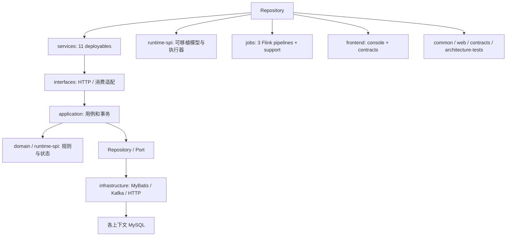

# 01 项目全景、扫描边界与证据索引

## 2026-10-19 更新

模块边界与平台主体继续保留；新增源码证据和前端交付以最新状态索引为准，原扫描数量属于历史基线。

当前源码核对基线 `6b9092f`；[完整状态与证据](CURRENT_STATUS.md)。以下保留原评审基线的发现、严重度和测试结果；其中“当前/待实施”均指原评审当时。历史源码链接已固定到原提交，后续实现请从最新状态索引进入。

## 历史报告正文（1392ca9 基线）

- 仓库：`marketing-lowcode-platform`；源码基线：`1392ca97bfe9cc6cfcd67888d318e0b2b66efe9c` 加当前未提交工作区。
- 分析日期：2026-09-22；模式：`READ_ONLY_ANALYSIS`。
- `CONFIRMED`＝源码/配置/测试直接证据；`INFERRED`＝据证据推断；`UNKNOWN`＝尚缺证据。代码存在不等于已部署或已通过真实链路验收。
- 本章遵循用户提示词；产品代码、数据库、运行配置、Git 提交与推送均不变。

## 系统定位与边界

**CONFIRMED**：这是营销设计控制面、在线优惠决策、资金权益、事件与有状态旅程组成的平台。目标操作者包括活动运营、业务/财务/合规审核者和运行维护人员；业务调用方是订单/用户事件来源及权益和触达下游。控制台、HTTP 权限、规则编译、发布指针和账本构成实际证据，不能仅依据 README 的 production-candidate 标签认定可上线。

**INFERRED**：业务价值是把重复活动开发转为受控配置、审核和版本发布。订单、支付、商品与会员权威数据不在本仓库闭环；真实身份、权益目录、风控、渠道依赖外部平台。外部可用性及合同部署一致性为 **UNKNOWN**。

## 技术栈：声明与用途

|类别|真实用途与状态|证据|
|---|---|---|
|Java 21 / Spring Boot 4.0.2 / Cloud 2025.1.1|Maven 版本声明；HTTP、事务、Gateway、Kafka 适配；本次未做官方兼容性审计|[根 pom.xml](https://github.com/lirji/marketing-lowcode-platform/blob/1392ca97bfe9cc6cfcd67888d318e0b2b66efe9c/pom.xml#L24)（根路径见下方模块清单）|
|MySQL / MyBatis / Flyway|服务独立数据库配置、XML SQL、版本迁移；正式持久化|[ControlMapper.xml:7](https://github.com/lirji/marketing-lowcode-platform/blob/1392ca97bfe9cc6cfcd67888d318e0b2b66efe9c/services/marketing-control-service/src/main/resources/mapper/ControlMapper.xml#L7)|
|Redis|决策幂等的可选权威存储和网关限流；不等同资金账本缓存|[DecisionRequestExecutor.java:23](https://github.com/lirji/marketing-lowcode-platform/blob/1392ca97bfe9cc6cfcd67888d318e0b2b66efe9c/services/offer-decision-service/src/main/java/com/acme/marketing/decision/application/DecisionRequestExecutor.java#L23)、[ClusterRateLimitFilter.java:1](https://github.com/lirji/marketing-lowcode-platform/blob/1392ca97bfe9cc6cfcd67888d318e0b2b66efe9c/services/edge-gateway/src/main/java/com/acme/marketing/gateway/ClusterRateLimitFilter.java#L1)|
|Caffeine|租户+状态维度的权益 SKU 列表 L1；发布实时核验绕过缓存|[HttpBenefitSkuCatalog.java:49](https://github.com/lirji/marketing-lowcode-platform/blob/1392ca97bfe9cc6cfcd67888d318e0b2b66efe9c/services/benefit-funding-service/src/main/java/com/acme/marketing/benefit/infrastructure/HttpBenefitSkuCatalog.java#L49)|
|Kafka / Flink|接入 Outbox，三个 keyed 流作业，checkpoint 与事务 Kafka sink|[FlinkKafkaJobRunner.java:15](https://github.com/lirji/marketing-lowcode-platform/blob/1392ca97bfe9cc6cfcd67888d318e0b2b66efe9c/jobs/flink-job-support/src/main/java/com/acme/marketing/jobs/support/FlinkKafkaJobRunner.java#L15)|
|Drools / DMN|有实际编译/求值适配器；常规在线决策主链执行 OfferPolicy，不应说所有报价都调用 Drools|[DroolsRuleEngineAdapter.java:34](https://github.com/lirji/marketing-lowcode-platform/blob/1392ca97bfe9cc6cfcd67888d318e0b2b66efe9c/runtime-spi/drools-runtime-adapter/src/main/java/com/acme/marketing/rule/drools/DroolsRuleEngineAdapter.java#L34)、[KieDmnDecisionTableAdapter.java:95](https://github.com/lirji/marketing-lowcode-platform/blob/1392ca97bfe9cc6cfcd67888d318e0b2b66efe9c/runtime-spi/dmn-runtime-adapter/src/main/java/com/acme/marketing/rule/dmn/KieDmnDecisionTableAdapter.java#L95)|
|React 19 / TypeScript / React Query / React Flow / Zod|画布、客户端查询缓存、接口解析|[package.json:1](https://github.com/lirji/marketing-lowcode-platform/blob/1392ca97bfe9cc6cfcd67888d318e0b2b66efe9c/frontend/apps/console/package.json#L1)、[LowCodeDesigner.tsx:66](https://github.com/lirji/marketing-lowcode-platform/blob/1392ca97bfe9cc6cfcd67888d318e0b2b66efe9c/frontend/apps/console/src/features/designers/LowCodeDesigner.tsx#L66)|
|OIDC / Casdoor 兼容身份|JWT tenant_id 与业务范围映射；DEV 另有头身份|[TenantContextFilter.java:39](https://github.com/lirji/marketing-lowcode-platform/blob/1392ca97bfe9cc6cfcd67888d318e0b2b66efe9c/platform-web/src/main/java/com/acme/marketing/platform/web/TenantContextFilter.java#L39)|
|Compose / Helm / GitHub Actions|本地编排、生产部署模板和验证工作流；不是当前环境成功证据|[compose.yaml:1](https://github.com/lirji/marketing-lowcode-platform/blob/1392ca97bfe9cc6cfcd67888d318e0b2b66efe9c/deploy/compose.yaml#L1)、[ci.yml:1](https://github.com/lirji/marketing-lowcode-platform/blob/1392ca97bfe9cc6cfcd67888d318e0b2b66efe9c/.github/workflows/ci.yml#L1)|

未在检索的生产 Java 链路确认 Elasticsearch、RabbitMQ、Nacos/Apollo、Quartz/XXL-JOB、Groovy/SpEL/QLExpress/Aviator 的实际调用。不能从“营销平台常用组件”补齐这些技术。ClickHouse 的部署相关线索也不等于衡量服务主查询已使用它；本轮主链证据指向 MyBatis 投影。

## 模块与入口

服务 reactor 有 11 个子模块：edge-gateway、marketing-control、rule-compiler、audience、offer-decision、benefit-funding、event-gateway、journey、engagement、measurement、referral。其中编译器是独立服务，referral 是可选 profile；11 不等于 11 个都在运行。

运行库包含 lowcode-language-core、decision-runtime-spi、journey-runtime-spi、provider-connector-spi、referral-runtime-spi、Drools 与 DMN adapters。jobs 有三个业务作业及 flink-job-support。公共模块 platform-common/platform-web 承载身份、错误、加密、资源隔离与持久幂等；marketing-contracts 提供对象、OpenAPI/AsyncAPI/JSON Schema；architecture-tests 约束依赖。

入口有 Console `/login`、`/api/v1/campaigns`、`/api/v1/definitions`、`/api/v1/releases`、`/api/v1/decisions:evaluate`、事件接入、旅程读模型。端口由部署变量覆盖，不能拿 README 默认端口代表机器实时入口。

## 扫描覆盖与限制

本轮采用模块清单→业务方法→SQL/配置→消费者与测试的交叉扫描。前轮同会话统计的 420 个 Java 主文件、81 个测试文件、50 个迁移文件是仓库规模，**不是逐文件全文审计覆盖率**。下方证据索引列出实际引用文件和 SHA-256；核心模块均有源码证据，边缘方法未穷举验证。

读取范围含 services、runtime-spi、jobs、platform-common、platform-web、frontend、marketing-contracts、architecture-tests、deploy、scripts 与 CI。没有读取 `.env`、访问生产库或检索同级外部平台私有数据。确认的是源码行为和配置默认值；目标部署、完整 E2E、生产性能/恢复目标仍未知。

## 本次对话已执行的验证

|命令|范围|结果|
|---|---|---|
|`pnpm frontend:test`|Console 单元测试|26 文件 / 83 项通过|
|`pnpm frontend:build`|TS 与生产打包|通过；有依赖注释处理警告|
|`pnpm frontend:lint`|ESLint 零警告门禁|失败：7 条 Fast Refresh 警告|
|`./mvnw --offline --batch-mode --no-transfer-progress -pl runtime-spi/referral-runtime-spi -am test`|common 10、contracts 18、lowcode 9、referral SPI 93|共 130，通过，无失败/错误/跳过|

以上于本次对话前一轮实际执行；本轮文档任务未将它们升级成全仓测试结论。后端原始日志 `/tmp/marketing-analysis-spi-tests.log` 为本机临时证据，可能被系统清理。历史交付测试数量不累加为本次验收数。

## Maven 模块完整清单（仓库声明）

|POM|artifactId|packaging|
|---|---|---|
|[architecture-tests/pom.xml](https://github.com/lirji/marketing-lowcode-platform/blob/1392ca97bfe9cc6cfcd67888d318e0b2b66efe9c/architecture-tests/pom.xml)|architecture-tests|jar|
|[jobs/audience-flink-job/pom.xml](https://github.com/lirji/marketing-lowcode-platform/blob/1392ca97bfe9cc6cfcd67888d318e0b2b66efe9c/jobs/audience-flink-job/pom.xml)|audience-flink-job|jar|
|[jobs/flink-job-support/pom.xml](https://github.com/lirji/marketing-lowcode-platform/blob/1392ca97bfe9cc6cfcd67888d318e0b2b66efe9c/jobs/flink-job-support/pom.xml)|flink-job-support|jar|
|[jobs/journey-runtime-flink-job/pom.xml](https://github.com/lirji/marketing-lowcode-platform/blob/1392ca97bfe9cc6cfcd67888d318e0b2b66efe9c/jobs/journey-runtime-flink-job/pom.xml)|journey-runtime-flink-job|jar|
|[jobs/measurement-flink-job/pom.xml](https://github.com/lirji/marketing-lowcode-platform/blob/1392ca97bfe9cc6cfcd67888d318e0b2b66efe9c/jobs/measurement-flink-job/pom.xml)|measurement-flink-job|jar|
|[jobs/pom.xml](https://github.com/lirji/marketing-lowcode-platform/blob/1392ca97bfe9cc6cfcd67888d318e0b2b66efe9c/jobs/pom.xml)|jobs|pom|
|[marketing-contracts/pom.xml](https://github.com/lirji/marketing-lowcode-platform/blob/1392ca97bfe9cc6cfcd67888d318e0b2b66efe9c/marketing-contracts/pom.xml)|marketing-contracts|jar|
|[platform-common/pom.xml](https://github.com/lirji/marketing-lowcode-platform/blob/1392ca97bfe9cc6cfcd67888d318e0b2b66efe9c/platform-common/pom.xml)|platform-common|jar|
|[platform-web/pom.xml](https://github.com/lirji/marketing-lowcode-platform/blob/1392ca97bfe9cc6cfcd67888d318e0b2b66efe9c/platform-web/pom.xml)|platform-web|jar|
|[pom.xml](https://github.com/lirji/marketing-lowcode-platform/blob/1392ca97bfe9cc6cfcd67888d318e0b2b66efe9c/pom.xml)|marketing-lowcode-platform|pom|
|[runtime-spi/decision-runtime-spi/pom.xml](https://github.com/lirji/marketing-lowcode-platform/blob/1392ca97bfe9cc6cfcd67888d318e0b2b66efe9c/runtime-spi/decision-runtime-spi/pom.xml)|decision-runtime-spi|jar|
|[runtime-spi/dmn-runtime-adapter/pom.xml](https://github.com/lirji/marketing-lowcode-platform/blob/1392ca97bfe9cc6cfcd67888d318e0b2b66efe9c/runtime-spi/dmn-runtime-adapter/pom.xml)|dmn-runtime-adapter|jar|
|[runtime-spi/drools-runtime-adapter/pom.xml](https://github.com/lirji/marketing-lowcode-platform/blob/1392ca97bfe9cc6cfcd67888d318e0b2b66efe9c/runtime-spi/drools-runtime-adapter/pom.xml)|drools-runtime-adapter|jar|
|[runtime-spi/journey-runtime-spi/pom.xml](https://github.com/lirji/marketing-lowcode-platform/blob/1392ca97bfe9cc6cfcd67888d318e0b2b66efe9c/runtime-spi/journey-runtime-spi/pom.xml)|journey-runtime-spi|jar|
|[runtime-spi/lowcode-language-core/pom.xml](https://github.com/lirji/marketing-lowcode-platform/blob/1392ca97bfe9cc6cfcd67888d318e0b2b66efe9c/runtime-spi/lowcode-language-core/pom.xml)|lowcode-language-core|jar|
|[runtime-spi/pom.xml](https://github.com/lirji/marketing-lowcode-platform/blob/1392ca97bfe9cc6cfcd67888d318e0b2b66efe9c/runtime-spi/pom.xml)|runtime-spi|pom|
|[runtime-spi/provider-connector-spi/pom.xml](https://github.com/lirji/marketing-lowcode-platform/blob/1392ca97bfe9cc6cfcd67888d318e0b2b66efe9c/runtime-spi/provider-connector-spi/pom.xml)|provider-connector-spi|jar|
|[runtime-spi/referral-runtime-spi/pom.xml](https://github.com/lirji/marketing-lowcode-platform/blob/1392ca97bfe9cc6cfcd67888d318e0b2b66efe9c/runtime-spi/referral-runtime-spi/pom.xml)|referral-runtime-spi|jar|
|[services/audience-service/pom.xml](https://github.com/lirji/marketing-lowcode-platform/blob/1392ca97bfe9cc6cfcd67888d318e0b2b66efe9c/services/audience-service/pom.xml)|audience-service|jar|
|[services/benefit-funding-service/pom.xml](https://github.com/lirji/marketing-lowcode-platform/blob/1392ca97bfe9cc6cfcd67888d318e0b2b66efe9c/services/benefit-funding-service/pom.xml)|benefit-funding-service|jar|
|[services/edge-gateway/pom.xml](https://github.com/lirji/marketing-lowcode-platform/blob/1392ca97bfe9cc6cfcd67888d318e0b2b66efe9c/services/edge-gateway/pom.xml)|edge-gateway|jar|
|[services/engagement-service/pom.xml](https://github.com/lirji/marketing-lowcode-platform/blob/1392ca97bfe9cc6cfcd67888d318e0b2b66efe9c/services/engagement-service/pom.xml)|engagement-service|jar|
|[services/event-gateway-service/pom.xml](https://github.com/lirji/marketing-lowcode-platform/blob/1392ca97bfe9cc6cfcd67888d318e0b2b66efe9c/services/event-gateway-service/pom.xml)|event-gateway-service|jar|
|[services/journey-service/pom.xml](https://github.com/lirji/marketing-lowcode-platform/blob/1392ca97bfe9cc6cfcd67888d318e0b2b66efe9c/services/journey-service/pom.xml)|journey-service|jar|
|[services/marketing-control-service/pom.xml](https://github.com/lirji/marketing-lowcode-platform/blob/1392ca97bfe9cc6cfcd67888d318e0b2b66efe9c/services/marketing-control-service/pom.xml)|marketing-control-service|jar|
|[services/measurement-service/pom.xml](https://github.com/lirji/marketing-lowcode-platform/blob/1392ca97bfe9cc6cfcd67888d318e0b2b66efe9c/services/measurement-service/pom.xml)|measurement-service|jar|
|[services/offer-decision-service/pom.xml](https://github.com/lirji/marketing-lowcode-platform/blob/1392ca97bfe9cc6cfcd67888d318e0b2b66efe9c/services/offer-decision-service/pom.xml)|offer-decision-service|jar|
|[services/pom.xml](https://github.com/lirji/marketing-lowcode-platform/blob/1392ca97bfe9cc6cfcd67888d318e0b2b66efe9c/services/pom.xml)|services|pom|
|[services/referral-service/pom.xml](https://github.com/lirji/marketing-lowcode-platform/blob/1392ca97bfe9cc6cfcd67888d318e0b2b66efe9c/services/referral-service/pom.xml)|referral-service|jar|
|[services/rule-compiler-worker/pom.xml](https://github.com/lirji/marketing-lowcode-platform/blob/1392ca97bfe9cc6cfcd67888d318e0b2b66efe9c/services/rule-compiler-worker/pom.xml)|rule-compiler-worker|jar|

## 证据索引与源码指纹

以下每条为报告直接引用的位置；SHA-256 对应整个文件。链接的行号用于本次快照定位，方法名/关键字可用于后续版本检索。没有以索引条目数冒充语义覆盖率。

|ID|源码定位|SHA-256|
|---|---|---|
|E001|[.github/workflows/ci.yml:1](https://github.com/lirji/marketing-lowcode-platform/blob/1392ca97bfe9cc6cfcd67888d318e0b2b66efe9c/.github/workflows/ci.yml#L1)|`4e86e27fa3a7f8fcb42f0186c835071325ae34b0642e7e5a18ca09248da25eef`|
|E002|[.github/workflows/ci.yml:54](https://github.com/lirji/marketing-lowcode-platform/blob/1392ca97bfe9cc6cfcd67888d318e0b2b66efe9c/.github/workflows/ci.yml#L54)|`4e86e27fa3a7f8fcb42f0186c835071325ae34b0642e7e5a18ca09248da25eef`|
|E003|[.github/workflows/full-stack.yml:1](https://github.com/lirji/marketing-lowcode-platform/blob/1392ca97bfe9cc6cfcd67888d318e0b2b66efe9c/.github/workflows/full-stack.yml#L1)|`3d5b037540ed4575f114a387064c27b8a64ea6c874a3cec68a5b57d5a91ad144`|
|E004|[architecture-tests/src/test/java/com/acme/marketing/architecture/ArchitectureRulesTest.java:34](https://github.com/lirji/marketing-lowcode-platform/blob/1392ca97bfe9cc6cfcd67888d318e0b2b66efe9c/architecture-tests/src/test/java/com/acme/marketing/architecture/ArchitectureRulesTest.java#L34)|`df18779f42e41ca09544c309b77f0a95804b1e757b03941563b05b5bc4f56e4d`|
|E005|[deploy/compose.yaml:1](https://github.com/lirji/marketing-lowcode-platform/blob/1392ca97bfe9cc6cfcd67888d318e0b2b66efe9c/deploy/compose.yaml#L1)|`906b565c5199ce3ded32356339de8c3605640cb3d31ad855eda6c17c6ddbeb61`|
|E006|[deploy/compose.yaml:144](https://github.com/lirji/marketing-lowcode-platform/blob/1392ca97bfe9cc6cfcd67888d318e0b2b66efe9c/deploy/compose.yaml#L144)|`906b565c5199ce3ded32356339de8c3605640cb3d31ad855eda6c17c6ddbeb61`|
|E007|[deploy/compose.yaml:258](https://github.com/lirji/marketing-lowcode-platform/blob/1392ca97bfe9cc6cfcd67888d318e0b2b66efe9c/deploy/compose.yaml#L258)|`906b565c5199ce3ded32356339de8c3605640cb3d31ad855eda6c17c6ddbeb61`|
|E008|[frontend/apps/console/package.json:1](https://github.com/lirji/marketing-lowcode-platform/blob/1392ca97bfe9cc6cfcd67888d318e0b2b66efe9c/frontend/apps/console/package.json#L1)|`00f7e88c35f66223708fcc9aaec7a66a998804d2e4d2c052ad85d29ce61abd24`|
|E009|[frontend/apps/console/package.json:11](https://github.com/lirji/marketing-lowcode-platform/blob/1392ca97bfe9cc6cfcd67888d318e0b2b66efe9c/frontend/apps/console/package.json#L11)|`00f7e88c35f66223708fcc9aaec7a66a998804d2e4d2c052ad85d29ce61abd24`|
|E010|[frontend/apps/console/src/features/campaign/CampaignsPage.tsx:41](https://github.com/lirji/marketing-lowcode-platform/blob/1392ca97bfe9cc6cfcd67888d318e0b2b66efe9c/frontend/apps/console/src/features/campaign/CampaignsPage.tsx#L41)|`440d691fda500d44648c2699062bc3083a29cb5a81744cad216c280ed20f9082`|
|E011|[frontend/apps/console/src/features/designers/DmnDesignerPage.tsx:13](https://github.com/lirji/marketing-lowcode-platform/blob/1392ca97bfe9cc6cfcd67888d318e0b2b66efe9c/frontend/apps/console/src/features/designers/DmnDesignerPage.tsx#L13)|`8659721e25173de22ff6655efd67b41ea9cea70a079e8a609f09a89579227cf5`|
|E012|[frontend/apps/console/src/features/designers/LowCodeDesigner.tsx:66](https://github.com/lirji/marketing-lowcode-platform/blob/1392ca97bfe9cc6cfcd67888d318e0b2b66efe9c/frontend/apps/console/src/features/designers/LowCodeDesigner.tsx#L66)|`298f6f62f70d99fec3a2d431f5dfd45356621f0f2f8d6362debe457e6c957405`|
|E013|[frontend/apps/console/src/features/designers/LowCodeDesigner.tsx:71](https://github.com/lirji/marketing-lowcode-platform/blob/1392ca97bfe9cc6cfcd67888d318e0b2b66efe9c/frontend/apps/console/src/features/designers/LowCodeDesigner.tsx#L71)|`298f6f62f70d99fec3a2d431f5dfd45356621f0f2f8d6362debe457e6c957405`|
|E014|[frontend/apps/console/src/features/designers/LowCodeDesigner.tsx:131](https://github.com/lirji/marketing-lowcode-platform/blob/1392ca97bfe9cc6cfcd67888d318e0b2b66efe9c/frontend/apps/console/src/features/designers/LowCodeDesigner.tsx#L131)|`298f6f62f70d99fec3a2d431f5dfd45356621f0f2f8d6362debe457e6c957405`|
|E015|[frontend/apps/console/src/features/designers/graph.ts:24](https://github.com/lirji/marketing-lowcode-platform/blob/1392ca97bfe9cc6cfcd67888d318e0b2b66efe9c/frontend/apps/console/src/features/designers/graph.ts#L24)|`470a24df22553a13378e8f29ae5736f97a3d4531624ceac4d105001514400bef`|
|E016|[frontend/apps/console/src/features/designers/graph.ts:83](https://github.com/lirji/marketing-lowcode-platform/blob/1392ca97bfe9cc6cfcd67888d318e0b2b66efe9c/frontend/apps/console/src/features/designers/graph.ts#L83)|`470a24df22553a13378e8f29ae5736f97a3d4531624ceac4d105001514400bef`|
|E017|[frontend/apps/console/src/main.tsx:17](https://github.com/lirji/marketing-lowcode-platform/blob/1392ca97bfe9cc6cfcd67888d318e0b2b66efe9c/frontend/apps/console/src/main.tsx#L17)|`d5cfd8b6299e9240ca0cc9b8e617fe52ffd6ca180612febdb627da1d3e588744`|
|E018|[frontend/apps/console/src/shared/auth/AuthContext.tsx:26](https://github.com/lirji/marketing-lowcode-platform/blob/1392ca97bfe9cc6cfcd67888d318e0b2b66efe9c/frontend/apps/console/src/shared/auth/AuthContext.tsx#L26)|`c62191511a5a058c517e222c1c85c240496a5370fafbe6e209b704d04348ff10`|
|E019|[jobs/audience-flink-job/src/main/java/com/acme/marketing/jobs/audience/AudienceMembershipProjection.java:10](https://github.com/lirji/marketing-lowcode-platform/blob/1392ca97bfe9cc6cfcd67888d318e0b2b66efe9c/jobs/audience-flink-job/src/main/java/com/acme/marketing/jobs/audience/AudienceMembershipProjection.java#L10)|`0bc10739a26744d7dd46ee2e3b5aafff1277ed302e16711ed53361cdc69affa0`|
|E020|[jobs/audience-flink-job/src/main/java/com/acme/marketing/jobs/audience/AudienceMembershipProjection.java:16](https://github.com/lirji/marketing-lowcode-platform/blob/1392ca97bfe9cc6cfcd67888d318e0b2b66efe9c/jobs/audience-flink-job/src/main/java/com/acme/marketing/jobs/audience/AudienceMembershipProjection.java#L16)|`0bc10739a26744d7dd46ee2e3b5aafff1277ed302e16711ed53361cdc69affa0`|
|E021|[jobs/flink-job-support/src/main/java/com/acme/marketing/jobs/support/FlinkKafkaJobRunner.java:15](https://github.com/lirji/marketing-lowcode-platform/blob/1392ca97bfe9cc6cfcd67888d318e0b2b66efe9c/jobs/flink-job-support/src/main/java/com/acme/marketing/jobs/support/FlinkKafkaJobRunner.java#L15)|`03303723db02686c44727f86efeb3c6b7d6d6ea21b920b3f0b9e934f0a8fe380`|
|E022|[jobs/flink-job-support/src/main/java/com/acme/marketing/jobs/support/FlinkKafkaJobRunner.java:46](https://github.com/lirji/marketing-lowcode-platform/blob/1392ca97bfe9cc6cfcd67888d318e0b2b66efe9c/jobs/flink-job-support/src/main/java/com/acme/marketing/jobs/support/FlinkKafkaJobRunner.java#L46)|`03303723db02686c44727f86efeb3c6b7d6d6ea21b920b3f0b9e934f0a8fe380`|
|E023|[jobs/flink-job-support/src/main/java/com/acme/marketing/jobs/support/FlinkKafkaJobRunner.java:71](https://github.com/lirji/marketing-lowcode-platform/blob/1392ca97bfe9cc6cfcd67888d318e0b2b66efe9c/jobs/flink-job-support/src/main/java/com/acme/marketing/jobs/support/FlinkKafkaJobRunner.java#L71)|`03303723db02686c44727f86efeb3c6b7d6d6ea21b920b3f0b9e934f0a8fe380`|
|E024|[jobs/journey-runtime-flink-job/src/main/java/com/acme/marketing/jobs/journey/JdbcJourneyPlanResolver.java:20](https://github.com/lirji/marketing-lowcode-platform/blob/1392ca97bfe9cc6cfcd67888d318e0b2b66efe9c/jobs/journey-runtime-flink-job/src/main/java/com/acme/marketing/jobs/journey/JdbcJourneyPlanResolver.java#L20)|`3caf5b3ee9eece98b788416952eaaccc37d798e980dd524afb96ed40902419da`|
|E025|[jobs/journey-runtime-flink-job/src/main/java/com/acme/marketing/jobs/journey/JdbcJourneyPlanResolver.java:64](https://github.com/lirji/marketing-lowcode-platform/blob/1392ca97bfe9cc6cfcd67888d318e0b2b66efe9c/jobs/journey-runtime-flink-job/src/main/java/com/acme/marketing/jobs/journey/JdbcJourneyPlanResolver.java#L64)|`3caf5b3ee9eece98b788416952eaaccc37d798e980dd524afb96ed40902419da`|
|E026|[jobs/journey-runtime-flink-job/src/main/java/com/acme/marketing/jobs/journey/JourneyJobReducer.java:1](https://github.com/lirji/marketing-lowcode-platform/blob/1392ca97bfe9cc6cfcd67888d318e0b2b66efe9c/jobs/journey-runtime-flink-job/src/main/java/com/acme/marketing/jobs/journey/JourneyJobReducer.java#L1)|`dec9540c5aa9cfadfd8fcde4a1cd0f78da8497d47bc368f3690d3f8172826ff9`|
|E027|[jobs/journey-runtime-flink-job/src/main/java/com/acme/marketing/jobs/journey/JourneyJobReducer.java:20](https://github.com/lirji/marketing-lowcode-platform/blob/1392ca97bfe9cc6cfcd67888d318e0b2b66efe9c/jobs/journey-runtime-flink-job/src/main/java/com/acme/marketing/jobs/journey/JourneyJobReducer.java#L20)|`dec9540c5aa9cfadfd8fcde4a1cd0f78da8497d47bc368f3690d3f8172826ff9`|
|E028|[jobs/journey-runtime-flink-job/src/main/java/com/acme/marketing/jobs/journey/JourneyJobReducer.java:33](https://github.com/lirji/marketing-lowcode-platform/blob/1392ca97bfe9cc6cfcd67888d318e0b2b66efe9c/jobs/journey-runtime-flink-job/src/main/java/com/acme/marketing/jobs/journey/JourneyJobReducer.java#L33)|`dec9540c5aa9cfadfd8fcde4a1cd0f78da8497d47bc368f3690d3f8172826ff9`|
|E029|[jobs/journey-runtime-flink-job/src/main/java/com/acme/marketing/jobs/journey/JourneyJobReducer.java:45](https://github.com/lirji/marketing-lowcode-platform/blob/1392ca97bfe9cc6cfcd67888d318e0b2b66efe9c/jobs/journey-runtime-flink-job/src/main/java/com/acme/marketing/jobs/journey/JourneyJobReducer.java#L45)|`dec9540c5aa9cfadfd8fcde4a1cd0f78da8497d47bc368f3690d3f8172826ff9`|
|E030|[jobs/journey-runtime-flink-job/src/main/java/com/acme/marketing/jobs/journey/JourneyJobReducer.java:46](https://github.com/lirji/marketing-lowcode-platform/blob/1392ca97bfe9cc6cfcd67888d318e0b2b66efe9c/jobs/journey-runtime-flink-job/src/main/java/com/acme/marketing/jobs/journey/JourneyJobReducer.java#L46)|`dec9540c5aa9cfadfd8fcde4a1cd0f78da8497d47bc368f3690d3f8172826ff9`|
|E031|[jobs/journey-runtime-flink-job/src/main/java/com/acme/marketing/jobs/journey/JourneyJobReducer.java:53](https://github.com/lirji/marketing-lowcode-platform/blob/1392ca97bfe9cc6cfcd67888d318e0b2b66efe9c/jobs/journey-runtime-flink-job/src/main/java/com/acme/marketing/jobs/journey/JourneyJobReducer.java#L53)|`dec9540c5aa9cfadfd8fcde4a1cd0f78da8497d47bc368f3690d3f8172826ff9`|
|E032|[jobs/journey-runtime-flink-job/src/main/java/com/acme/marketing/jobs/journey/JourneyRuntimeProcessFunction.java:1](https://github.com/lirji/marketing-lowcode-platform/blob/1392ca97bfe9cc6cfcd67888d318e0b2b66efe9c/jobs/journey-runtime-flink-job/src/main/java/com/acme/marketing/jobs/journey/JourneyRuntimeProcessFunction.java#L1)|`09a5d67044ad417bc7379ee24793cb6ff34ed8457b795e5b08ae600e02a22adc`|
|E033|[jobs/journey-runtime-flink-job/src/main/java/com/acme/marketing/jobs/journey/JourneyRuntimeProcessFunction.java:11](https://github.com/lirji/marketing-lowcode-platform/blob/1392ca97bfe9cc6cfcd67888d318e0b2b66efe9c/jobs/journey-runtime-flink-job/src/main/java/com/acme/marketing/jobs/journey/JourneyRuntimeProcessFunction.java#L11)|`09a5d67044ad417bc7379ee24793cb6ff34ed8457b795e5b08ae600e02a22adc`|
|E034|[jobs/journey-runtime-flink-job/src/main/java/com/acme/marketing/jobs/journey/JourneyRuntimeProcessFunction.java:19](https://github.com/lirji/marketing-lowcode-platform/blob/1392ca97bfe9cc6cfcd67888d318e0b2b66efe9c/jobs/journey-runtime-flink-job/src/main/java/com/acme/marketing/jobs/journey/JourneyRuntimeProcessFunction.java#L19)|`09a5d67044ad417bc7379ee24793cb6ff34ed8457b795e5b08ae600e02a22adc`|
|E035|[jobs/journey-runtime-flink-job/src/main/java/com/acme/marketing/jobs/journey/JourneyRuntimeProcessFunction.java:56](https://github.com/lirji/marketing-lowcode-platform/blob/1392ca97bfe9cc6cfcd67888d318e0b2b66efe9c/jobs/journey-runtime-flink-job/src/main/java/com/acme/marketing/jobs/journey/JourneyRuntimeProcessFunction.java#L56)|`09a5d67044ad417bc7379ee24793cb6ff34ed8457b795e5b08ae600e02a22adc`|
|E036|[marketing-contracts/src/main/resources/schema/graph/graph-definition.schema.json:1](https://github.com/lirji/marketing-lowcode-platform/blob/1392ca97bfe9cc6cfcd67888d318e0b2b66efe9c/marketing-contracts/src/main/resources/schema/graph/graph-definition.schema.json#L1)|`1b1dd7558ff4e8cd0bb633fc0266eb62d0775ef8f51ddb840bb89346977855c9`|
|E037|[platform-web/src/main/java/com/acme/marketing/platform/web/TenantContextFilter.java:39](https://github.com/lirji/marketing-lowcode-platform/blob/1392ca97bfe9cc6cfcd67888d318e0b2b66efe9c/platform-web/src/main/java/com/acme/marketing/platform/web/TenantContextFilter.java#L39)|`ab52ad0d211fc4a6821f876f6e95a762ce0d89ced80e17d0c7afc5a74b077cb7`|
|E038|[runtime-spi/decision-runtime-spi/src/main/java/com/acme/marketing/decision/pricing/LargestRemainderAllocator.java:1](https://github.com/lirji/marketing-lowcode-platform/blob/1392ca97bfe9cc6cfcd67888d318e0b2b66efe9c/runtime-spi/decision-runtime-spi/src/main/java/com/acme/marketing/decision/pricing/LargestRemainderAllocator.java#L1)|`2d468b15e91c5f171a961e19e2acf15d4afa75bd9539bb2f0d56275434e04d0b`|
|E039|[runtime-spi/decision-runtime-spi/src/main/java/com/acme/marketing/decision/pricing/LargestRemainderAllocator.java:35](https://github.com/lirji/marketing-lowcode-platform/blob/1392ca97bfe9cc6cfcd67888d318e0b2b66efe9c/runtime-spi/decision-runtime-spi/src/main/java/com/acme/marketing/decision/pricing/LargestRemainderAllocator.java#L35)|`2d468b15e91c5f171a961e19e2acf15d4afa75bd9539bb2f0d56275434e04d0b`|
|E040|[runtime-spi/decision-runtime-spi/src/main/java/com/acme/marketing/decision/pricing/LargestRemainderAllocator.java:39](https://github.com/lirji/marketing-lowcode-platform/blob/1392ca97bfe9cc6cfcd67888d318e0b2b66efe9c/runtime-spi/decision-runtime-spi/src/main/java/com/acme/marketing/decision/pricing/LargestRemainderAllocator.java#L39)|`2d468b15e91c5f171a961e19e2acf15d4afa75bd9539bb2f0d56275434e04d0b`|
|E041|[runtime-spi/decision-runtime-spi/src/main/java/com/acme/marketing/decision/pricing/OfferSelector.java:1](https://github.com/lirji/marketing-lowcode-platform/blob/1392ca97bfe9cc6cfcd67888d318e0b2b66efe9c/runtime-spi/decision-runtime-spi/src/main/java/com/acme/marketing/decision/pricing/OfferSelector.java#L1)|`24e562d8e039114ff03596379e4e77bf2126fee7a90ce04666276597971c46d5`|
|E042|[runtime-spi/decision-runtime-spi/src/main/java/com/acme/marketing/decision/pricing/OfferSelector.java:16](https://github.com/lirji/marketing-lowcode-platform/blob/1392ca97bfe9cc6cfcd67888d318e0b2b66efe9c/runtime-spi/decision-runtime-spi/src/main/java/com/acme/marketing/decision/pricing/OfferSelector.java#L16)|`24e562d8e039114ff03596379e4e77bf2126fee7a90ce04666276597971c46d5`|
|E043|[runtime-spi/decision-runtime-spi/src/main/java/com/acme/marketing/decision/pricing/OfferSelector.java:31](https://github.com/lirji/marketing-lowcode-platform/blob/1392ca97bfe9cc6cfcd67888d318e0b2b66efe9c/runtime-spi/decision-runtime-spi/src/main/java/com/acme/marketing/decision/pricing/OfferSelector.java#L31)|`24e562d8e039114ff03596379e4e77bf2126fee7a90ce04666276597971c46d5`|
|E044|[runtime-spi/decision-runtime-spi/src/main/java/com/acme/marketing/decision/pricing/PricingEngine.java:34](https://github.com/lirji/marketing-lowcode-platform/blob/1392ca97bfe9cc6cfcd67888d318e0b2b66efe9c/runtime-spi/decision-runtime-spi/src/main/java/com/acme/marketing/decision/pricing/PricingEngine.java#L34)|`e2ab9031885e1fea89c267e6d611cdf5f8993b31dc7c8d6b6e247b54cc11bc23`|
|E045|[runtime-spi/decision-runtime-spi/src/main/java/com/acme/marketing/decision/rule/RuleFacts.java:1](https://github.com/lirji/marketing-lowcode-platform/blob/1392ca97bfe9cc6cfcd67888d318e0b2b66efe9c/runtime-spi/decision-runtime-spi/src/main/java/com/acme/marketing/decision/rule/RuleFacts.java#L1)|`26845be07dfe1ff0f628aa82c51be6bdfa130a10b1bcb5738c09207b95c5b751`|
|E046|[runtime-spi/dmn-runtime-adapter/src/main/java/com/acme/marketing/rule/dmn/KieDmnDecisionTableAdapter.java:95](https://github.com/lirji/marketing-lowcode-platform/blob/1392ca97bfe9cc6cfcd67888d318e0b2b66efe9c/runtime-spi/dmn-runtime-adapter/src/main/java/com/acme/marketing/rule/dmn/KieDmnDecisionTableAdapter.java#L95)|`d08476ba14254b1ef86a67df4fb58ff75554c123ad8fffb592f011d4fac87612`|
|E047|[runtime-spi/drools-runtime-adapter/src/main/java/com/acme/marketing/rule/drools/DroolsRuleEngineAdapter.java:34](https://github.com/lirji/marketing-lowcode-platform/blob/1392ca97bfe9cc6cfcd67888d318e0b2b66efe9c/runtime-spi/drools-runtime-adapter/src/main/java/com/acme/marketing/rule/drools/DroolsRuleEngineAdapter.java#L34)|`4e55733b7dfde598fd3e9e1f9b1bbf6816742a1658cb31daae203ef2c88ce6ba`|
|E048|[runtime-spi/drools-runtime-adapter/src/main/java/com/acme/marketing/rule/drools/DroolsRuleEngineAdapter.java:102](https://github.com/lirji/marketing-lowcode-platform/blob/1392ca97bfe9cc6cfcd67888d318e0b2b66efe9c/runtime-spi/drools-runtime-adapter/src/main/java/com/acme/marketing/rule/drools/DroolsRuleEngineAdapter.java#L102)|`4e55733b7dfde598fd3e9e1f9b1bbf6816742a1658cb31daae203ef2c88ce6ba`|
|E049|[runtime-spi/journey-runtime-spi/src/main/java/com/acme/marketing/journey/EnrollmentSnapshot.java:1](https://github.com/lirji/marketing-lowcode-platform/blob/1392ca97bfe9cc6cfcd67888d318e0b2b66efe9c/runtime-spi/journey-runtime-spi/src/main/java/com/acme/marketing/journey/EnrollmentSnapshot.java#L1)|`df440636bcf4fbe6dcc3985e5f85fbc0f5ad469b4ef05cda309a9c815a868420`|
|E050|[runtime-spi/journey-runtime-spi/src/main/java/com/acme/marketing/journey/JourneyCompiler.java:1](https://github.com/lirji/marketing-lowcode-platform/blob/1392ca97bfe9cc6cfcd67888d318e0b2b66efe9c/runtime-spi/journey-runtime-spi/src/main/java/com/acme/marketing/journey/JourneyCompiler.java#L1)|`e48a53824c785e9b377441290d6dc0266b47ddfdaa7dbbe3d7144b9114915daf`|
|E051|[runtime-spi/journey-runtime-spi/src/main/java/com/acme/marketing/journey/JourneyCompiler.java:13](https://github.com/lirji/marketing-lowcode-platform/blob/1392ca97bfe9cc6cfcd67888d318e0b2b66efe9c/runtime-spi/journey-runtime-spi/src/main/java/com/acme/marketing/journey/JourneyCompiler.java#L13)|`e48a53824c785e9b377441290d6dc0266b47ddfdaa7dbbe3d7144b9114915daf`|
|E052|[runtime-spi/journey-runtime-spi/src/main/java/com/acme/marketing/journey/JourneyCompiler.java:28](https://github.com/lirji/marketing-lowcode-platform/blob/1392ca97bfe9cc6cfcd67888d318e0b2b66efe9c/runtime-spi/journey-runtime-spi/src/main/java/com/acme/marketing/journey/JourneyCompiler.java#L28)|`e48a53824c785e9b377441290d6dc0266b47ddfdaa7dbbe3d7144b9114915daf`|
|E053|[runtime-spi/journey-runtime-spi/src/main/java/com/acme/marketing/journey/JourneyCompiler.java:41](https://github.com/lirji/marketing-lowcode-platform/blob/1392ca97bfe9cc6cfcd67888d318e0b2b66efe9c/runtime-spi/journey-runtime-spi/src/main/java/com/acme/marketing/journey/JourneyCompiler.java#L41)|`e48a53824c785e9b377441290d6dc0266b47ddfdaa7dbbe3d7144b9114915daf`|
|E054|[runtime-spi/journey-runtime-spi/src/main/java/com/acme/marketing/journey/JourneyCompiler.java:50](https://github.com/lirji/marketing-lowcode-platform/blob/1392ca97bfe9cc6cfcd67888d318e0b2b66efe9c/runtime-spi/journey-runtime-spi/src/main/java/com/acme/marketing/journey/JourneyCompiler.java#L50)|`e48a53824c785e9b377441290d6dc0266b47ddfdaa7dbbe3d7144b9114915daf`|
|E055|[runtime-spi/journey-runtime-spi/src/main/java/com/acme/marketing/journey/JourneyRuntime.java:18](https://github.com/lirji/marketing-lowcode-platform/blob/1392ca97bfe9cc6cfcd67888d318e0b2b66efe9c/runtime-spi/journey-runtime-spi/src/main/java/com/acme/marketing/journey/JourneyRuntime.java#L18)|`5d13aec3a94325d2d4bf3242cc0995e9b2deae74882f5064fd98b5a52bd542a7`|
|E056|[runtime-spi/journey-runtime-spi/src/main/java/com/acme/marketing/journey/JourneyRuntime.java:23](https://github.com/lirji/marketing-lowcode-platform/blob/1392ca97bfe9cc6cfcd67888d318e0b2b66efe9c/runtime-spi/journey-runtime-spi/src/main/java/com/acme/marketing/journey/JourneyRuntime.java#L23)|`5d13aec3a94325d2d4bf3242cc0995e9b2deae74882f5064fd98b5a52bd542a7`|
|E057|[runtime-spi/journey-runtime-spi/src/main/java/com/acme/marketing/journey/JourneyRuntime.java:38](https://github.com/lirji/marketing-lowcode-platform/blob/1392ca97bfe9cc6cfcd67888d318e0b2b66efe9c/runtime-spi/journey-runtime-spi/src/main/java/com/acme/marketing/journey/JourneyRuntime.java#L38)|`5d13aec3a94325d2d4bf3242cc0995e9b2deae74882f5064fd98b5a52bd542a7`|
|E058|[runtime-spi/journey-runtime-spi/src/main/java/com/acme/marketing/journey/JourneyRuntime.java:67](https://github.com/lirji/marketing-lowcode-platform/blob/1392ca97bfe9cc6cfcd67888d318e0b2b66efe9c/runtime-spi/journey-runtime-spi/src/main/java/com/acme/marketing/journey/JourneyRuntime.java#L67)|`5d13aec3a94325d2d4bf3242cc0995e9b2deae74882f5064fd98b5a52bd542a7`|
|E059|[runtime-spi/journey-runtime-spi/src/main/java/com/acme/marketing/journey/JourneyRuntime.java:90](https://github.com/lirji/marketing-lowcode-platform/blob/1392ca97bfe9cc6cfcd67888d318e0b2b66efe9c/runtime-spi/journey-runtime-spi/src/main/java/com/acme/marketing/journey/JourneyRuntime.java#L90)|`5d13aec3a94325d2d4bf3242cc0995e9b2deae74882f5064fd98b5a52bd542a7`|
|E060|[runtime-spi/lowcode-language-core/src/main/java/com/acme/marketing/lowcode/model/GraphDefinition.java:1](https://github.com/lirji/marketing-lowcode-platform/blob/1392ca97bfe9cc6cfcd67888d318e0b2b66efe9c/runtime-spi/lowcode-language-core/src/main/java/com/acme/marketing/lowcode/model/GraphDefinition.java#L1)|`09d2689896c95959acb4a847f390c72e8c583e01a6c7967f62a55f767438ce2f`|
|E061|[runtime-spi/lowcode-language-core/src/main/java/com/acme/marketing/lowcode/model/NodeDefinition.java:1](https://github.com/lirji/marketing-lowcode-platform/blob/1392ca97bfe9cc6cfcd67888d318e0b2b66efe9c/runtime-spi/lowcode-language-core/src/main/java/com/acme/marketing/lowcode/model/NodeDefinition.java#L1)|`0ea64d7f3a5ad689a1cf5f5607d32d127e5907fd40b5da699f10cfbe74bec668`|
|E062|[runtime-spi/lowcode-language-core/src/main/java/com/acme/marketing/lowcode/validation/GraphValidator.java:30](https://github.com/lirji/marketing-lowcode-platform/blob/1392ca97bfe9cc6cfcd67888d318e0b2b66efe9c/runtime-spi/lowcode-language-core/src/main/java/com/acme/marketing/lowcode/validation/GraphValidator.java#L30)|`6aa9a412eebe1f3a09edc3704e287998dff099826aa191cdb6e1fde43cab7b1e`|
|E063|[runtime-spi/lowcode-language-core/src/main/java/com/acme/marketing/lowcode/validation/GraphValidator.java:44](https://github.com/lirji/marketing-lowcode-platform/blob/1392ca97bfe9cc6cfcd67888d318e0b2b66efe9c/runtime-spi/lowcode-language-core/src/main/java/com/acme/marketing/lowcode/validation/GraphValidator.java#L44)|`6aa9a412eebe1f3a09edc3704e287998dff099826aa191cdb6e1fde43cab7b1e`|
|E064|[runtime-spi/lowcode-language-core/src/main/java/com/acme/marketing/lowcode/validation/GraphValidator.java:187](https://github.com/lirji/marketing-lowcode-platform/blob/1392ca97bfe9cc6cfcd67888d318e0b2b66efe9c/runtime-spi/lowcode-language-core/src/main/java/com/acme/marketing/lowcode/validation/GraphValidator.java#L187)|`6aa9a412eebe1f3a09edc3704e287998dff099826aa191cdb6e1fde43cab7b1e`|
|E065|[scripts/restore.sh:1](https://github.com/lirji/marketing-lowcode-platform/blob/1392ca97bfe9cc6cfcd67888d318e0b2b66efe9c/scripts/restore.sh#L1)|`4856152e149fb7371a78099b56d22b8670a3d6f568e597c44178bb05acf81984`|
|E066|[scripts/restore.sh:10](https://github.com/lirji/marketing-lowcode-platform/blob/1392ca97bfe9cc6cfcd67888d318e0b2b66efe9c/scripts/restore.sh#L10)|`4856152e149fb7371a78099b56d22b8670a3d6f568e597c44178bb05acf81984`|
|E067|[scripts/run-capacity-suite.sh:1](https://github.com/lirji/marketing-lowcode-platform/blob/1392ca97bfe9cc6cfcd67888d318e0b2b66efe9c/scripts/run-capacity-suite.sh#L1)|`b7edd32b816e310d3566f64cf60e2861fc20aaabb6ff08de2c3b4a538a9737e6`|
|E068|[services/audience-service/src/main/java/com/acme/marketing/audience/application/AudienceService.java:77](https://github.com/lirji/marketing-lowcode-platform/blob/1392ca97bfe9cc6cfcd67888d318e0b2b66efe9c/services/audience-service/src/main/java/com/acme/marketing/audience/application/AudienceService.java#L77)|`7613cc3c5886d132ab66d1d9a08b59eef653e7d50b8f8549066c927f9d353fa4`|
|E069|[services/audience-service/src/main/java/com/acme/marketing/audience/application/AudienceService.java:89](https://github.com/lirji/marketing-lowcode-platform/blob/1392ca97bfe9cc6cfcd67888d318e0b2b66efe9c/services/audience-service/src/main/java/com/acme/marketing/audience/application/AudienceService.java#L89)|`7613cc3c5886d132ab66d1d9a08b59eef653e7d50b8f8549066c927f9d353fa4`|
|E070|[services/audience-service/src/main/java/com/acme/marketing/audience/application/AudienceService.java:159](https://github.com/lirji/marketing-lowcode-platform/blob/1392ca97bfe9cc6cfcd67888d318e0b2b66efe9c/services/audience-service/src/main/java/com/acme/marketing/audience/application/AudienceService.java#L159)|`7613cc3c5886d132ab66d1d9a08b59eef653e7d50b8f8549066c927f9d353fa4`|
|E071|[services/audience-service/src/main/java/com/acme/marketing/audience/application/AudienceService.java:167](https://github.com/lirji/marketing-lowcode-platform/blob/1392ca97bfe9cc6cfcd67888d318e0b2b66efe9c/services/audience-service/src/main/java/com/acme/marketing/audience/application/AudienceService.java#L167)|`7613cc3c5886d132ab66d1d9a08b59eef653e7d50b8f8549066c927f9d353fa4`|
|E072|[services/audience-service/src/main/java/com/acme/marketing/audience/application/AudienceService.java:192](https://github.com/lirji/marketing-lowcode-platform/blob/1392ca97bfe9cc6cfcd67888d318e0b2b66efe9c/services/audience-service/src/main/java/com/acme/marketing/audience/application/AudienceService.java#L192)|`7613cc3c5886d132ab66d1d9a08b59eef653e7d50b8f8549066c927f9d353fa4`|
|E073|[services/audience-service/src/main/java/com/acme/marketing/audience/application/AudienceService.java:221](https://github.com/lirji/marketing-lowcode-platform/blob/1392ca97bfe9cc6cfcd67888d318e0b2b66efe9c/services/audience-service/src/main/java/com/acme/marketing/audience/application/AudienceService.java#L221)|`7613cc3c5886d132ab66d1d9a08b59eef653e7d50b8f8549066c927f9d353fa4`|
|E074|[services/audience-service/src/main/resources/db/migration/V1__audience.sql:1](../../services/audience-service/src/main/resources/db/migration/V1__audience.sql#L1)|`00aaa00f4e4dc65399c56d754d053f3a1ccc9fcd1d3e8e28354e8a10d1ca0784`|
|E075|[services/benefit-funding-service/src/main/java/com/acme/marketing/benefit/application/AwardIntentService.java:83](https://github.com/lirji/marketing-lowcode-platform/blob/1392ca97bfe9cc6cfcd67888d318e0b2b66efe9c/services/benefit-funding-service/src/main/java/com/acme/marketing/benefit/application/AwardIntentService.java#L83)|`a98f801d25b1901deb0a1cedc8c995fbfa398ea284a830382f2dc6315d1972b6`|
|E076|[services/benefit-funding-service/src/main/java/com/acme/marketing/benefit/application/AwardIntentService.java:86](https://github.com/lirji/marketing-lowcode-platform/blob/1392ca97bfe9cc6cfcd67888d318e0b2b66efe9c/services/benefit-funding-service/src/main/java/com/acme/marketing/benefit/application/AwardIntentService.java#L86)|`a98f801d25b1901deb0a1cedc8c995fbfa398ea284a830382f2dc6315d1972b6`|
|E077|[services/benefit-funding-service/src/main/java/com/acme/marketing/benefit/application/AwardIntentService.java:87](https://github.com/lirji/marketing-lowcode-platform/blob/1392ca97bfe9cc6cfcd67888d318e0b2b66efe9c/services/benefit-funding-service/src/main/java/com/acme/marketing/benefit/application/AwardIntentService.java#L87)|`a98f801d25b1901deb0a1cedc8c995fbfa398ea284a830382f2dc6315d1972b6`|
|E078|[services/benefit-funding-service/src/main/java/com/acme/marketing/benefit/application/AwardIntentService.java:95](https://github.com/lirji/marketing-lowcode-platform/blob/1392ca97bfe9cc6cfcd67888d318e0b2b66efe9c/services/benefit-funding-service/src/main/java/com/acme/marketing/benefit/application/AwardIntentService.java#L95)|`a98f801d25b1901deb0a1cedc8c995fbfa398ea284a830382f2dc6315d1972b6`|
|E079|[services/benefit-funding-service/src/main/java/com/acme/marketing/benefit/application/AwardIntentService.java:137](https://github.com/lirji/marketing-lowcode-platform/blob/1392ca97bfe9cc6cfcd67888d318e0b2b66efe9c/services/benefit-funding-service/src/main/java/com/acme/marketing/benefit/application/AwardIntentService.java#L137)|`a98f801d25b1901deb0a1cedc8c995fbfa398ea284a830382f2dc6315d1972b6`|
|E080|[services/benefit-funding-service/src/main/java/com/acme/marketing/benefit/application/BenefitFundingService.java:943](https://github.com/lirji/marketing-lowcode-platform/blob/1392ca97bfe9cc6cfcd67888d318e0b2b66efe9c/services/benefit-funding-service/src/main/java/com/acme/marketing/benefit/application/BenefitFundingService.java#L943)|`9e93266be160ad61c58948f26fc3015ed81b52673bde04fee05f4566261c3aa4`|
|E081|[services/benefit-funding-service/src/main/java/com/acme/marketing/benefit/application/BenefitFundingService.java:1012](https://github.com/lirji/marketing-lowcode-platform/blob/1392ca97bfe9cc6cfcd67888d318e0b2b66efe9c/services/benefit-funding-service/src/main/java/com/acme/marketing/benefit/application/BenefitFundingService.java#L1012)|`9e93266be160ad61c58948f26fc3015ed81b52673bde04fee05f4566261c3aa4`|
|E082|[services/benefit-funding-service/src/main/java/com/acme/marketing/benefit/domain/ReferralAwardPreparation.java:117](https://github.com/lirji/marketing-lowcode-platform/blob/1392ca97bfe9cc6cfcd67888d318e0b2b66efe9c/services/benefit-funding-service/src/main/java/com/acme/marketing/benefit/domain/ReferralAwardPreparation.java#L117)|`90a1208f87f5a5f913c3c16e4a7d95f164fe829a8bf9c270020561354f59063d`|
|E083|[services/benefit-funding-service/src/main/java/com/acme/marketing/benefit/domain/ReferralAwardPreparation.java:118](https://github.com/lirji/marketing-lowcode-platform/blob/1392ca97bfe9cc6cfcd67888d318e0b2b66efe9c/services/benefit-funding-service/src/main/java/com/acme/marketing/benefit/domain/ReferralAwardPreparation.java#L118)|`90a1208f87f5a5f913c3c16e4a7d95f164fe829a8bf9c270020561354f59063d`|
|E084|[services/benefit-funding-service/src/main/java/com/acme/marketing/benefit/infrastructure/HttpBenefitSkuCatalog.java:49](https://github.com/lirji/marketing-lowcode-platform/blob/1392ca97bfe9cc6cfcd67888d318e0b2b66efe9c/services/benefit-funding-service/src/main/java/com/acme/marketing/benefit/infrastructure/HttpBenefitSkuCatalog.java#L49)|`eae38ef7c5c084e57cd486b6b8c541c9f27fa44ed8ae5b36d0e242eb7370cd72`|
|E085|[services/benefit-funding-service/src/main/java/com/acme/marketing/benefit/infrastructure/HttpBenefitSkuCatalog.java:63](https://github.com/lirji/marketing-lowcode-platform/blob/1392ca97bfe9cc6cfcd67888d318e0b2b66efe9c/services/benefit-funding-service/src/main/java/com/acme/marketing/benefit/infrastructure/HttpBenefitSkuCatalog.java#L63)|`eae38ef7c5c084e57cd486b6b8c541c9f27fa44ed8ae5b36d0e242eb7370cd72`|
|E086|[services/benefit-funding-service/src/main/resources/db/migration/V10__referral_award_preparation.sql:1](../../services/benefit-funding-service/src/main/resources/db/migration/V10__referral_award_preparation.sql#L1)|`9a9c54384bd9d792afa0fd1ab1118b123c4aec3d2b027cc784de6506820f717d`|
|E087|[services/benefit-funding-service/src/main/resources/db/migration/V10__referral_award_preparation.sql:32](../../services/benefit-funding-service/src/main/resources/db/migration/V10__referral_award_preparation.sql#L32)|`9a9c54384bd9d792afa0fd1ab1118b123c4aec3d2b027cc784de6506820f717d`|
|E088|[services/benefit-funding-service/src/main/resources/db/migration/V1__benefit_funding.sql:1](../../services/benefit-funding-service/src/main/resources/db/migration/V1__benefit_funding.sql#L1)|`94830751756a3699d9cc9352724845f3a4f57a845e1c4a749f28b7a0088724d5`|
|E089|[services/benefit-funding-service/src/main/resources/db/migration/V1__benefit_funding.sql:19](../../services/benefit-funding-service/src/main/resources/db/migration/V1__benefit_funding.sql#L19)|`94830751756a3699d9cc9352724845f3a4f57a845e1c4a749f28b7a0088724d5`|
|E090|[services/benefit-funding-service/src/main/resources/db/migration/V5__award_intent_outbox.sql:1](../../services/benefit-funding-service/src/main/resources/db/migration/V5__award_intent_outbox.sql#L1)|`c490cd038a59f7a2864f14fb8e947e76d03353654c1b5df2d381f1ce7b12310d`|
|E091|[services/benefit-funding-service/src/main/resources/mapper/AwardIntentRelayMapper.xml:9](https://github.com/lirji/marketing-lowcode-platform/blob/1392ca97bfe9cc6cfcd67888d318e0b2b66efe9c/services/benefit-funding-service/src/main/resources/mapper/AwardIntentRelayMapper.xml#L9)|`10725bfb679df15ad8fd2d1e95c11212d53ae9daec751625388a919987e1e3ba`|
|E092|[services/benefit-funding-service/src/main/resources/mapper/AwardIntentRelayMapper.xml:12](https://github.com/lirji/marketing-lowcode-platform/blob/1392ca97bfe9cc6cfcd67888d318e0b2b66efe9c/services/benefit-funding-service/src/main/resources/mapper/AwardIntentRelayMapper.xml#L12)|`10725bfb679df15ad8fd2d1e95c11212d53ae9daec751625388a919987e1e3ba`|
|E093|[services/benefit-funding-service/src/main/resources/mapper/AwardIntentRelayMapper.xml:22](https://github.com/lirji/marketing-lowcode-platform/blob/1392ca97bfe9cc6cfcd67888d318e0b2b66efe9c/services/benefit-funding-service/src/main/resources/mapper/AwardIntentRelayMapper.xml#L22)|`10725bfb679df15ad8fd2d1e95c11212d53ae9daec751625388a919987e1e3ba`|
|E094|[services/benefit-funding-service/src/main/resources/mapper/AwardIntentRelayMapper.xml:31](https://github.com/lirji/marketing-lowcode-platform/blob/1392ca97bfe9cc6cfcd67888d318e0b2b66efe9c/services/benefit-funding-service/src/main/resources/mapper/AwardIntentRelayMapper.xml#L31)|`10725bfb679df15ad8fd2d1e95c11212d53ae9daec751625388a919987e1e3ba`|
|E095|[services/edge-gateway/src/main/java/com/acme/marketing/gateway/ClusterRateLimitFilter.java:1](https://github.com/lirji/marketing-lowcode-platform/blob/1392ca97bfe9cc6cfcd67888d318e0b2b66efe9c/services/edge-gateway/src/main/java/com/acme/marketing/gateway/ClusterRateLimitFilter.java#L1)|`33341a41a93a586613f7bc77c96577dde5bb8a8b78582b9bbb4144c7ffc1f38c`|
|E096|[services/engagement-service/src/main/java/com/acme/marketing/engagement/infrastructure/EngagementConfiguration.java:20](https://github.com/lirji/marketing-lowcode-platform/blob/1392ca97bfe9cc6cfcd67888d318e0b2b66efe9c/services/engagement-service/src/main/java/com/acme/marketing/engagement/infrastructure/EngagementConfiguration.java#L20)|`915bccaf32739adc188c450dfe8e97e57a0826e5a8d615744b879387cf49e65c`|
|E097|[services/engagement-service/src/main/java/com/acme/marketing/engagement/infrastructure/JourneyEngagementConsumer.java:24](https://github.com/lirji/marketing-lowcode-platform/blob/1392ca97bfe9cc6cfcd67888d318e0b2b66efe9c/services/engagement-service/src/main/java/com/acme/marketing/engagement/infrastructure/JourneyEngagementConsumer.java#L24)|`5501d153c29413dc92d2d301ef429918b608a7865ba3c428532fb0d4e62786f4`|
|E098|[services/engagement-service/src/main/java/com/acme/marketing/engagement/infrastructure/KafkaFailureConfiguration.java:11](https://github.com/lirji/marketing-lowcode-platform/blob/1392ca97bfe9cc6cfcd67888d318e0b2b66efe9c/services/engagement-service/src/main/java/com/acme/marketing/engagement/infrastructure/KafkaFailureConfiguration.java#L11)|`18a90acf0462815af32e7e14d67f2013377950fea62a41b1a405ae34b8b7c6df`|
|E099|[services/event-gateway-service/src/main/java/com/acme/marketing/eventgateway/application/EventIngestionService.java:64](https://github.com/lirji/marketing-lowcode-platform/blob/1392ca97bfe9cc6cfcd67888d318e0b2b66efe9c/services/event-gateway-service/src/main/java/com/acme/marketing/eventgateway/application/EventIngestionService.java#L64)|`5c7c241e3a041a3c4a2e06f2ece13967ccf65e02e9cd821cd496517ba23a2f68`|
|E100|[services/event-gateway-service/src/main/java/com/acme/marketing/eventgateway/application/EventIngestionService.java:116](https://github.com/lirji/marketing-lowcode-platform/blob/1392ca97bfe9cc6cfcd67888d318e0b2b66efe9c/services/event-gateway-service/src/main/java/com/acme/marketing/eventgateway/application/EventIngestionService.java#L116)|`5c7c241e3a041a3c4a2e06f2ece13967ccf65e02e9cd821cd496517ba23a2f68`|
|E101|[services/event-gateway-service/src/main/java/com/acme/marketing/eventgateway/application/EventPayloadRouter.java:21](https://github.com/lirji/marketing-lowcode-platform/blob/1392ca97bfe9cc6cfcd67888d318e0b2b66efe9c/services/event-gateway-service/src/main/java/com/acme/marketing/eventgateway/application/EventPayloadRouter.java#L21)|`0150c2bf7fb336b0318b2bdc5a19a9cafd87bd3a3e40380d68078927aa926fc4`|
|E102|[services/event-gateway-service/src/main/java/com/acme/marketing/eventgateway/application/EventPayloadRouter.java:34](https://github.com/lirji/marketing-lowcode-platform/blob/1392ca97bfe9cc6cfcd67888d318e0b2b66efe9c/services/event-gateway-service/src/main/java/com/acme/marketing/eventgateway/application/EventPayloadRouter.java#L34)|`0150c2bf7fb336b0318b2bdc5a19a9cafd87bd3a3e40380d68078927aa926fc4`|
|E103|[services/event-gateway-service/src/main/java/com/acme/marketing/eventgateway/application/EventPayloadRouter.java:54](https://github.com/lirji/marketing-lowcode-platform/blob/1392ca97bfe9cc6cfcd67888d318e0b2b66efe9c/services/event-gateway-service/src/main/java/com/acme/marketing/eventgateway/application/EventPayloadRouter.java#L54)|`0150c2bf7fb336b0318b2bdc5a19a9cafd87bd3a3e40380d68078927aa926fc4`|
|E104|[services/journey-service/src/main/java/com/acme/marketing/journeyservice/application/JourneyApplicationService.java:47](https://github.com/lirji/marketing-lowcode-platform/blob/1392ca97bfe9cc6cfcd67888d318e0b2b66efe9c/services/journey-service/src/main/java/com/acme/marketing/journeyservice/application/JourneyApplicationService.java#L47)|`10b1f0c0d4067348219a8bf086537941a2465a26a179b14fbdf2f3f3a00be09d`|
|E105|[services/journey-service/src/main/java/com/acme/marketing/journeyservice/application/JourneyApplicationService.java:68](https://github.com/lirji/marketing-lowcode-platform/blob/1392ca97bfe9cc6cfcd67888d318e0b2b66efe9c/services/journey-service/src/main/java/com/acme/marketing/journeyservice/application/JourneyApplicationService.java#L68)|`10b1f0c0d4067348219a8bf086537941a2465a26a179b14fbdf2f3f3a00be09d`|
|E106|[services/journey-service/src/main/java/com/acme/marketing/journeyservice/application/JourneyApplicationService.java:91](https://github.com/lirji/marketing-lowcode-platform/blob/1392ca97bfe9cc6cfcd67888d318e0b2b66efe9c/services/journey-service/src/main/java/com/acme/marketing/journeyservice/application/JourneyApplicationService.java#L91)|`10b1f0c0d4067348219a8bf086537941a2465a26a179b14fbdf2f3f3a00be09d`|
|E107|[services/journey-service/src/main/java/com/acme/marketing/journeyservice/application/JourneyApplicationService.java:114](https://github.com/lirji/marketing-lowcode-platform/blob/1392ca97bfe9cc6cfcd67888d318e0b2b66efe9c/services/journey-service/src/main/java/com/acme/marketing/journeyservice/application/JourneyApplicationService.java#L114)|`10b1f0c0d4067348219a8bf086537941a2465a26a179b14fbdf2f3f3a00be09d`|
|E108|[services/journey-service/src/main/java/com/acme/marketing/journeyservice/application/JourneyApplicationService.java:240](https://github.com/lirji/marketing-lowcode-platform/blob/1392ca97bfe9cc6cfcd67888d318e0b2b66efe9c/services/journey-service/src/main/java/com/acme/marketing/journeyservice/application/JourneyApplicationService.java#L240)|`10b1f0c0d4067348219a8bf086537941a2465a26a179b14fbdf2f3f3a00be09d`|
|E109|[services/journey-service/src/main/java/com/acme/marketing/journeyservice/application/JourneyOutputProjector.java:1](https://github.com/lirji/marketing-lowcode-platform/blob/1392ca97bfe9cc6cfcd67888d318e0b2b66efe9c/services/journey-service/src/main/java/com/acme/marketing/journeyservice/application/JourneyOutputProjector.java#L1)|`eaa8c34b5ffd49b051d723d093376400dd5784652aa4f191a9d4d3dcc8d021c0`|
|E110|[services/journey-service/src/main/java/com/acme/marketing/journeyservice/application/JourneyOutputProjector.java:33](https://github.com/lirji/marketing-lowcode-platform/blob/1392ca97bfe9cc6cfcd67888d318e0b2b66efe9c/services/journey-service/src/main/java/com/acme/marketing/journeyservice/application/JourneyOutputProjector.java#L33)|`eaa8c34b5ffd49b051d723d093376400dd5784652aa4f191a9d4d3dcc8d021c0`|
|E111|[services/journey-service/src/main/java/com/acme/marketing/journeyservice/application/JourneyOutputProjector.java:44](https://github.com/lirji/marketing-lowcode-platform/blob/1392ca97bfe9cc6cfcd67888d318e0b2b66efe9c/services/journey-service/src/main/java/com/acme/marketing/journeyservice/application/JourneyOutputProjector.java#L44)|`eaa8c34b5ffd49b051d723d093376400dd5784652aa4f191a9d4d3dcc8d021c0`|
|E112|[services/journey-service/src/main/java/com/acme/marketing/journeyservice/application/JourneyOutputProjector.java:67](https://github.com/lirji/marketing-lowcode-platform/blob/1392ca97bfe9cc6cfcd67888d318e0b2b66efe9c/services/journey-service/src/main/java/com/acme/marketing/journeyservice/application/JourneyOutputProjector.java#L67)|`eaa8c34b5ffd49b051d723d093376400dd5784652aa4f191a9d4d3dcc8d021c0`|
|E113|[services/journey-service/src/main/java/com/acme/marketing/journeyservice/application/JourneyOutputProjector.java:104](https://github.com/lirji/marketing-lowcode-platform/blob/1392ca97bfe9cc6cfcd67888d318e0b2b66efe9c/services/journey-service/src/main/java/com/acme/marketing/journeyservice/application/JourneyOutputProjector.java#L104)|`eaa8c34b5ffd49b051d723d093376400dd5784652aa4f191a9d4d3dcc8d021c0`|
|E114|[services/journey-service/src/main/java/com/acme/marketing/journeyservice/application/JourneyOutputProjector.java:157](https://github.com/lirji/marketing-lowcode-platform/blob/1392ca97bfe9cc6cfcd67888d318e0b2b66efe9c/services/journey-service/src/main/java/com/acme/marketing/journeyservice/application/JourneyOutputProjector.java#L157)|`eaa8c34b5ffd49b051d723d093376400dd5784652aa4f191a9d4d3dcc8d021c0`|
|E115|[services/journey-service/src/main/resources/application.yml:29](https://github.com/lirji/marketing-lowcode-platform/blob/1392ca97bfe9cc6cfcd67888d318e0b2b66efe9c/services/journey-service/src/main/resources/application.yml#L29)|`0bef1c2024d23610590850ded9c4fbb9b62df07cf7646483111cf3460179e4be`|
|E116|[services/journey-service/src/main/resources/db/migration/V1__journey.sql:1](../../services/journey-service/src/main/resources/db/migration/V1__journey.sql#L1)|`36c16263c33b363be2903c5b59600ae812173361748a0e64b3430290b652fec8`|
|E117|[services/marketing-control-service/src/main/java/com/acme/marketing/control/application/ControlApplicationService.java:54](https://github.com/lirji/marketing-lowcode-platform/blob/1392ca97bfe9cc6cfcd67888d318e0b2b66efe9c/services/marketing-control-service/src/main/java/com/acme/marketing/control/application/ControlApplicationService.java#L54)|`5a1dffb1d69e015cde30a26069bfceee23d869a2ad7c6cfb585fb397acbe0f7c`|
|E118|[services/marketing-control-service/src/main/java/com/acme/marketing/control/application/ControlApplicationService.java:96](https://github.com/lirji/marketing-lowcode-platform/blob/1392ca97bfe9cc6cfcd67888d318e0b2b66efe9c/services/marketing-control-service/src/main/java/com/acme/marketing/control/application/ControlApplicationService.java#L96)|`5a1dffb1d69e015cde30a26069bfceee23d869a2ad7c6cfb585fb397acbe0f7c`|
|E119|[services/marketing-control-service/src/main/java/com/acme/marketing/control/application/ControlApplicationService.java:158](https://github.com/lirji/marketing-lowcode-platform/blob/1392ca97bfe9cc6cfcd67888d318e0b2b66efe9c/services/marketing-control-service/src/main/java/com/acme/marketing/control/application/ControlApplicationService.java#L158)|`5a1dffb1d69e015cde30a26069bfceee23d869a2ad7c6cfb585fb397acbe0f7c`|
|E120|[services/marketing-control-service/src/main/java/com/acme/marketing/control/application/ControlApplicationService.java:218](https://github.com/lirji/marketing-lowcode-platform/blob/1392ca97bfe9cc6cfcd67888d318e0b2b66efe9c/services/marketing-control-service/src/main/java/com/acme/marketing/control/application/ControlApplicationService.java#L218)|`5a1dffb1d69e015cde30a26069bfceee23d869a2ad7c6cfb585fb397acbe0f7c`|
|E121|[services/marketing-control-service/src/main/java/com/acme/marketing/control/application/ControlApplicationService.java:387](https://github.com/lirji/marketing-lowcode-platform/blob/1392ca97bfe9cc6cfcd67888d318e0b2b66efe9c/services/marketing-control-service/src/main/java/com/acme/marketing/control/application/ControlApplicationService.java#L387)|`5a1dffb1d69e015cde30a26069bfceee23d869a2ad7c6cfb585fb397acbe0f7c`|
|E122|[services/marketing-control-service/src/main/java/com/acme/marketing/control/application/DefaultNodeRegistry.java:1](https://github.com/lirji/marketing-lowcode-platform/blob/1392ca97bfe9cc6cfcd67888d318e0b2b66efe9c/services/marketing-control-service/src/main/java/com/acme/marketing/control/application/DefaultNodeRegistry.java#L1)|`7c71204361e3898ad55bbdfb3e55ba791dc7bfed5b754ea56409578483501cae`|
|E123|[services/marketing-control-service/src/main/java/com/acme/marketing/control/application/DefaultNodeRegistry.java:16](https://github.com/lirji/marketing-lowcode-platform/blob/1392ca97bfe9cc6cfcd67888d318e0b2b66efe9c/services/marketing-control-service/src/main/java/com/acme/marketing/control/application/DefaultNodeRegistry.java#L16)|`7c71204361e3898ad55bbdfb3e55ba791dc7bfed5b754ea56409578483501cae`|
|E124|[services/marketing-control-service/src/main/java/com/acme/marketing/control/application/GraphSimulationService.java:48](https://github.com/lirji/marketing-lowcode-platform/blob/1392ca97bfe9cc6cfcd67888d318e0b2b66efe9c/services/marketing-control-service/src/main/java/com/acme/marketing/control/application/GraphSimulationService.java#L48)|`2c40d174f3217d1f5e12245ddba92a3293c8006b6ecb23bfa17b7dacedf972d4`|
|E125|[services/marketing-control-service/src/main/java/com/acme/marketing/control/application/GraphSimulationService.java:55](https://github.com/lirji/marketing-lowcode-platform/blob/1392ca97bfe9cc6cfcd67888d318e0b2b66efe9c/services/marketing-control-service/src/main/java/com/acme/marketing/control/application/GraphSimulationService.java#L55)|`2c40d174f3217d1f5e12245ddba92a3293c8006b6ecb23bfa17b7dacedf972d4`|
|E126|[services/marketing-control-service/src/main/java/com/acme/marketing/control/application/ReleaseApplicationService.java:85](https://github.com/lirji/marketing-lowcode-platform/blob/1392ca97bfe9cc6cfcd67888d318e0b2b66efe9c/services/marketing-control-service/src/main/java/com/acme/marketing/control/application/ReleaseApplicationService.java#L85)|`10e594904ddd01d60f4df450ef13ea01b7e85819f724429e6e9008068cb30373`|
|E127|[services/marketing-control-service/src/main/java/com/acme/marketing/control/application/ReleaseApplicationService.java:93](https://github.com/lirji/marketing-lowcode-platform/blob/1392ca97bfe9cc6cfcd67888d318e0b2b66efe9c/services/marketing-control-service/src/main/java/com/acme/marketing/control/application/ReleaseApplicationService.java#L93)|`10e594904ddd01d60f4df450ef13ea01b7e85819f724429e6e9008068cb30373`|
|E128|[services/marketing-control-service/src/main/java/com/acme/marketing/control/application/ReleaseApplicationService.java:99](https://github.com/lirji/marketing-lowcode-platform/blob/1392ca97bfe9cc6cfcd67888d318e0b2b66efe9c/services/marketing-control-service/src/main/java/com/acme/marketing/control/application/ReleaseApplicationService.java#L99)|`10e594904ddd01d60f4df450ef13ea01b7e85819f724429e6e9008068cb30373`|
|E129|[services/marketing-control-service/src/main/java/com/acme/marketing/control/application/ReleaseApplicationService.java:110](https://github.com/lirji/marketing-lowcode-platform/blob/1392ca97bfe9cc6cfcd67888d318e0b2b66efe9c/services/marketing-control-service/src/main/java/com/acme/marketing/control/application/ReleaseApplicationService.java#L110)|`10e594904ddd01d60f4df450ef13ea01b7e85819f724429e6e9008068cb30373`|
|E130|[services/marketing-control-service/src/main/java/com/acme/marketing/control/application/ReleaseApplicationService.java:126](https://github.com/lirji/marketing-lowcode-platform/blob/1392ca97bfe9cc6cfcd67888d318e0b2b66efe9c/services/marketing-control-service/src/main/java/com/acme/marketing/control/application/ReleaseApplicationService.java#L126)|`10e594904ddd01d60f4df450ef13ea01b7e85819f724429e6e9008068cb30373`|
|E131|[services/marketing-control-service/src/main/java/com/acme/marketing/control/application/ReleaseApplicationService.java:208](https://github.com/lirji/marketing-lowcode-platform/blob/1392ca97bfe9cc6cfcd67888d318e0b2b66efe9c/services/marketing-control-service/src/main/java/com/acme/marketing/control/application/ReleaseApplicationService.java#L208)|`10e594904ddd01d60f4df450ef13ea01b7e85819f724429e6e9008068cb30373`|
|E132|[services/marketing-control-service/src/main/java/com/acme/marketing/control/application/ReleaseApplicationService.java:220](https://github.com/lirji/marketing-lowcode-platform/blob/1392ca97bfe9cc6cfcd67888d318e0b2b66efe9c/services/marketing-control-service/src/main/java/com/acme/marketing/control/application/ReleaseApplicationService.java#L220)|`10e594904ddd01d60f4df450ef13ea01b7e85819f724429e6e9008068cb30373`|
|E133|[services/marketing-control-service/src/main/java/com/acme/marketing/control/application/ReleaseApplicationService.java:226](https://github.com/lirji/marketing-lowcode-platform/blob/1392ca97bfe9cc6cfcd67888d318e0b2b66efe9c/services/marketing-control-service/src/main/java/com/acme/marketing/control/application/ReleaseApplicationService.java#L226)|`10e594904ddd01d60f4df450ef13ea01b7e85819f724429e6e9008068cb30373`|
|E134|[services/marketing-control-service/src/main/java/com/acme/marketing/control/domain/ApprovalCase.java:32](https://github.com/lirji/marketing-lowcode-platform/blob/1392ca97bfe9cc6cfcd67888d318e0b2b66efe9c/services/marketing-control-service/src/main/java/com/acme/marketing/control/domain/ApprovalCase.java#L32)|`51b26111434bd22bd3aee726521c028065d6588896f87b5590b9b75442a7ca40`|
|E135|[services/marketing-control-service/src/main/java/com/acme/marketing/control/domain/Campaign.java:1](https://github.com/lirji/marketing-lowcode-platform/blob/1392ca97bfe9cc6cfcd67888d318e0b2b66efe9c/services/marketing-control-service/src/main/java/com/acme/marketing/control/domain/Campaign.java#L1)|`e585dba0802d8b6aaa6d5d8abddbd76a653977b4b9dcda9d2bc4f978c1d0ed54`|
|E136|[services/marketing-control-service/src/main/java/com/acme/marketing/control/domain/Campaign.java:43](https://github.com/lirji/marketing-lowcode-platform/blob/1392ca97bfe9cc6cfcd67888d318e0b2b66efe9c/services/marketing-control-service/src/main/java/com/acme/marketing/control/domain/Campaign.java#L43)|`e585dba0802d8b6aaa6d5d8abddbd76a653977b4b9dcda9d2bc4f978c1d0ed54`|
|E137|[services/marketing-control-service/src/main/java/com/acme/marketing/control/interfaces/ControlController.java:46](https://github.com/lirji/marketing-lowcode-platform/blob/1392ca97bfe9cc6cfcd67888d318e0b2b66efe9c/services/marketing-control-service/src/main/java/com/acme/marketing/control/interfaces/ControlController.java#L46)|`84aa1548821035da0d4a4fa9e65229348cc52dd92b8d27cab52be556dde8e943`|
|E138|[services/marketing-control-service/src/main/resources/db/migration/V1__control_plane.sql:1](../../services/marketing-control-service/src/main/resources/db/migration/V1__control_plane.sql#L1)|`8e2d506c04b44aa812d2fd1910efd856154828fd2a1d65f40bc8140070169733`|
|E139|[services/marketing-control-service/src/main/resources/db/migration/V2__release_plane.sql:1](../../services/marketing-control-service/src/main/resources/db/migration/V2__release_plane.sql#L1)|`da67b84d014d529fe94e0a4901a0901945fd00e8b6bc9252bad8336747d2da2a`|
|E140|[services/marketing-control-service/src/main/resources/mapper/ControlMapper.xml:7](https://github.com/lirji/marketing-lowcode-platform/blob/1392ca97bfe9cc6cfcd67888d318e0b2b66efe9c/services/marketing-control-service/src/main/resources/mapper/ControlMapper.xml#L7)|`84ced4631695d01b3cd9c653066a34f8bb00fbe009f59006e39e6889e5e46bea`|
|E141|[services/marketing-control-service/src/main/resources/mapper/ControlMapper.xml:86](https://github.com/lirji/marketing-lowcode-platform/blob/1392ca97bfe9cc6cfcd67888d318e0b2b66efe9c/services/marketing-control-service/src/main/resources/mapper/ControlMapper.xml#L86)|`84ced4631695d01b3cd9c653066a34f8bb00fbe009f59006e39e6889e5e46bea`|
|E142|[services/measurement-service/src/main/java/com/acme/marketing/measurement/application/MeasurementService.java:114](https://github.com/lirji/marketing-lowcode-platform/blob/1392ca97bfe9cc6cfcd67888d318e0b2b66efe9c/services/measurement-service/src/main/java/com/acme/marketing/measurement/application/MeasurementService.java#L114)|`25a63e1c6e3c01f251ff901455e2f0bd0aeca1f518d6300f64987f6867ca9338`|
|E143|[services/measurement-service/src/main/java/com/acme/marketing/measurement/application/MeasurementService.java:366](https://github.com/lirji/marketing-lowcode-platform/blob/1392ca97bfe9cc6cfcd67888d318e0b2b66efe9c/services/measurement-service/src/main/java/com/acme/marketing/measurement/application/MeasurementService.java#L366)|`25a63e1c6e3c01f251ff901455e2f0bd0aeca1f518d6300f64987f6867ca9338`|
|E144|[services/offer-decision-service/src/main/java/com/acme/marketing/decision/application/DecisionApplicationService.java:51](https://github.com/lirji/marketing-lowcode-platform/blob/1392ca97bfe9cc6cfcd67888d318e0b2b66efe9c/services/offer-decision-service/src/main/java/com/acme/marketing/decision/application/DecisionApplicationService.java#L51)|`525b9184c77487d3fb0b1953e42a9d826ade3d1d7df15c482a14b3cf647b5d1f`|
|E145|[services/offer-decision-service/src/main/java/com/acme/marketing/decision/application/DecisionApplicationService.java:56](https://github.com/lirji/marketing-lowcode-platform/blob/1392ca97bfe9cc6cfcd67888d318e0b2b66efe9c/services/offer-decision-service/src/main/java/com/acme/marketing/decision/application/DecisionApplicationService.java#L56)|`525b9184c77487d3fb0b1953e42a9d826ade3d1d7df15c482a14b3cf647b5d1f`|
|E146|[services/offer-decision-service/src/main/java/com/acme/marketing/decision/application/DecisionApplicationService.java:69](https://github.com/lirji/marketing-lowcode-platform/blob/1392ca97bfe9cc6cfcd67888d318e0b2b66efe9c/services/offer-decision-service/src/main/java/com/acme/marketing/decision/application/DecisionApplicationService.java#L69)|`525b9184c77487d3fb0b1953e42a9d826ade3d1d7df15c482a14b3cf647b5d1f`|
|E147|[services/offer-decision-service/src/main/java/com/acme/marketing/decision/application/DecisionRequestExecutor.java:23](https://github.com/lirji/marketing-lowcode-platform/blob/1392ca97bfe9cc6cfcd67888d318e0b2b66efe9c/services/offer-decision-service/src/main/java/com/acme/marketing/decision/application/DecisionRequestExecutor.java#L23)|`1b36768b2728f12f1c878c7b9ad999475a6763ae9efe521a0b8be40222664cfe`|
|E148|[services/offer-decision-service/src/main/java/com/acme/marketing/decision/application/DecisionRequestExecutor.java:67](https://github.com/lirji/marketing-lowcode-platform/blob/1392ca97bfe9cc6cfcd67888d318e0b2b66efe9c/services/offer-decision-service/src/main/java/com/acme/marketing/decision/application/DecisionRequestExecutor.java#L67)|`1b36768b2728f12f1c878c7b9ad999475a6763ae9efe521a0b8be40222664cfe`|
|E149|[services/offer-decision-service/src/main/java/com/acme/marketing/decision/application/DecisionRequestExecutor.java:77](https://github.com/lirji/marketing-lowcode-platform/blob/1392ca97bfe9cc6cfcd67888d318e0b2b66efe9c/services/offer-decision-service/src/main/java/com/acme/marketing/decision/application/DecisionRequestExecutor.java#L77)|`1b36768b2728f12f1c878c7b9ad999475a6763ae9efe521a0b8be40222664cfe`|
|E150|[services/offer-decision-service/src/main/java/com/acme/marketing/decision/runtime/AudienceMembershipConsumer.java:25](https://github.com/lirji/marketing-lowcode-platform/blob/1392ca97bfe9cc6cfcd67888d318e0b2b66efe9c/services/offer-decision-service/src/main/java/com/acme/marketing/decision/runtime/AudienceMembershipConsumer.java#L25)|`19341462faa7907c599944bfd9a950560e76c625aae8e758b0d4f41f5f3aebfc`|
|E151|[services/offer-decision-service/src/main/java/com/acme/marketing/decision/runtime/AudienceMembershipConsumer.java:38](https://github.com/lirji/marketing-lowcode-platform/blob/1392ca97bfe9cc6cfcd67888d318e0b2b66efe9c/services/offer-decision-service/src/main/java/com/acme/marketing/decision/runtime/AudienceMembershipConsumer.java#L38)|`19341462faa7907c599944bfd9a950560e76c625aae8e758b0d4f41f5f3aebfc`|
|E152|[services/offer-decision-service/src/main/java/com/acme/marketing/decision/runtime/AudienceMembershipProjection.java:8](https://github.com/lirji/marketing-lowcode-platform/blob/1392ca97bfe9cc6cfcd67888d318e0b2b66efe9c/services/offer-decision-service/src/main/java/com/acme/marketing/decision/runtime/AudienceMembershipProjection.java#L8)|`ed2c84a076ebf5ea072307ddd95482253d864b63e6c78677a85768ae4b668603`|
|E153|[services/offer-decision-service/src/main/java/com/acme/marketing/decision/runtime/AudienceMembershipProjection.java:46](https://github.com/lirji/marketing-lowcode-platform/blob/1392ca97bfe9cc6cfcd67888d318e0b2b66efe9c/services/offer-decision-service/src/main/java/com/acme/marketing/decision/runtime/AudienceMembershipProjection.java#L46)|`ed2c84a076ebf5ea072307ddd95482253d864b63e6c78677a85768ae4b668603`|
|E154|[services/offer-decision-service/src/main/java/com/acme/marketing/decision/runtime/RuntimeManifestRegistry.java:69](https://github.com/lirji/marketing-lowcode-platform/blob/1392ca97bfe9cc6cfcd67888d318e0b2b66efe9c/services/offer-decision-service/src/main/java/com/acme/marketing/decision/runtime/RuntimeManifestRegistry.java#L69)|`a14e0618e5370b05641111df6ccfbfd8a1955cf0a14ae1bca9dddd560380a7d5`|
|E155|[services/offer-decision-service/src/main/java/com/acme/marketing/decision/runtime/RuntimeManifestRegistry.java:96](https://github.com/lirji/marketing-lowcode-platform/blob/1392ca97bfe9cc6cfcd67888d318e0b2b66efe9c/services/offer-decision-service/src/main/java/com/acme/marketing/decision/runtime/RuntimeManifestRegistry.java#L96)|`a14e0618e5370b05641111df6ccfbfd8a1955cf0a14ae1bca9dddd560380a7d5`|
|E156|[services/offer-decision-service/src/main/java/com/acme/marketing/decision/runtime/RuntimeManifestRegistry.java:211](https://github.com/lirji/marketing-lowcode-platform/blob/1392ca97bfe9cc6cfcd67888d318e0b2b66efe9c/services/offer-decision-service/src/main/java/com/acme/marketing/decision/runtime/RuntimeManifestRegistry.java#L211)|`a14e0618e5370b05641111df6ccfbfd8a1955cf0a14ae1bca9dddd560380a7d5`|
|E157|[services/offer-decision-service/src/main/java/com/acme/marketing/decision/runtime/RuntimeManifestRegistry.java:236](https://github.com/lirji/marketing-lowcode-platform/blob/1392ca97bfe9cc6cfcd67888d318e0b2b66efe9c/services/offer-decision-service/src/main/java/com/acme/marketing/decision/runtime/RuntimeManifestRegistry.java#L236)|`a14e0618e5370b05641111df6ccfbfd8a1955cf0a14ae1bca9dddd560380a7d5`|
|E158|[services/offer-decision-service/src/main/java/com/acme/marketing/decision/runtime/RuntimeManifestRegistry.java:319](https://github.com/lirji/marketing-lowcode-platform/blob/1392ca97bfe9cc6cfcd67888d318e0b2b66efe9c/services/offer-decision-service/src/main/java/com/acme/marketing/decision/runtime/RuntimeManifestRegistry.java#L319)|`a14e0618e5370b05641111df6ccfbfd8a1955cf0a14ae1bca9dddd560380a7d5`|
|E159|[services/referral-service/src/main/java/com/acme/marketing/referral/application/release/ReferralRuntimeReadinessPort.java:1](https://github.com/lirji/marketing-lowcode-platform/blob/1392ca97bfe9cc6cfcd67888d318e0b2b66efe9c/services/referral-service/src/main/java/com/acme/marketing/referral/application/release/ReferralRuntimeReadinessPort.java#L1)|`3df7e7092b665bba50ec0cddb6787685adb1a1fbb64d320a566717cb3bb0f930`|
|E160|[services/referral-service/src/main/java/com/acme/marketing/referral/infrastructure/ReferralConfiguration.java:1](https://github.com/lirji/marketing-lowcode-platform/blob/1392ca97bfe9cc6cfcd67888d318e0b2b66efe9c/services/referral-service/src/main/java/com/acme/marketing/referral/infrastructure/ReferralConfiguration.java#L1)|`13abc9066aa7cbea727123ec5ee581445d54b4986a6334acbcd2f5b2ea962954`|
|E161|[services/referral-service/src/main/resources/db/migration/V1__referral_participation.sql:1](../../services/referral-service/src/main/resources/db/migration/V1__referral_participation.sql#L1)|`c1d7aab2994d924c399f1cb9c9d9dc3103330e73f60a92d8c9d6e243bb3fcb12`|
|E162|[services/rule-compiler-worker/src/main/java/com/acme/marketing/compiler/application/OfferPolicyGraphCompiler.java:28](https://github.com/lirji/marketing-lowcode-platform/blob/1392ca97bfe9cc6cfcd67888d318e0b2b66efe9c/services/rule-compiler-worker/src/main/java/com/acme/marketing/compiler/application/OfferPolicyGraphCompiler.java#L28)|`f5661698145c76065a7715c41a4e11c6f78236542892bce4bd6d18e0546bcc88`|
|E163|[services/rule-compiler-worker/src/main/java/com/acme/marketing/compiler/application/OfferPolicyGraphCompiler.java:52](https://github.com/lirji/marketing-lowcode-platform/blob/1392ca97bfe9cc6cfcd67888d318e0b2b66efe9c/services/rule-compiler-worker/src/main/java/com/acme/marketing/compiler/application/OfferPolicyGraphCompiler.java#L52)|`f5661698145c76065a7715c41a4e11c6f78236542892bce4bd6d18e0546bcc88`|
|E164|[services/rule-compiler-worker/src/main/java/com/acme/marketing/compiler/application/OfferPolicyGraphCompiler.java:83](https://github.com/lirji/marketing-lowcode-platform/blob/1392ca97bfe9cc6cfcd67888d318e0b2b66efe9c/services/rule-compiler-worker/src/main/java/com/acme/marketing/compiler/application/OfferPolicyGraphCompiler.java#L83)|`f5661698145c76065a7715c41a4e11c6f78236542892bce4bd6d18e0546bcc88`|
|E165|[services/rule-compiler-worker/src/main/java/com/acme/marketing/compiler/application/OfferPolicyGraphCompiler.java:96](https://github.com/lirji/marketing-lowcode-platform/blob/1392ca97bfe9cc6cfcd67888d318e0b2b66efe9c/services/rule-compiler-worker/src/main/java/com/acme/marketing/compiler/application/OfferPolicyGraphCompiler.java#L96)|`f5661698145c76065a7715c41a4e11c6f78236542892bce4bd6d18e0546bcc88`|
|E166|[services/rule-compiler-worker/src/main/java/com/acme/marketing/compiler/application/RuleCompilerService.java:56](https://github.com/lirji/marketing-lowcode-platform/blob/1392ca97bfe9cc6cfcd67888d318e0b2b66efe9c/services/rule-compiler-worker/src/main/java/com/acme/marketing/compiler/application/RuleCompilerService.java#L56)|`9d130bd37436cc148f49b66970a796edcc90a01ca4de6a51965578bb0e0f16e2`|
|E167|[services/rule-compiler-worker/src/main/java/com/acme/marketing/compiler/application/RuleCompilerService.java:96](https://github.com/lirji/marketing-lowcode-platform/blob/1392ca97bfe9cc6cfcd67888d318e0b2b66efe9c/services/rule-compiler-worker/src/main/java/com/acme/marketing/compiler/application/RuleCompilerService.java#L96)|`9d130bd37436cc148f49b66970a796edcc90a01ca4de6a51965578bb0e0f16e2`|
|E168|[services/rule-compiler-worker/src/main/java/com/acme/marketing/compiler/application/RuleCompilerService.java:120](https://github.com/lirji/marketing-lowcode-platform/blob/1392ca97bfe9cc6cfcd67888d318e0b2b66efe9c/services/rule-compiler-worker/src/main/java/com/acme/marketing/compiler/application/RuleCompilerService.java#L120)|`9d130bd37436cc148f49b66970a796edcc90a01ca4de6a51965578bb0e0f16e2`|
|E169|[services/rule-compiler-worker/src/main/java/com/acme/marketing/compiler/application/RuleCompilerService.java:141](https://github.com/lirji/marketing-lowcode-platform/blob/1392ca97bfe9cc6cfcd67888d318e0b2b66efe9c/services/rule-compiler-worker/src/main/java/com/acme/marketing/compiler/application/RuleCompilerService.java#L141)|`9d130bd37436cc148f49b66970a796edcc90a01ca4de6a51965578bb0e0f16e2`|
|E170|[services/rule-compiler-worker/src/main/java/com/acme/marketing/compiler/application/UntrustedRuleSourcePolicy.java:1](https://github.com/lirji/marketing-lowcode-platform/blob/1392ca97bfe9cc6cfcd67888d318e0b2b66efe9c/services/rule-compiler-worker/src/main/java/com/acme/marketing/compiler/application/UntrustedRuleSourcePolicy.java#L1)|`12434b86b8264de47f487170dde697fa9f31ee17f476e4500966598d559bece4`|

## 证据纪律

配置默认值、源码存在、单测通过、集成通过、已部署和生产达标是六个不同层级。报告中的 INFERRED 原因分析不是作者访谈，UNKNOWN 不是尚未实现的同义词；后者需要额外证据。没有读完整仓库全部文件，不给虚构的覆盖百分比。

## 用户提示词覆盖映射

|提示词部分|分析落点|
|---|---|
|一 执行原则；二 全景|全报告置信度标记；01模块与证据索引|
|三 业务；四 模型|02业务、03领域、04活动十问|
|五 规则；六 人群|05 DSL/操作符/执行/扩展/性能；06计算与投影|
|七 Journey；八 Runtime；九 Trigger|07定义实例/节点；02 Chain 5；10运行|
|十 Executor；十一 DAG；十二 延迟|07 switch、单游标、循环与timer限制；13扩展成本|
|十三 低代码；十四 设计运行|08 Schema映射；10控制运行面|
|十五 发布；十六 回滚；十七 版本|09版本轴、权限、事务、回滚九问|
|十八 状态机|03状态表、04双生命周期、07实例、11投递|
|十九 事件；二十 一致性；二十一 幂等；二十二 并发|11完整事件/原子范围/幂等键/竞争矩阵|
|二十三 缓存|10缓存权威、容量、TTL、新鲜度和故障|
|二十四 数据|12核心表、约束、所有权和ER|
|二十五 扩展；二十六 平台化|13八类扩展及证据判断|
|二十七 多租户；二十八 权限|10租户/数据/任务/cache scope；09审核/发布权限|
|二十九 观测；三十 恢复|14运营解释问题、失败恢复矩阵与证据|
|三十一 分层；三十二 Trace|01分层图、03混合建模、02七条链路|
|三十三 难点|17五项完整问题与失败链|
|三十四 风险；三十五 演进|15分级登记、16 Current/Target/Path|
|三十六 五Engine；三十七 双平面|13逻辑边界、10实际部署职责|
|三十八 成熟度|16逐维16项，不给总分|
|三十九 面试；四十 STAR|18八故事三素材、17五难点五亮点、19十追问|
|四十一 图；四十二 产物|20集中15图；00–20共21文件|
|四十三 摘要；四十四 归纳；四十五 核心判断|00固定16问、20更准确模型|
|四十六 执行模式；四十七 状态|00交付边界、完成表及Evidence Gap|

## 文档自检

已检查21文件存在且非空、Markdown代码围栏闭合、全部相对文件链接存在、带行号引用未越界、170个索引位置对应的源码指纹未变化。Mermaid已做图块/类型/围栏结构检查，未使用渲染器生成图片，不宣称图像视觉验收通过。既有已跟踪工作区差异SHA与开始写文档前相同；原有产品改动保留。
