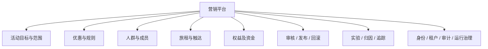

# 02 业务架构与五条以上核心链路

## 2026-10-19 更新

主业务链未整体重写；Offer/Journey 正确性护栏已补齐，Campaign 聚合状态和外部终态仍需合同。

当前源码核对基线 `6b9092f`；[完整状态与证据](CURRENT_STATUS.md)。以下保留原评审基线的发现、严重度和测试结果；其中“当前/待实施”均指原评审当时。历史源码链接已固定到原提交，后续实现请从最新状态索引进入。

## 历史报告正文（1392ca9 基线）

- 仓库：`marketing-lowcode-platform`；源码基线：`1392ca97bfe9cc6cfcd67888d318e0b2b66efe9c` 加当前未提交工作区。
- 分析日期：2026-09-22；模式：`READ_ONLY_ANALYSIS`。
- `CONFIRMED`＝源码/配置/测试直接证据；`INFERRED`＝据证据推断；`UNKNOWN`＝尚缺证据。代码存在不等于已部署或已通过真实链路验收。
- 本章遵循用户提示词；产品代码、数据库、运行配置、Git 提交与推送均不变。

## 业务问题

**CONFIRMED**：平台把“谁能享受什么优惠、何时触达、谁批准、如何切换和追责”落为不同模型。Campaign 组织营销目标；DefinitionVersion 保存某种方言的设计；Audience 表达目标群体；Offer 决定优惠；Journey 编排时间与动作；Release 选择运行制品；Benefit/Funding 控制真实资源。一个活动不必经过 Journey 才能报价。

## Chain 1：创建活动与定义

**CONFIRMED**：`POST /api/v1/campaigns` → ControlController → ControlCommandExecutor → ControlApplicationService.createCampaign → TenantScope 权限及 org/shop 校验 → Campaign(DRAFT) → ControlRepository → MybatisControlRepository → ControlMapper.insertCampaign → mk_campaign，同时写审计。保存定义另走 `/definitions`，锁活动归属、按 semanticHash 去重、追加 version_no，不覆盖已发布图。

证据：[ControlController.java:46](https://github.com/lirji/marketing-lowcode-platform/blob/1392ca97bfe9cc6cfcd67888d318e0b2b66efe9c/services/marketing-control-service/src/main/java/com/acme/marketing/control/interfaces/ControlController.java#L46)、[ControlApplicationService.java:54](https://github.com/lirji/marketing-lowcode-platform/blob/1392ca97bfe9cc6cfcd67888d318e0b2b66efe9c/services/marketing-control-service/src/main/java/com/acme/marketing/control/application/ControlApplicationService.java#L54)、[ControlMapper.xml:7](https://github.com/lirji/marketing-lowcode-platform/blob/1392ca97bfe9cc6cfcd67888d318e0b2b66efe9c/services/marketing-control-service/src/main/resources/mapper/ControlMapper.xml#L7)。

## Chain 2：规则配置到线上报价

**CONFIRMED**：LowCodeDesigner → toGraphDefinition → saveDefinition → GraphValidator/GovernanceValidator → submit/decide → RuleCompilerService 的 OFFER_POLICY 分支 → OfferPolicyGraphCompiler → mk_compiled_artifact → 签名发布/安装 → RuntimeManifestRegistry.route → DecisionApplicationService.rejection → PricingEngine → OfferTokenCodec。

注意：仿真使用 GraphSimulationService 的图遍历，编译使用优惠节点提取；二者当前并不同源，见风险 R01。DRL/DMN 编译器存在不能替代这条实际调用链。

证据：[graph.ts:24](https://github.com/lirji/marketing-lowcode-platform/blob/1392ca97bfe9cc6cfcd67888d318e0b2b66efe9c/frontend/apps/console/src/features/designers/graph.ts#L24)、[RuleCompilerService.java:96](https://github.com/lirji/marketing-lowcode-platform/blob/1392ca97bfe9cc6cfcd67888d318e0b2b66efe9c/services/rule-compiler-worker/src/main/java/com/acme/marketing/compiler/application/RuleCompilerService.java#L96)、[DecisionApplicationService.java:56](https://github.com/lirji/marketing-lowcode-platform/blob/1392ca97bfe9cc6cfcd67888d318e0b2b66efe9c/services/offer-decision-service/src/main/java/com/acme/marketing/decision/application/DecisionApplicationService.java#L56)。

## Chain 3：创建和编译旅程

**CONFIRMED**：前端 Journey 图与 Offer 共用图协议 → 控制面版本保存、节点目录/边/环/治理校验 → JOURNEY_PLAN 编译 → JourneyCompiler 把 sourcePort 映射为 route，把稳定类型尾段转换为 Type → JourneyPlan，保存签名制品。DSL 图不直接成为任意脚本。

证据：[JourneyCompiler.java:13](https://github.com/lirji/marketing-lowcode-platform/blob/1392ca97bfe9cc6cfcd67888d318e0b2b66efe9c/runtime-spi/journey-runtime-spi/src/main/java/com/acme/marketing/journey/JourneyCompiler.java#L13)、[GraphValidator.java:30](https://github.com/lirji/marketing-lowcode-platform/blob/1392ca97bfe9cc6cfcd67888d318e0b2b66efe9c/runtime-spi/lowcode-language-core/src/main/java/com/acme/marketing/lowcode/validation/GraphValidator.java#L30)、[RuleCompilerService.java:120](https://github.com/lirji/marketing-lowcode-platform/blob/1392ca97bfe9cc6cfcd67888d318e0b2b66efe9c/services/rule-compiler-worker/src/main/java/com/acme/marketing/compiler/application/RuleCompilerService.java#L120)。

## Chain 4：发布与切换

**CONFIRMED**：ReleaseController.stage → ReleaseApplicationService 校验 APPROVED、权益闭包、制品 → 锁 slot 分配 generation → STAGED manifest → runtime warm/签名 ACK → acknowledge 校验 ABI/制品/容量/时间 → activate 锁 slot + CAS + activationSequence + outbox → Kafka 通知及运行时 reconcile → 本地活跃指针。

事务只保证单服务数据库内的指针、指令和 Outbox 一起提交；并非所有运行实例在同一纳秒切换。证据：[ReleaseApplicationService.java:85](https://github.com/lirji/marketing-lowcode-platform/blob/1392ca97bfe9cc6cfcd67888d318e0b2b66efe9c/services/marketing-control-service/src/main/java/com/acme/marketing/control/application/ReleaseApplicationService.java#L85)、[RuntimeManifestRegistry.java:236](https://github.com/lirji/marketing-lowcode-platform/blob/1392ca97bfe9cc6cfcd67888d318e0b2b66efe9c/services/offer-decision-service/src/main/java/com/acme/marketing/decision/runtime/RuntimeManifestRegistry.java#L236)。

## Chain 5：用户进入并推进 STREAM Journey

**CONFIRMED**：可信调用方发送 `/api/v1/events` 的 JOURNEY_SIGNAL/START，携带 enrollment businessKey 和已激活 PlanReference → EventIngestionService 收据/Outbox → EventPayloadRouter → mk.journey.signal.v1 → JourneyRuntimeFlinkJob → keyed reducer → resolver 核验当前签名发布 → EnrollmentSnapshot.start → JourneyRuntime.advance → 状态/副作用输出 → mk.journey.output.v1 → JourneyOutputProjector → mk_enrollment + effect + dispatch outbox。

**UNKNOWN**：未确认有“所有普通订单事件自动匹配全部活动，然后自动选择 Journey”的通用触发路由器；当前明确入口需要调用方提供 JOURNEY_SIGNAL。不能把 PROFILE_CHANGED 自动画成 Journey START。

证据：[EventPayloadRouter.java:54](https://github.com/lirji/marketing-lowcode-platform/blob/1392ca97bfe9cc6cfcd67888d318e0b2b66efe9c/services/event-gateway-service/src/main/java/com/acme/marketing/eventgateway/application/EventPayloadRouter.java#L54)、[JourneyJobReducer.java:20](https://github.com/lirji/marketing-lowcode-platform/blob/1392ca97bfe9cc6cfcd67888d318e0b2b66efe9c/jobs/journey-runtime-flink-job/src/main/java/com/acme/marketing/jobs/journey/JourneyJobReducer.java#L20)、[JourneyOutputProjector.java:33](https://github.com/lirji/marketing-lowcode-platform/blob/1392ca97bfe9cc6cfcd67888d318e0b2b66efe9c/services/journey-service/src/main/java/com/acme/marketing/journeyservice/application/JourneyOutputProjector.java#L33)。

## Chain 6：等待唤醒到发放/触达

**CONFIRMED**：WAIT_TIMER → JourneyTransition.timers → reducer activeTimer → Flink processing-time timer + checkpoint → onTimer → advance → SEND/GRANT commandId → Kafka output → projector dispatch → SEND/WEBHOOK 到 engagement，GRANT 到 benefit → 各自持久幂等及结果。

不是 Flink 直接向短信平台发请求，也不是 Journey COMPLETED 就代表短信已经送达。[JourneyRuntimeProcessFunction.java:56](https://github.com/lirji/marketing-lowcode-platform/blob/1392ca97bfe9cc6cfcd67888d318e0b2b66efe9c/jobs/journey-runtime-flink-job/src/main/java/com/acme/marketing/jobs/journey/JourneyRuntimeProcessFunction.java#L56)、[JourneyOutputProjector.java:157](https://github.com/lirji/marketing-lowcode-platform/blob/1392ca97bfe9cc6cfcd67888d318e0b2b66efe9c/services/journey-service/src/main/java/com/acme/marketing/journeyservice/application/JourneyOutputProjector.java#L157)、[JourneyEngagementConsumer.java:24](https://github.com/lirji/marketing-lowcode-platform/blob/1392ca97bfe9cc6cfcd67888d318e0b2b66efe9c/services/engagement-service/src/main/java/com/acme/marketing/engagement/infrastructure/JourneyEngagementConsumer.java#L24)。

## Chain 7：风控与权益中台异步发放

**CONFIRMED**：AwardIntentService 以 sourceRequestId 领取 durable claim → 组装签名报价与目录 → 事务外风控 → 短事务保存 OUTBOX/BLOCK → CENTER 同事务写 expected fact → AwardIntentRelay 使用租约 CAS 调用权益中台 → 回填 orderNo，失败重试/DEAD。LEGACY、SHADOW 不是 CENTER 实际履约。

[AwardIntentService.java:83](https://github.com/lirji/marketing-lowcode-platform/blob/1392ca97bfe9cc6cfcd67888d318e0b2b66efe9c/services/benefit-funding-service/src/main/java/com/acme/marketing/benefit/application/AwardIntentService.java#L83)、[AwardIntentRelayMapper.xml:22](https://github.com/lirji/marketing-lowcode-platform/blob/1392ca97bfe9cc6cfcd67888d318e0b2b66efe9c/services/benefit-funding-service/src/main/resources/mapper/AwardIntentRelayMapper.xml#L22)。真实中台终态与资金对账还需外部环境验证。
