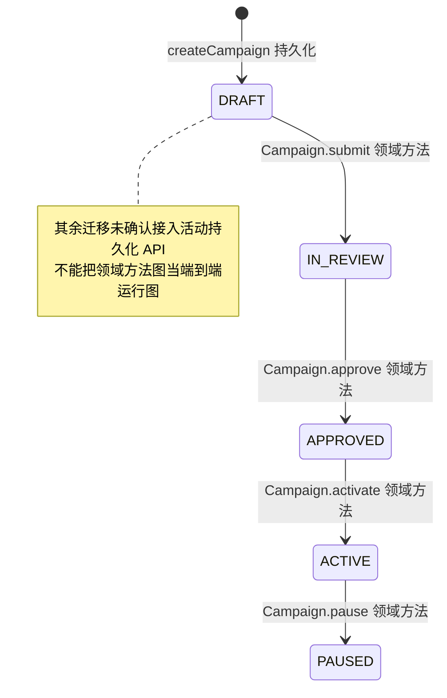
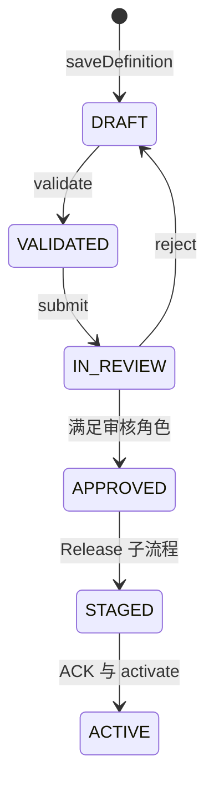

# 04 活动模型、生命周期与设计运行隔离

## 2026-10-19 更新

保留活动作为目标/归属容器的模型；本次不将演示数据中的 ACTIVE 当成生命周期已经闭环。

当前源码核对基线 `6b9092f`；[完整状态与证据](CURRENT_STATUS.md)。以下保留原评审基线的发现、严重度和测试结果；其中“当前/待实施”均指原评审当时。历史源码链接已固定到原提交，后续实现请从最新状态索引进入。

## 历史报告正文（1392ca9 基线）

- 仓库：`marketing-lowcode-platform`；源码基线：`1392ca97bfe9cc6cfcd67888d318e0b2b66efe9c` 加当前未提交工作区。
- 分析日期：2026-09-22；模式：`READ_ONLY_ANALYSIS`。
- `CONFIRMED`＝源码/配置/测试直接证据；`INFERRED`＝据证据推断；`UNKNOWN`＝尚缺证据。代码存在不等于已部署或已通过真实链路验收。
- 本章遵循用户提示词；产品代码、数据库、运行配置、Git 提交与推送均不变。

## 活动的十个问题

|问题|结论与置信度|
|---|---|
|如何创建|CONFIRMED：ControlController→应用服务校验 scope→Campaign(DRAFT)→mk_campaign+审计|
|由哪些元素组成|CONFIRMED：活动关联多个 definition version，按 dialect 表达 Offer/Journey/Referral 等；受众、权益通过规则引用参与|
|与规则关系|CONFIRMED：definitionId 归属 campaignId；Offer 编译结果不保留一个通用 Activity 实例|
|与受众关系|CONFIRMED：OfferPolicy.requiredAudienceSnapshotId 是资格引用；未确认活动表直接拥有全部人群成员|
|与旅程关系|CONFIRMED：Journey graph 是活动下某种定义；JourneyPlan 的 journeyId 使用 graph.definitionId|
|是否支持版本|CONFIRMED：配置定义有独立版本；未确认 Campaign 全量版本聚合|
|草稿/运行隔离|CONFIRMED：graph_json 与已签名制品/安装代次分离|
|发布后可否编辑|CONFIRMED：saveDefinition 追加新版本或按 hash 返回已存在版本；不就地更新原图|
|运行时读什么|CONFIRMED：OfferPolicy 代次快照、已激活 JourneyPlan、运行成员投影；并非每次读最新草稿|
|活动优先互斥|CONFIRMED：优惠候选有 priority/stackGroup/incompatibleOfferIds；未确认跨全部 Campaign 的全局互斥调度|

证据：[ControlApplicationService.java:96](https://github.com/lirji/marketing-lowcode-platform/blob/1392ca97bfe9cc6cfcd67888d318e0b2b66efe9c/services/marketing-control-service/src/main/java/com/acme/marketing/control/application/ControlApplicationService.java#L96)、[OfferPolicyGraphCompiler.java:52](https://github.com/lirji/marketing-lowcode-platform/blob/1392ca97bfe9cc6cfcd67888d318e0b2b66efe9c/services/rule-compiler-worker/src/main/java/com/acme/marketing/compiler/application/OfferPolicyGraphCompiler.java#L52)、[JourneyCompiler.java:41](https://github.com/lirji/marketing-lowcode-platform/blob/1392ca97bfe9cc6cfcd67888d318e0b2b66efe9c/runtime-spi/journey-runtime-spi/src/main/java/com/acme/marketing/journey/JourneyCompiler.java#L41)。

## 真实生命周期

**CONFIRMED**：当前创建/列表接线明确；全局搜索 control 生产代码未发现调用 Campaign.submit/approve/activate/pause 并更新 mk_campaign 状态的完整链路。ControlApplicationService.submit/decide 更新的是 Definition，不是 Campaign。Release.activate 更新 manifest/slot，不同步 Campaign ACTIVE。

**INFERRED**：新建活动完成定义发布后，活动列表状态可能仍是 DRAFT。该问题需要用完整发布路径验收；种子数据里存在 ACTIVE/PAUSED 不能证明生命周期已接线。

定义层实际流程：

最后两项属于 Release 体系，不是 Definition 状态字段。[ControlApplicationService.java:158](https://github.com/lirji/marketing-lowcode-platform/blob/1392ca97bfe9cc6cfcd67888d318e0b2b66efe9c/services/marketing-control-service/src/main/java/com/acme/marketing/control/application/ControlApplicationService.java#L158)、[ReleaseApplicationService.java:220](https://github.com/lirji/marketing-lowcode-platform/blob/1392ca97bfe9cc6cfcd67888d318e0b2b66efe9c/services/marketing-control-service/src/main/java/com/acme/marketing/control/application/ReleaseApplicationService.java#L220)。

## Activity Engine 是否该独立

**INFERRED / 建议**：优先在 control 上下文内完善活动生命周期与发布状态的关系，不新增 Activity 微服务。明确“一个活动有多个方言，何时整体 ACTIVE”的聚合规则、事件投影和状态优先级后，再决定 Campaign 状态是权威业务状态还是发布读模型。验收要求新建活动到可运行全程不依赖 SQL 种子改状态，非法暂停/终止迁移可观测。
