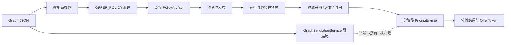

# 05 规则 DSL、执行路径与语义一致性

## 2026-10-19 更新

原先条件静默丢失与比例字段分歧已修复：当前拒绝不支持的图，共享候选构建及定价；尚不支持任意条件图。

当前源码核对基线 `6b9092f`；[完整状态与证据](CURRENT_STATUS.md)。以下保留原评审基线的发现、严重度和测试结果；其中“当前/待实施”均指原评审当时。历史源码链接已固定到原提交，后续实现请从最新状态索引进入。

## 历史报告正文（1392ca9 基线）

- 仓库：`marketing-lowcode-platform`；源码基线：`1392ca97bfe9cc6cfcd67888d318e0b2b66efe9c` 加当前未提交工作区。
- 分析日期：2026-09-22；模式：`READ_ONLY_ANALYSIS`。
- `CONFIRMED`＝源码/配置/测试直接证据；`INFERRED`＝据证据推断；`UNKNOWN`＝尚缺证据。代码存在不等于已部署或已通过真实链路验收。
- 本章遵循用户提示词；产品代码、数据库、运行配置、Git 提交与推送均不变。

## 四类规则路径

**CONFIRMED**：存在 GraphDefinition 的 JSON DSL、受众 SegmentRule、Journey 条件和 DRL/DMN 适配器。它们不是同一个任意表达式执行框架。

|路径|模型 / Context|实际执行|
|---|---|---|
|Offer|优惠节点 config→OfferPolicy；cart、subject、channel、time、tenant/org/shop、audience 投影|资格过滤→PricingEngine→分摊→签名 token|
|Audience|SegmentRule(match, conditions)，字段字符串 map|ALL/ANY + compare|
|Journey 条件|node.config.field/equals + instance variables/event attributes|字符串 equals 后选 true/false route|
|DRL|source + namespace；RuleFacts/Map|DroolsRuleEngineAdapter.compile/evaluate|
|DMN|XML+namespace/modelName；context Map|KIE compile/analyze/evaluateByName|
|Referral|严格线性图→ReferralPlan / policy|共享纯 evaluator、观察期/订单证据等；真实授权仍分离|

[RuleCompilerService.java:56](https://github.com/lirji/marketing-lowcode-platform/blob/1392ca97bfe9cc6cfcd67888d318e0b2b66efe9c/services/rule-compiler-worker/src/main/java/com/acme/marketing/compiler/application/RuleCompilerService.java#L56)、[RuleFacts.java:1](https://github.com/lirji/marketing-lowcode-platform/blob/1392ca97bfe9cc6cfcd67888d318e0b2b66efe9c/runtime-spi/decision-runtime-spi/src/main/java/com/acme/marketing/decision/rule/RuleFacts.java#L1)、[DecisionApplicationService.java:51](https://github.com/lirji/marketing-lowcode-platform/blob/1392ca97bfe9cc6cfcd67888d318e0b2b66efe9c/services/offer-decision-service/src/main/java/com/acme/marketing/decision/application/DecisionApplicationService.java#L51)、[JourneyRuntime.java:90](https://github.com/lirji/marketing-lowcode-platform/blob/1392ca97bfe9cc6cfcd67888d318e0b2b66efe9c/runtime-spi/journey-runtime-spi/src/main/java/com/acme/marketing/journey/JourneyRuntime.java#L90)。

## DSL 及完整执行模型

**CONFIRMED**：编译器过滤 `offer.fixed` / `offer.percentage`，读取节点 config，不使用 edges 或 condition 节点。线上不构造通用 AST；DRL/DMN 并未接入 DecisionApplicationService.evaluateNow 主链。不能把“适配器可求值”写成“页面配置最终都由 Drools 执行”。[OfferPolicyGraphCompiler.java:28](https://github.com/lirji/marketing-lowcode-platform/blob/1392ca97bfe9cc6cfcd67888d318e0b2b66efe9c/services/rule-compiler-worker/src/main/java/com/acme/marketing/compiler/application/OfferPolicyGraphCompiler.java#L28)、[RuntimeManifestRegistry.java:69](https://github.com/lirji/marketing-lowcode-platform/blob/1392ca97bfe9cc6cfcd67888d318e0b2b66efe9c/services/offer-decision-service/src/main/java/com/acme/marketing/decision/runtime/RuntimeManifestRegistry.java#L69)。

JSON 图包含 definitionId、dialect/dialectVersion、nodes(id/stableTypeId/semanticVersion/config)、edges(source/port/target)、variables/annotations。语义 hash 和制品签名建立设计输入与安装字节的身份；签名保证未篡改，不保证编译语义正确。

## 所有已确认业务操作符

- Audience：`EQ NE GT GTE LT LTE IN`；`ALL`/`ANY` 是平面 AND/OR。未实现递归 ConditionGroup、NOT、BETWEEN、REGEX、EXISTS。
- Journey condition：仅 `equals`；WAIT_EVENT 是指定事件类型或 `*`，不是任意表达式。
- Offer：资格检查为代码中的时间、渠道、SKU/category/shop、人群；优惠公式枚举与阶段定价另行处理。不可将 Audience 的运算符集合套给 Offer。
- DRL/DMN：语言能力还受 UntrustedRuleSourcePolicy 限制；本轮不穷举第三方语言全部语法，也不承诺安全沙箱。

[AudienceService.java:221](https://github.com/lirji/marketing-lowcode-platform/blob/1392ca97bfe9cc6cfcd67888d318e0b2b66efe9c/services/audience-service/src/main/java/com/acme/marketing/audience/application/AudienceService.java#L221)、[UntrustedRuleSourcePolicy.java:1](https://github.com/lirji/marketing-lowcode-platform/blob/1392ca97bfe9cc6cfcd67888d318e0b2b66efe9c/services/rule-compiler-worker/src/main/java/com/acme/marketing/compiler/application/UntrustedRuleSourcePolicy.java#L1)。

## 组合、选择和精确分摊

**CONFIRMED**：OfferSelector 支持 FIRST、SUM、BEST、MAX_N、候选优先级、组限额和双向互斥，最多 14 个可选候选，穷举可行子集；每阶段重算目标值。LargestRemainderAllocator 用整数/BigInteger 分商余数，余数同值按稳定键排序，保证分摊总和。

**INFERRED**：组合空间最多 2^14 仍需乘以每个子集定价及购物车行数；上界不是 P99 承诺。规则增长优先在编译阶段限制复杂度，不应简单改大常量。[OfferSelector.java:16](https://github.com/lirji/marketing-lowcode-platform/blob/1392ca97bfe9cc6cfcd67888d318e0b2b66efe9c/runtime-spi/decision-runtime-spi/src/main/java/com/acme/marketing/decision/pricing/OfferSelector.java#L16)、[PricingEngine.java:34](https://github.com/lirji/marketing-lowcode-platform/blob/1392ca97bfe9cc6cfcd67888d318e0b2b66efe9c/runtime-spi/decision-runtime-spi/src/main/java/com/acme/marketing/decision/pricing/PricingEngine.java#L34)、[LargestRemainderAllocator.java:39](https://github.com/lirji/marketing-lowcode-platform/blob/1392ca97bfe9cc6cfcd67888d318e0b2b66efe9c/runtime-spi/decision-runtime-spi/src/main/java/com/acme/marketing/decision/pricing/LargestRemainderAllocator.java#L39)。

## 关键语义缺陷 R01

**CONFIRMED / 静态证据**：仿真沿 edge 执行 offer.condition，线上编译丢弃该条件。构造 start→condition(field=tier,equals=VIP)，true→fixed(完整合法优惠配置)，false→end；普通用户在仿真没有折扣，编译仍包含 fixed。只要时间/商品/人群等独立资格通过，线上可选中折扣。线上 Context 本身也没有任意 tier facts 对应路径。

另一反例：仿真 percentage 读取 `basisPoints`，编译读取 `discountBasisPoints`。使用后者时仿真默认 0，线上可能非零。证据：[GraphSimulationService.java:48](https://github.com/lirji/marketing-lowcode-platform/blob/1392ca97bfe9cc6cfcd67888d318e0b2b66efe9c/services/marketing-control-service/src/main/java/com/acme/marketing/control/application/GraphSimulationService.java#L48)、[GraphSimulationService.java:55](https://github.com/lirji/marketing-lowcode-platform/blob/1392ca97bfe9cc6cfcd67888d318e0b2b66efe9c/services/marketing-control-service/src/main/java/com/acme/marketing/control/application/GraphSimulationService.java#L55)、[OfferPolicyGraphCompiler.java:83](https://github.com/lirji/marketing-lowcode-platform/blob/1392ca97bfe9cc6cfcd67888d318e0b2b66efe9c/services/rule-compiler-worker/src/main/java/com/acme/marketing/compiler/application/OfferPolicyGraphCompiler.java#L83)。

影响为运营审核结果与真实优惠不一致，定为 P1；未对真实资金运行复现，不称生产事故。最小安全修复可先拒绝无法忠实降级的图，再让仿真调用同一编译 IR/evaluator。验收矩阵必须包含正反分支、比例字段、门槛、封顶、叠加和同输入差分。

## 扩展、安全、性能取舍

Operator 是 enum/switch，新增要改模型、类型校验、compare、合同、前端控件与测试，约 4–6 个逻辑边界；不是热插拔。RuleEngineAdapter 是隔离供应商的 Java 接口，不是动态插件安装体系。

Drools 有编译预算和 fireLimit，但取消线程不能直接证明硬隔离。适配器每次执行创建虚拟线程 executor，关闭等待行为与引擎可中断性需要专项验证；未实测时记 **UNKNOWN**，不写成确定超时 SLA。源码安全策略有拒绝名单/受限 consequence，但也不等于进程沙箱。[DroolsRuleEngineAdapter.java:102](https://github.com/lirji/marketing-lowcode-platform/blob/1392ca97bfe9cc6cfcd67888d318e0b2b66efe9c/runtime-spi/drools-runtime-adapter/src/main/java/com/acme/marketing/rule/drools/DroolsRuleEngineAdapter.java#L102)。

## 优惠公式枚举与可编译子集

**CONFIRMED**：PromotionKind 枚举包含 FIXED_OFF、PERCENT_OFF、EVERY_FULL_REDUCTION、FIXED_TOTAL、FREE_SHIPPING、GIFT、POINTS、RED_PACKET、CASHBACK、DRAW_CHANCE；PriceStage 顺序为 BASE、ITEM、SHOP、CROSS_SHOP、PLATFORM、COUPON、SHIPPING、PAYMENT_DISPLAY。但当前 OfferPolicyGraphCompiler 只从 fixed/percentage 节点生成前两种，枚举能力不能自动算作全部页面玩法可发布。

[PromotionKind](https://github.com/lirji/marketing-lowcode-platform/blob/1392ca97bfe9cc6cfcd67888d318e0b2b66efe9c/runtime-spi/decision-runtime-spi/src/main/java/com/acme/marketing/decision/model/PromotionKind.java#L3)、[PriceStage](https://github.com/lirji/marketing-lowcode-platform/blob/1392ca97bfe9cc6cfcd67888d318e0b2b66efe9c/runtime-spi/decision-runtime-spi/src/main/java/com/acme/marketing/decision/model/PriceStage.java#L3)。扩展动作时还要查公式执行、资源归属和下游履约，不只新增枚举。
