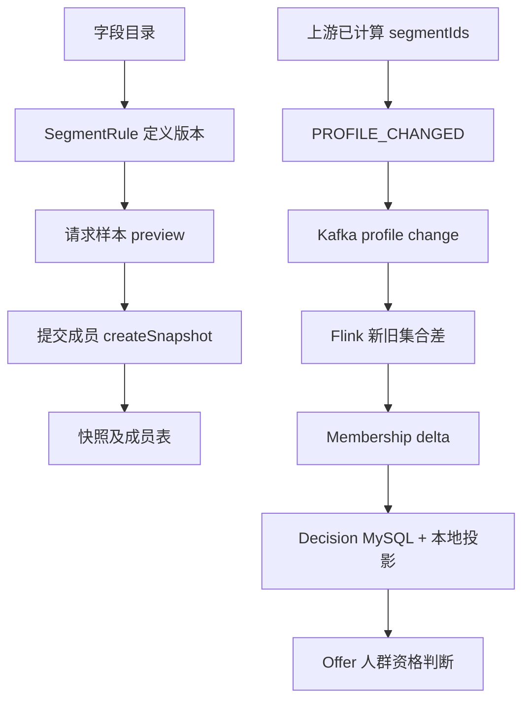

# 06 人群表达式、快照与实时成员投影

## 2026-10-19 更新

字段类型/算子治理已完成；人群投影改为主键回源和有界缓存；snapshot/segment 权威映射仍待合同。

当前源码核对基线 `6b9092f`；[完整状态与证据](CURRENT_STATUS.md)。以下保留原评审基线的发现、严重度和测试结果；其中“当前/待实施”均指原评审当时。历史源码链接已固定到原提交，后续实现请从最新状态索引进入。

## 历史报告正文（1392ca9 基线）

- 仓库：`marketing-lowcode-platform`；源码基线：`1392ca97bfe9cc6cfcd67888d318e0b2b66efe9c` 加当前未提交工作区。
- 分析日期：2026-09-22；模式：`READ_ONLY_ANALYSIS`。
- `CONFIRMED`＝源码/配置/测试直接证据；`INFERRED`＝据证据推断；`UNKNOWN`＝尚缺证据。代码存在不等于已部署或已通过真实链路验收。
- 本章遵循用户提示词；产品代码、数据库、运行配置、Git 提交与推送均不变。

## 实际能力分层

**CONFIRMED**：控制面保存字段元数据和人群定义版本；preview 对请求提交的 profiles 执行规则；createSnapshot 保存调用方提交的 subjectTokens；成员可后续按单调版本更新。流作业接收已包含 segmentIds 的 PROFILE_CHANGED，计算集合差，而不是从任意用户属性执行全库人群表达式。

上下两条通道不能未经映射就视为同一标识空间。证据：[AudienceService.java:77](https://github.com/lirji/marketing-lowcode-platform/blob/1392ca97bfe9cc6cfcd67888d318e0b2b66efe9c/services/audience-service/src/main/java/com/acme/marketing/audience/application/AudienceService.java#L77)、[AudienceService.java:89](https://github.com/lirji/marketing-lowcode-platform/blob/1392ca97bfe9cc6cfcd67888d318e0b2b66efe9c/services/audience-service/src/main/java/com/acme/marketing/audience/application/AudienceService.java#L89)、[AudienceMembershipProjection.java:10](https://github.com/lirji/marketing-lowcode-platform/blob/1392ca97bfe9cc6cfcd67888d318e0b2b66efe9c/jobs/audience-flink-job/src/main/java/com/acme/marketing/jobs/audience/AudienceMembershipProjection.java#L10)、[AudienceMembershipConsumer.java:38](https://github.com/lirji/marketing-lowcode-platform/blob/1392ca97bfe9cc6cfcd67888d318e0b2b66efe9c/services/offer-decision-service/src/main/java/com/acme/marketing/decision/runtime/AudienceMembershipConsumer.java#L38)。

## 九个问题

|问题|回答|
|---|---|
|静态/动态|CONFIRMED：有快照起始集合，也有 versioned membership 更新|
|实时/离线|CONFIRMED：样本同步预览、Flink 实时差分；未确认离线全量计算调度|
|快照|CONFIRMED：snapshotId、segmentVersion、asOf、watermark、expiresAt、memberCount、checksum|
|标签体系|CONFIRMED：FieldDefinition 有来源、所有者、分类、允许用途、时效、空值/缺失策略等元数据|
|标签来源|CONFIRMED：preview 的调用方 attributes；流输入的上游 segmentIds；真实画像系统 UNKNOWN|
|SQL/ES/Bitmap|MyBatis 存储存在；未确认通用 SQL 人群编译、ES 检索或 Bitmap 求交执行器|
|规模计算|keyed 差分按 tenant+subject 处理；全量圈选能力和容量 UNKNOWN|
|发布冻结|定义版本可固定；快照成员允许更新，不能承诺成员永久冻结|
|Audience 与 Rule|Audience 提供“属于哪些群体/时效”，Offer 决定“本次交易可得什么”；Journey 决定“何时做动作”|

## 字段元数据不等于全部运行策略

**CONFIRMED**：validateRule 只查 field types 并校验 value；compare 实际对 null 一律 false，数值比较按 BigDecimal，IN 用逗号拆分集合。未见该路径执行 allowedUses、maxAgeSeconds、NullPolicy、MissingPolicy 的全部语义。

具体失败输入：注册 STRING 字段 tier，规则 operator=GT/value=VIP 可通过 STRING 值检查，但 preview 的 GT 会尝试 `new BigDecimal("VIP")` 抛错。DECIMAL 字段 IN/value=`1,2` 在定义阶段先按单值 BigDecimal 校验，无法表达合法数值集合。**CONFIRMED** 为代码类型/操作符不一致；用户影响据输入路径推导，未写库复现。[AudienceService.java:159](https://github.com/lirji/marketing-lowcode-platform/blob/1392ca97bfe9cc6cfcd67888d318e0b2b66efe9c/services/audience-service/src/main/java/com/acme/marketing/audience/application/AudienceService.java#L159)、[AudienceService.java:192](https://github.com/lirji/marketing-lowcode-platform/blob/1392ca97bfe9cc6cfcd67888d318e0b2b66efe9c/services/audience-service/src/main/java/com/acme/marketing/audience/application/AudienceService.java#L192)。

## 需要确认的身份与同步闭环

流消费者把 delta.segmentId 存为投影 audienceId，而 Offer 配置字段叫 requiredAudienceSnapshotId。**CONFIRMED** 两侧键来源不同；**UNKNOWN** 是否上游约定它们采用同一值或有外部映射。不能声称随机生成的 snapshotId 已自动进入决策缓存。验收需要一条真实“保存 snapshot→引用该 ID→更新上游→决策命中/撤销”的链路。

## 新鲜度和容量

控制面 membership 有 REJECT_CANDIDATE / USE_LAST_GOOD / GENERIC_PATH；决策本地投影则只接受存在、member=true、未过期。流 TTL 默认 30 天，来自事件时间，不是用户访问续期。每秒增量 reload 带版本比较和过期清理；ConcurrentHashMap 没有最大条目数，初次 reload 自 epoch 起扫描。**INFERRED**：大人群下内存及启动扫描成本是主要压力点，需容量上限、分片和受控回源策略；没有实测就不承诺承载百万用户。[AudienceMembershipProjection.java:46](https://github.com/lirji/marketing-lowcode-platform/blob/1392ca97bfe9cc6cfcd67888d318e0b2b66efe9c/services/offer-decision-service/src/main/java/com/acme/marketing/decision/runtime/AudienceMembershipProjection.java#L46)。
