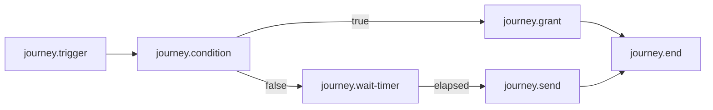

# 07 Journey 状态机、等待与工作流运行

## 2026-10-19 更新

编译前必需路由和图完整性已修复；临时存储故障交给作业恢复。累计寿命/重放预算和真实链路恢复仍待验收。

当前源码核对基线 `6b9092f`；[完整状态与证据](CURRENT_STATUS.md)。以下保留原评审基线的发现、严重度和测试结果；其中“当前/待实施”均指原评审当时。历史源码链接已固定到原提交，后续实现请从最新状态索引进入。

## 历史报告正文（1392ca9 基线）

- 仓库：`marketing-lowcode-platform`；源码基线：`1392ca97bfe9cc6cfcd67888d318e0b2b66efe9c` 加当前未提交工作区。
- 分析日期：2026-09-22；模式：`READ_ONLY_ANALYSIS`。
- `CONFIRMED`＝源码/配置/测试直接证据；`INFERRED`＝据证据推断；`UNKNOWN`＝尚缺证据。代码存在不等于已部署或已通过真实链路验收。
- 本章遵循用户提示词；产品代码、数据库、运行配置、Git 提交与推送均不变。

## 定义与实例

**CONFIRMED**：JourneyPlan 保存 startNodeId、nodes/routes、maxStepsPerSignal、maxIterations、stateTtl；EnrollmentSnapshot 保存固定 journeyVersion、currentNodeId、variables、processedSignalIds、iterations 和 nodeExecutions。单实例只有一个 currentNodeId，不是并行 token 集合。

节点类型为 TRIGGER、CONDITION、WAIT_EVENT、WAIT_TIMER、SEND、GRANT、WEBHOOK、REPEAT、END。执行器是 JourneyRuntime.advance 内的 enum switch，未使用 Flowable/通用 BPMN 或每节点动态插件注册。

[JourneyRuntime.java:38](https://github.com/lirji/marketing-lowcode-platform/blob/1392ca97bfe9cc6cfcd67888d318e0b2b66efe9c/runtime-spi/journey-runtime-spi/src/main/java/com/acme/marketing/journey/JourneyRuntime.java#L38)、[JourneyCompiler.java:13](https://github.com/lirji/marketing-lowcode-platform/blob/1392ca97bfe9cc6cfcd67888d318e0b2b66efe9c/runtime-spi/journey-runtime-spi/src/main/java/com/acme/marketing/journey/JourneyCompiler.java#L13)、[EnrollmentSnapshot.java:1](https://github.com/lirji/marketing-lowcode-platform/blob/1392ca97bfe9cc6cfcd67888d318e0b2b66efe9c/runtime-spi/journey-runtime-spi/src/main/java/com/acme/marketing/journey/EnrollmentSnapshot.java#L1)。

## 支持与不支持

|能力|结论|
|---|---|
|分支|CONFIRMED：condition equals 选择 true/false 单路径|
|汇聚|可将多条路径指向同节点，但没有等待全部前驱的 join 语义|
|并行|未发现并行 token/fork/join；不宣称支持|
|等待|CONFIRMED：WAIT_EVENT 与 WAIT_TIMER|
|循环|runtime 有 REPEAT；控制面 bounded-repeat 校验与目录/编译映射不完整，不能宣称端到端可用|
|重试|Flink timer 有 5 次指数退避；消息消费者另有重试/DLT；不是任意节点事务回滚|
|失败重启|checkpoint 恢复 state/timer 的设计已接入；完整环境恢复演练未执行|

GraphValidator 允许带 maxIterations/deadline 的 `control.bounded-repeat`，DefaultNodeRegistry 不注册它，JourneyCompiler 又把尾段转换为 `BOUNDED_REPEAT` 而 runtime enum 为 REPEAT。**CONFIRMED**：公共图入口到运行节点的映射存在缺口。若需重复玩法，先统一类型、限制与 deadline 执行，不可仅显示一个重复节点。

## 可表达的示意流程

这是依照支持节点构造的说明图，不是声称仓库已有部署活动；分支只选一条，没有并发汇聚。

## STREAM 等待持久化与唤醒

1. runtime 遇 WAIT_TIMER，生成 `enrollmentId:nodeId` 和 `signal.occurredAt + delaySeconds`，返回 WAITING。
2. reducer 只允许一个 activeTimer，过去到期时间钳制到 processingNow+1ms；同节点无关事件不会延后已有 timer。
3. process function 将 JourneyJobState 写 ValueState 并注册 processing-time timer；checkpoint 负责状态和计时器恢复。
4. onTimer 根据当前活跃时间判断是否陈旧；核验 pinned plan 与 kill-switch，然后 advance。
5. 输出状态和命令到 Kafka 事务 sink；MySQL 是运营投影与分发持久化边界。

[JourneyJobReducer.java:45](https://github.com/lirji/marketing-lowcode-platform/blob/1392ca97bfe9cc6cfcd67888d318e0b2b66efe9c/jobs/journey-runtime-flink-job/src/main/java/com/acme/marketing/jobs/journey/JourneyJobReducer.java#L45)、[JourneyRuntimeProcessFunction.java:56](https://github.com/lirji/marketing-lowcode-platform/blob/1392ca97bfe9cc6cfcd67888d318e0b2b66efe9c/jobs/journey-runtime-flink-job/src/main/java/com/acme/marketing/jobs/journey/JourneyRuntimeProcessFunction.java#L56)、[FlinkKafkaJobRunner.java:71](https://github.com/lirji/marketing-lowcode-platform/blob/1392ca97bfe9cc6cfcd67888d318e0b2b66efe9c/jobs/flink-job-support/src/main/java/com/acme/marketing/jobs/support/FlinkKafkaJobRunner.java#L71)。

**INFERRED**：延迟精度受 checkpoint、作业恢复、阻塞 IO 与处理积压影响，不能承诺精确到毫秒。暂停时每 5 秒尝试，普通 timer 错误最多 5 次，耗尽输出 JOURNEY_TIMER_RETRIES_EXHAUSTED，投影标失败。

## DIRECT 与 STREAM 区别

DIRECT 将 snapshot/effect/timer 写 MySQL，适合本地机制验证；生产 OIDC 构造阶段要求 STREAM。STREAM 拒绝 `/enrollments` 直接写状态，要求经事件接入。不能把 DIRECT 的 mk_journey_timer 表当作生产 Flink timer 的存储，也未确认有完整 DIRECT timer 自动唤醒 worker。

[JourneyApplicationService.java:47](https://github.com/lirji/marketing-lowcode-platform/blob/1392ca97bfe9cc6cfcd67888d318e0b2b66efe9c/services/journey-service/src/main/java/com/acme/marketing/journeyservice/application/JourneyApplicationService.java#L47)、[JourneyApplicationService.java:68](https://github.com/lirji/marketing-lowcode-platform/blob/1392ca97bfe9cc6cfcd67888d318e0b2b66efe9c/services/journey-service/src/main/java/com/acme/marketing/journeyservice/application/JourneyApplicationService.java#L68)、[JourneyApplicationService.java:91](https://github.com/lirji/marketing-lowcode-platform/blob/1392ca97bfe9cc6cfcd67888d318e0b2b66efe9c/services/journey-service/src/main/java/com/acme/marketing/journeyservice/application/JourneyApplicationService.java#L91)。

## 恢复、终态与长任务风险

runtime 的 COMPLETED 表示已走到 END、命令已生成，不代表渠道/发券终态成功。FAILED/COMPLETED 收到后续信号直接返回，不提供普通 advance 重开。通用人工恢复某失败节点的产品入口为 UNKNOWN；重投副作用、恢复 Flink 状态和业务补偿是三种不同操作。

**CONFIRMED**：每个非重复信号会复制并增长 processedSignalIds；reducer 以当前 processing time 续 stateTtl。**INFERRED / R08**：持续活跃 WAIT_EVENT 实例可能长期不退出且去重集合不断增长，maxSteps 限制不了跨信号累计大小。应测量状态字节、事件数上限、去重保留与重放保证，再引入绝对生命周期或受控归档。
