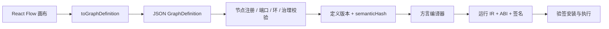

# 08 低代码 Schema 与前后端映射

## 2026-10-19 更新

图 ID、版本、变量、注释及具名端口往返保存已修复；DMN 持久化/通用元数据迁移不因此视为完成。

当前源码核对基线 `6b9092f`；[完整状态与证据](CURRENT_STATUS.md)。以下保留原评审基线的发现、严重度和测试结果；其中“当前/待实施”均指原评审当时。历史源码链接已固定到原提交，后续实现请从最新状态索引进入。

## 历史报告正文（1392ca9 基线）

- 仓库：`marketing-lowcode-platform`；源码基线：`1392ca97bfe9cc6cfcd67888d318e0b2b66efe9c` 加当前未提交工作区。
- 分析日期：2026-09-22；模式：`READ_ONLY_ANALYSIS`。
- `CONFIRMED`＝源码/配置/测试直接证据；`INFERRED`＝据证据推断；`UNKNOWN`＝尚缺证据。代码存在不等于已部署或已通过真实链路验收。
- 本章遵循用户提示词；产品代码、数据库、运行配置、Git 提交与推送均不变。

## 为什么是低代码

**CONFIRMED**：运营画布能生成后端图定义，保存版本，校验后编译为运行制品。存在稳定节点类型、语义版本、端口类型、副作用标签和成本预算。**INFERRED**：可称领域专用低代码平台；不能称任意业务免开发的通用低代码平台。

## Schema 层次

|层次|内容|证据|
|---|---|---|
|GraphDefinition|dialect/version、nodes、edges、variables、annotations|[GraphDefinition.java:1](https://github.com/lirji/marketing-lowcode-platform/blob/1392ca97bfe9cc6cfcd67888d318e0b2b66efe9c/runtime-spi/lowcode-language-core/src/main/java/com/acme/marketing/lowcode/model/GraphDefinition.java#L1)|
|NodeDefinition|stableTypeId、semanticVersion、ports、schema URI、sideEffect、cost、权限|[NodeDefinition.java:1](https://github.com/lirji/marketing-lowcode-platform/blob/1392ca97bfe9cc6cfcd67888d318e0b2b66efe9c/runtime-spi/lowcode-language-core/src/main/java/com/acme/marketing/lowcode/model/NodeDefinition.java#L1)|
|机器合同|Graph JSON Schema、事件 Schema、OpenAPI/AsyncAPI|[graph-definition.schema.json:1](https://github.com/lirji/marketing-lowcode-platform/blob/1392ca97bfe9cc6cfcd67888d318e0b2b66efe9c/marketing-contracts/src/main/resources/schema/graph/graph-definition.schema.json#L1)|
|前端适配|React Flow Node→后端节点；config 为字符串映射|[graph.ts:24](https://github.com/lirji/marketing-lowcode-platform/blob/1392ca97bfe9cc6cfcd67888d318e0b2b66efe9c/frontend/apps/console/src/features/designers/graph.ts#L24)|
|校验|节点存在/版本、端口类型、纯方言禁止副作用、可达性和环、成本|[GraphValidator.java:44](https://github.com/lirji/marketing-lowcode-platform/blob/1392ca97bfe9cc6cfcd67888d318e0b2b66efe9c/runtime-spi/lowcode-language-core/src/main/java/com/acme/marketing/lowcode/validation/GraphValidator.java#L44)|

## 元数据驱动的实际程度

**CONFIRMED**：LowCodeDesigner 查询 api.nodeRegistry，按 dialect 构建 palette；但后端 DefaultNodeRegistry 是代码列表，插件 digest 为固定占位值。前端仍维护 TONE_BY_TYPE 与类型转换，不能仅新增数据库一行就安装新执行器。

NodeDefinition 的 configSchema/uiSchema 是 URI 字段；本轮未确认通用 Schema 解析器可将每个 URI 动态渲染成完整专用表单。新增节点通常要修改前端配置体验、后端目录、编译器、runtime switch、合同与测试。

[DefaultNodeRegistry.java:16](https://github.com/lirji/marketing-lowcode-platform/blob/1392ca97bfe9cc6cfcd67888d318e0b2b66efe9c/services/marketing-control-service/src/main/java/com/acme/marketing/control/application/DefaultNodeRegistry.java#L16)、[LowCodeDesigner.tsx:71](https://github.com/lirji/marketing-lowcode-platform/blob/1392ca97bfe9cc6cfcd67888d318e0b2b66efe9c/frontend/apps/console/src/features/designers/LowCodeDesigner.tsx#L71)。

## UI 保存、版本与布局

实时模式必须具备 campaignId 和 definition:write；save 会先存 localStorage 草稿，再写控制面版本。重新打开优先加载 API 定义；fromGraphDefinition 按节点顺序重建位置，没有把原 x/y 写入后端 GraphDefinition。**CONFIRMED**：语义图可还原不等于画布布局原样还原。语义版本、图定义版本、运行 ABI 不能混为一个 version。

[LowCodeDesigner.tsx:131](https://github.com/lirji/marketing-lowcode-platform/blob/1392ca97bfe9cc6cfcd67888d318e0b2b66efe9c/frontend/apps/console/src/features/designers/LowCodeDesigner.tsx#L131)、[graph.ts:83](https://github.com/lirji/marketing-lowcode-platform/blob/1392ca97bfe9cc6cfcd67888d318e0b2b66efe9c/frontend/apps/console/src/features/designers/graph.ts#L83)。

## 已知产品边界

DMN 页面本地草稿没有保存/分析/求值链路；前端编译器存在不代表工作台已闭环。DEMO_MODE 仍有硬编码活动和内存创建，违反当前用户“Mock 入库”的统一要求；默认关闭不消除该维护差距。实时设计还存在 Offer 仿真/编译语义偏差，见 R01。

[DmnDesignerPage.tsx:13](https://github.com/lirji/marketing-lowcode-platform/blob/1392ca97bfe9cc6cfcd67888d318e0b2b66efe9c/frontend/apps/console/src/features/designers/DmnDesignerPage.tsx#L13)、[CampaignsPage.tsx:41](https://github.com/lirji/marketing-lowcode-platform/blob/1392ca97bfe9cc6cfcd67888d318e0b2b66efe9c/frontend/apps/console/src/features/campaign/CampaignsPage.tsx#L41)。

## 演进取舍

**INFERRED / 建议**：先定义支持的 DSL 子集和兼容矩阵，让未支持节点失败关闭；统一校验/编译/仿真语义；随后补齐 config schema 校验和表单生成。比优先建设远程插件市场成本低，也能阻止配置“看起来可执行、实际丢条件”的风险。插件加载若将来引入，需要独立签名、版本依赖和资源隔离，当前未实现，不计入成熟度。
