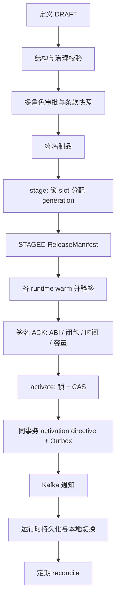
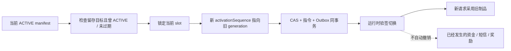

# 09 发布、版本、灰度与回滚语义

## 2026-10-19 更新

新增支持子集及旧比例制品激活门禁；已有活跃制品未自动重签或替换，跨 slot 原子性与保留策略仍需明确。

当前源码核对基线 `6b9092f`；[完整状态与证据](CURRENT_STATUS.md)。以下保留原评审基线的发现、严重度和测试结果；其中“当前/待实施”均指原评审当时。历史源码链接已固定到原提交，后续实现请从最新状态索引进入。

## 历史报告正文（1392ca9 基线）

- 仓库：`marketing-lowcode-platform`；源码基线：`1392ca97bfe9cc6cfcd67888d318e0b2b66efe9c` 加当前未提交工作区。
- 分析日期：2026-09-22；模式：`READ_ONLY_ANALYSIS`。
- `CONFIRMED`＝源码/配置/测试直接证据；`INFERRED`＝据证据推断；`UNKNOWN`＝尚缺证据。代码存在不等于已部署或已通过真实链路验收。
- 本章遵循用户提示词；产品代码、数据库、运行配置、Git 提交与推送均不变。

## 版本不是单个 version 字段

**CONFIRMED**：设计 definitionVersion、节点 semanticVersion、dialectVersion、制品 checksum/ABI、运行 generation、activationSequence、人群 snapshot/membership version、Journey pinned version 分别约束不同对象。

|版本|变化原因|不能替代什么|
|---|---|---|
|Definition version|配置语义改变|活动整体状态|
|Artifact checksum / signature|可执行字节、来源与密钥绑定|业务语义正确性|
|Generation|同一个 runtime slot 发布新制品集合|消息顺序|
|Activation sequence|激活或回滚指令推进|目标 generation 大小|
|Journey version|编译后执行计划|既有实例自动迁移|
|Membership version|群体成员增删|静态快照永不变化|

Release slot 包含 tenant/environment/cell/runtime/namespace。按 runtime 分槽意味着 decision 和 journey 并非天然跨服务同事务切换。统一 ReleaseManifest 表达制品集合，并不等于所有业务对象共用一个全局版本。

[ReleaseApplicationService.java:99](https://github.com/lirji/marketing-lowcode-platform/blob/1392ca97bfe9cc6cfcd67888d318e0b2b66efe9c/services/marketing-control-service/src/main/java/com/acme/marketing/control/application/ReleaseApplicationService.java#L99)、[RuntimeManifestRegistry.java:319](https://github.com/lirji/marketing-lowcode-platform/blob/1392ca97bfe9cc6cfcd67888d318e0b2b66efe9c/services/offer-decision-service/src/main/java/com/acme/marketing/decision/runtime/RuntimeManifestRegistry.java#L319)。

## 发布路径与权限

**CONFIRMED**：发布需要 release:write，激活 release:activate，ACK runtime:ack，回滚 release:rollback，熔断 release:kill-switch。审批角色细分，ApprovalCase 排除提交者自批和同一人替代多个角色。stage 校验 APPROVED、权益闭包、制品身份。ACK 校验 generation/cell、时间窗口、签名、支持 ABI、精确 warmedArtifactIds 和容量范围。

[ApprovalCase.java:32](https://github.com/lirji/marketing-lowcode-platform/blob/1392ca97bfe9cc6cfcd67888d318e0b2b66efe9c/services/marketing-control-service/src/main/java/com/acme/marketing/control/domain/ApprovalCase.java#L32)、[ReleaseApplicationService.java:126](https://github.com/lirji/marketing-lowcode-platform/blob/1392ca97bfe9cc6cfcd67888d318e0b2b66efe9c/services/marketing-control-service/src/main/java/com/acme/marketing/control/application/ReleaseApplicationService.java#L126)。

## 原子范围与恢复

**CONFIRMED**：activate 在控制库锁定 slot，用旧 desiredGeneration/activationSequence 作 CAS；指令、状态和 Outbox 同事务提交。运行实例消费和 reconcile 最终收敛；决策 registry 保留 last-known-good，并检查指令/manifest 失效时间。**INFERRED**：短暂代次不一致是需要观测的一致性窗口，不能宣传全实例瞬时原子切流。

灰度用 stableGeneration + canaryBasisPoints，按 tenant/slot/subject 的稳定桶选代次。预热失败不应该产生可用代次；目标冷缓存会拒绝而不是读草稿。[RuntimeManifestRegistry.java:211](https://github.com/lirji/marketing-lowcode-platform/blob/1392ca97bfe9cc6cfcd67888d318e0b2b66efe9c/services/offer-decision-service/src/main/java/com/acme/marketing/decision/runtime/RuntimeManifestRegistry.java#L211)。

## 回滚究竟做什么

**CONFIRMED**：目标必须在 retainedGenerations，target.state=ACTIVE 且 manifest 未过期；回滚使用更高 activationSequence，当前 manifest 标 ROLLED_BACK。旧消息无法仅凭 generation 大小覆盖新指令。[ReleaseApplicationService.java:226](https://github.com/lirji/marketing-lowcode-platform/blob/1392ca97bfe9cc6cfcd67888d318e0b2b66efe9c/services/marketing-control-service/src/main/java/com/acme/marketing/control/application/ReleaseApplicationService.java#L226)。

|问题|实际边界|
|---|---|
|Rule 是否回滚|目标 runtime slot 的旧制品重新被选中|
|Audience 是否回滚|只有引用随制品回到旧值；成员外部更新不会自动撤销|
|Journey 是否回滚|journey slot 可回旧计划；decision 回滚不等于 journey 同步回滚|
|旧实例怎么办|按原 pinned reference/version 继续；新 START 要当前激活引用|
|已执行节点/短信|没有反向撤销时间或消息的语义|
|已发券/资金|需要下游撤销、退款或补偿用例；不能以镜像/指针回滚替代|
|实例迁移|DIRECT 有显式节点映射/分批/dryRun；STREAM 不可直接改 MySQL 投影当作状态迁移|

[JdbcJourneyPlanResolver.java:64](https://github.com/lirji/marketing-lowcode-platform/blob/1392ca97bfe9cc6cfcd67888d318e0b2b66efe9c/jobs/journey-runtime-flink-job/src/main/java/com/acme/marketing/jobs/journey/JdbcJourneyPlanResolver.java#L64)、[JourneyApplicationService.java:114](https://github.com/lirji/marketing-lowcode-platform/blob/1392ca97bfe9cc6cfcd67888d318e0b2b66efe9c/services/journey-service/src/main/java/com/acme/marketing/journeyservice/application/JourneyApplicationService.java#L114)。

## 限制

裂变 stage/ACK/activate/rollback 均保留拒绝门禁，R3 本地机制不授予真实发布许可。回滚还需确认旧实例存量、旧版本资源保留和实际运行容量；仅调用回滚 API 成功不证明业务效果恢复。未来应补跨 slot 发布协调与差异看板，但是否需要由业务原子性要求决定。
