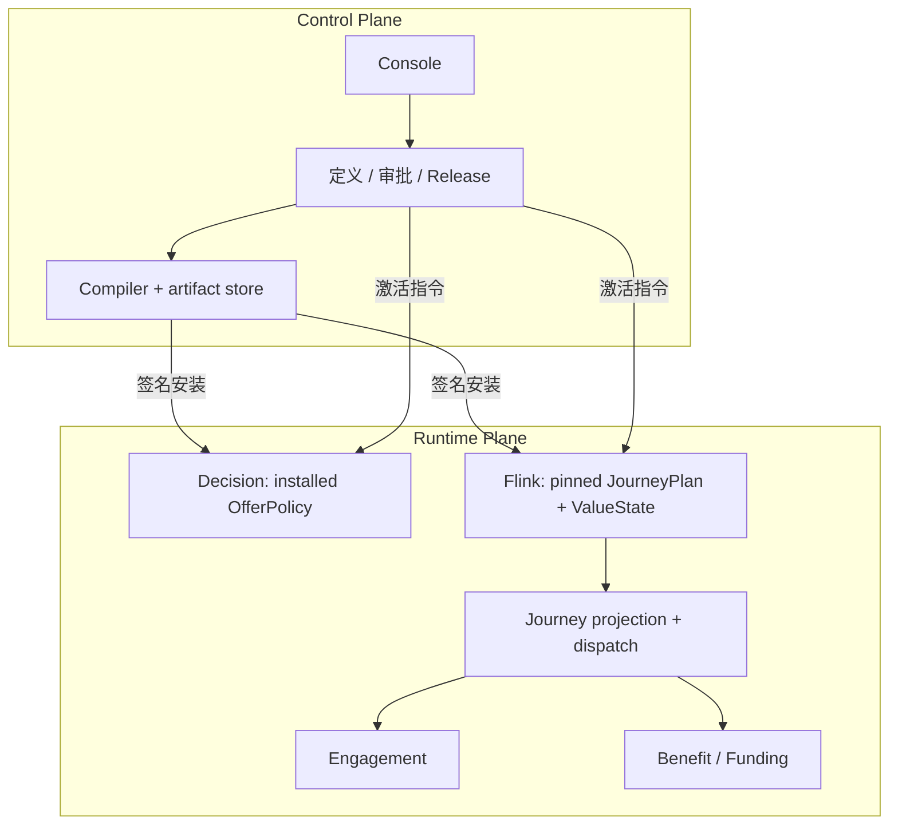

# 10 运行态架构、缓存、隔离与性能边界

## 2026-10-19 更新

人群投影不再全表轮询；默认最多 10000 条、最长一秒缓存并按主键回源。同步 DB 依赖和容量预算仍需实测。

当前源码核对基线 `6b9092f`；[完整状态与证据](CURRENT_STATUS.md)。以下保留原评审基线的发现、严重度和测试结果；其中“当前/待实施”均指原评审当时。历史源码链接已固定到原提交，后续实现请从最新状态索引进入。

## 历史报告正文（1392ca9 基线）

- 仓库：`marketing-lowcode-platform`；源码基线：`1392ca97bfe9cc6cfcd67888d318e0b2b66efe9c` 加当前未提交工作区。
- 分析日期：2026-09-22；模式：`READ_ONLY_ANALYSIS`。
- `CONFIRMED`＝源码/配置/测试直接证据；`INFERRED`＝据证据推断；`UNKNOWN`＝尚缺证据。代码存在不等于已部署或已通过真实链路验收。
- 本章遵循用户提示词；产品代码、数据库、运行配置、Git 提交与推送均不变。

## 控制面与运行面

**CONFIRMED**：control/compiler 负责配置、审批和制品；decision/流作业/副作用消费者执行运行行为。Journey 服务同时提供签名计划安装、运营投影与分发，不能把每个进程简单分成“纯设计”或“纯运行”。

## 数据权威与缓存

|数据|权威/恢复来源|热路径与容量|新鲜度/故障语义|
|---|---|---|---|
|Decision 运行代次|RuntimeStateStore/MySQL 中已验证安装与期望指针|本地 generation/active maps|安装不切流；签名激活；reconcile 默认 1 秒；有效期外拒绝|
|Decision 幂等|JDBC 或 Redis **二选一**|Redis Lua claim/complete/release；tenant hash tag|24 小时；REDIS 模式不是 JDBC 的透明缓存，丢失会损失窗口内回放|
|决策人群|MySQL 投影 + Kafka delta|ConcurrentHashMap，未设最大条目数|默认 1 秒 reload，版本拒旧、过期清理；缺失拒绝候选|
|Journey plan|journey runtime generation/activation 表|本地最多 128 条|新 START 核对当前指针；旧实例按历史激活验证|
|Journey kill-switch|运行库状态|最多 1024 条、1 秒刷新|过窗查库失败抛错；并不等于所有入口都具有相同 fail-closed 协议|
|权益 SKU 列表|外部 benefit-center|Caffeine 最大 1000 个 tenant/status 项；默认 20 秒|发布核验绕过缓存；每项可容纳多页完整列表|
|Console 查询|API 为业务来源|React Query staleTime 15 秒|DEV 切租户缺缓存清理，见 R05|

[DecisionRequestExecutor.java:77](https://github.com/lirji/marketing-lowcode-platform/blob/1392ca97bfe9cc6cfcd67888d318e0b2b66efe9c/services/offer-decision-service/src/main/java/com/acme/marketing/decision/application/DecisionRequestExecutor.java#L77)、[RuntimeManifestRegistry.java:236](https://github.com/lirji/marketing-lowcode-platform/blob/1392ca97bfe9cc6cfcd67888d318e0b2b66efe9c/services/offer-decision-service/src/main/java/com/acme/marketing/decision/runtime/RuntimeManifestRegistry.java#L236)、[JdbcJourneyPlanResolver.java:20](https://github.com/lirji/marketing-lowcode-platform/blob/1392ca97bfe9cc6cfcd67888d318e0b2b66efe9c/jobs/journey-runtime-flink-job/src/main/java/com/acme/marketing/jobs/journey/JdbcJourneyPlanResolver.java#L20)、[HttpBenefitSkuCatalog.java:63](https://github.com/lirji/marketing-lowcode-platform/blob/1392ca97bfe9cc6cfcd67888d318e0b2b66efe9c/services/benefit-funding-service/src/main/java/com/acme/marketing/benefit/infrastructure/HttpBenefitSkuCatalog.java#L63)。

**CONFIRMED**：没有统一“L1 Caffeine + L2 Redis + DB”覆盖所有模块。应按数据类别描述实际路径；不能把 Redis 默认称为非权威缓存，因为选中 REDIS 幂等模式后它承担该窗口权威。

## 运行配置差异

application.yml 默认可用 DIRECT、JDBC、消费者关闭；Compose 显式将 Journey 设置 STREAM、dispatch/消费者开启、Decision 幂等 REDIS。referral 仍需 profile。是否正在运行哪个配置为 UNKNOWN，本轮未读取秘密环境或重启服务。

[application.yml:29](https://github.com/lirji/marketing-lowcode-platform/blob/1392ca97bfe9cc6cfcd67888d318e0b2b66efe9c/services/journey-service/src/main/resources/application.yml#L29)、[compose.yaml:144](https://github.com/lirji/marketing-lowcode-platform/blob/1392ca97bfe9cc6cfcd67888d318e0b2b66efe9c/deploy/compose.yaml#L144)、[compose.yaml:258](https://github.com/lirji/marketing-lowcode-platform/blob/1392ca97bfe9cc6cfcd67888d318e0b2b66efe9c/deploy/compose.yaml#L258)。

## 多租户、安全与公平性

**CONFIRMED**：Web 层从已验证 JWT 的 tenant_id/properties.tenant_id 取业务租户，不把 owner 自动当 tenant；org/shop 是数据范围；服务应用方法校验 permission。SQL 大量以 tenant 组合键过滤；消息 partition key 含 tenant；缓存目录键含 tenant/status。属于 permission/RBAC 风格加数据 scope，不是通用策略语言 ABAC 引擎。

限流、TenantBulkhead、EventAdmissionControl 和 Award Relay 的单租户批量限制提供资源隔离基础。但全 JVM 多租户公平性、后台查询资源预算及真实压测仍 UNKNOWN。[TenantContextFilter.java:39](https://github.com/lirji/marketing-lowcode-platform/blob/1392ca97bfe9cc6cfcd67888d318e0b2b66efe9c/platform-web/src/main/java/com/acme/marketing/platform/web/TenantContextFilter.java#L39)、[DecisionApplicationService.java:56](https://github.com/lirji/marketing-lowcode-platform/blob/1392ca97bfe9cc6cfcd67888d318e0b2b66efe9c/services/offer-decision-service/src/main/java/com/acme/marketing/decision/application/DecisionApplicationService.java#L56)、[AwardIntentRelayMapper.xml:12](https://github.com/lirji/marketing-lowcode-platform/blob/1392ca97bfe9cc6cfcd67888d318e0b2b66efe9c/services/benefit-funding-service/src/main/resources/mapper/AwardIntentRelayMapper.xml#L12)。

## 十倍流量压力假设（INFERRED，非实测）

- Offer 精确求解受候选组合×购物车行数影响；应测 worst-case，而不是只测一个优惠。
- 人群全量热集合和初次 reload 可能首先触发内存/启动延迟；需要分片、容量预算及冷启动限流。
- JdbcJourneyPlanResolver 的同步 JDBC / DriverManager 调用进入 Flink 处理路径，可能将数据库延迟放大为单 key/算子积压。
- 权益发布实时 fetchAll 最多 1000 页×100 条，缓存每项大小不固定；需要按 SKU 精确查询接口和总时间预算。
- 同租户审核审计头、发布 slot、热门资源行是串行化点；是否瓶颈取决于负载，不能提前以拆服务替代测量。

吞吐、P95/P99、可用性、RTO/RPO 均为 UNKNOWN；需要明确业务目标、硬件、数据分布、租户偏斜和故障工况后测量。
