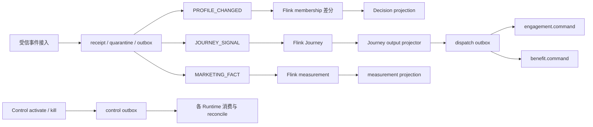

# 11 事件、一致性、幂等与并发

## 2026-10-19 更新

保留分段幂等、资金本地事务及外部终态边界；不因局部修复宣称跨系统 exactly-once。

当前源码核对基线 `6b9092f`；[完整状态与证据](CURRENT_STATUS.md)。以下保留原评审基线的发现、严重度和测试结果；其中“当前/待实施”均指原评审当时。历史源码链接已固定到原提交，后续实现请从最新状态索引进入。

## 历史报告正文（1392ca9 基线）

- 仓库：`marketing-lowcode-platform`；源码基线：`1392ca97bfe9cc6cfcd67888d318e0b2b66efe9c` 加当前未提交工作区。
- 分析日期：2026-09-22；模式：`READ_ONLY_ANALYSIS`。
- `CONFIRMED`＝源码/配置/测试直接证据；`INFERRED`＝据证据推断；`UNKNOWN`＝尚缺证据。代码存在不等于已部署或已通过真实链路验收。
- 本章遵循用户提示词；产品代码、数据库、运行配置、Git 提交与推送均不变。

## 事件地图

主要 topic：mk.profile.change.v1、mk.audience.membership.v1、mk.journey.signal.v1、mk.journey.output.v1、mk.engagement.command.v1、mk.benefit.command.v1、mk.marketing.fact.v1、mk.measurement.projection.v1、mk.release.activation.v1、mk.release.kill-switch.v1。另有普通事件 topic；普通事件不会自动进入每条引擎。

[EventPayloadRouter.java:21](https://github.com/lirji/marketing-lowcode-platform/blob/1392ca97bfe9cc6cfcd67888d318e0b2b66efe9c/services/event-gateway-service/src/main/java/com/acme/marketing/eventgateway/application/EventPayloadRouter.java#L21)、[JourneyOutputProjector.java:157](https://github.com/lirji/marketing-lowcode-platform/blob/1392ca97bfe9cc6cfcd67888d318e0b2b66efe9c/services/journey-service/src/main/java/com/acme/marketing/journeyservice/application/JourneyOutputProjector.java#L157)、[AudienceMembershipConsumer.java:25](https://github.com/lirji/marketing-lowcode-platform/blob/1392ca97bfe9cc6cfcd67888d318e0b2b66efe9c/services/offer-decision-service/src/main/java/com/acme/marketing/decision/runtime/AudienceMembershipConsumer.java#L25)。

## 一致性分段

|边界|机制|失败窗口与恢复|
|---|---|---|
|接入 HTTP→数据库|收据唯一键/内容 hash + outbox 同事务|提交后响应丢失重放；异内容同 eventId 拒绝|
|数据库→Kafka|持久 Outbox、有限批次发布|发送成功但本地回写失败会重复，消费者必须幂等|
|Flink state→Kafka sink|checkpoint EXACTLY_ONCE + 事务 sink + read_committed|依赖 checkpoint 存储、broker 事务配置与恢复部署|
|Kafka→MySQL Journey 投影|topic/partition/offset receipt + effect/outbox 同事务|数据库成功而 offset 未提交：重投识别原收据|
|副作用→外部渠道/权益|稳定业务命令键、下游幂等、重试/DEAD|外部成功后响应丢失不能靠 Kafka 事务解决|
|发布控制库→多 runtime|单调指令+Outbox+消费/reconcile|最终收敛，有实例切换窗口|

**CONFIRMED** 为局部实现；端到端 exactly-once、跨库 XA/Seata、统一 Saga 协调器未确认。不要把多处补偿方法包装成仓库拥有通用 Saga 平台。

[EventIngestionService.java:64](https://github.com/lirji/marketing-lowcode-platform/blob/1392ca97bfe9cc6cfcd67888d318e0b2b66efe9c/services/event-gateway-service/src/main/java/com/acme/marketing/eventgateway/application/EventIngestionService.java#L64)、[FlinkKafkaJobRunner.java:46](https://github.com/lirji/marketing-lowcode-platform/blob/1392ca97bfe9cc6cfcd67888d318e0b2b66efe9c/jobs/flink-job-support/src/main/java/com/acme/marketing/jobs/support/FlinkKafkaJobRunner.java#L46)、[JourneyOutputProjector.java:44](https://github.com/lirji/marketing-lowcode-platform/blob/1392ca97bfe9cc6cfcd67888d318e0b2b66efe9c/services/journey-service/src/main/java/com/acme/marketing/journeyservice/application/JourneyOutputProjector.java#L44)。

## 幂等键矩阵

|操作|作用域 / key|冲突/重复|
|---|---|---|
|接入事件|tenant + sourceId + eventId|payloadHash 不同冲突，相同回原收据|
|Decision|tenant + idempotencyKey|请求 hash 冲突；保留响应 24 小时|
|DIRECT enroll|tenant + journeyId/version + subject + trigger|唯一索引兜底；并发冲突需重试|
|STREAM instance|tenant + enrollment businessKey|身份及 pinned reference 验证；processedSignalIds 防重复推进|
|Node effect|tenant/enrollment/version/node/execution 的稳定摘要|下游 commandId 去重；同 key 异内容冲突|
|资金命令|tenant + commandId|账内锁读取及原响应回放|
|跨中台奖励|tenant + sourceSystem + sourceRequestId|固定首次路由，durable claim 和 payload 一致性|
|发布指令|slot + activationSequence|重复原内容可重放，旧序号/冲突拒绝|

[JourneyRuntime.java:67](https://github.com/lirji/marketing-lowcode-platform/blob/1392ca97bfe9cc6cfcd67888d318e0b2b66efe9c/runtime-spi/journey-runtime-spi/src/main/java/com/acme/marketing/journey/JourneyRuntime.java#L67)、[BenefitFundingService.java:943](https://github.com/lirji/marketing-lowcode-platform/blob/1392ca97bfe9cc6cfcd67888d318e0b2b66efe9c/services/benefit-funding-service/src/main/java/com/acme/marketing/benefit/application/BenefitFundingService.java#L943)、[AwardIntentService.java:95](https://github.com/lirji/marketing-lowcode-platform/blob/1392ca97bfe9cc6cfcd67888d318e0b2b66efe9c/services/benefit-funding-service/src/main/java/com/acme/marketing/benefit/application/AwardIntentService.java#L95)。

## 并发边界

同时发布锁 slot 并 CAS；同时改定义在保存路径锁活动再分配版本；资源竞争锁账户/预占项并检查版本/受影响行数；Outbox relay 领取带 leaseVersion，旧 owner 不可完成新租约。租约不能替代业务唯一约束，Redis 锁不是资金完整性最终防线。

人群定义的 MAX(version)+1 与控制面定义锁策略不同；人群表唯一键可阻止重复版本，但友好的并发重试语义需验证，不将数据库冲突一概写作无损成功。

## 消费失败与乱序

事件聚合版本、人群 profile/membership version、发布 activationSequence、投影 offset 分别处理不同范围的乱序；Kafka 只按分区排序。Journey projector 明确拒绝同实例输出分区改变，扩分区不是无需迁移的配置更新。

Spring 消费者有 FixedBackOff 后 `.dlt`；Flink 输出为 `.dlq`，两者治理入口不能混淆。应明确保留、人工授权重放和业务幂等保留窗口；本轮未执行断连/重平衡/重复投递演练。

[JourneyOutputProjector.java:104](https://github.com/lirji/marketing-lowcode-platform/blob/1392ca97bfe9cc6cfcd67888d318e0b2b66efe9c/services/journey-service/src/main/java/com/acme/marketing/journeyservice/application/JourneyOutputProjector.java#L104)、[KafkaFailureConfiguration.java:11](https://github.com/lirji/marketing-lowcode-platform/blob/1392ca97bfe9cc6cfcd67888d318e0b2b66efe9c/services/engagement-service/src/main/java/com/acme/marketing/engagement/infrastructure/KafkaFailureConfiguration.java#L11)。
