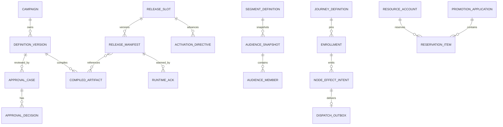

# 12 核心数据模型、所有权与约束

## 2026-10-19 更新

架构整改没有新增业务 DDL；既有 Owner 和资金约束继续适用，演示分桶回填已限制到约定记录。

当前源码核对基线 `6b9092f`；[完整状态与证据](CURRENT_STATUS.md)。以下保留原评审基线的发现、严重度和测试结果；其中“当前/待实施”均指原评审当时。历史源码链接已固定到原提交，后续实现请从最新状态索引进入。

## 历史报告正文（1392ca9 基线）

- 仓库：`marketing-lowcode-platform`；源码基线：`1392ca97bfe9cc6cfcd67888d318e0b2b66efe9c` 加当前未提交工作区。
- 分析日期：2026-09-22；模式：`READ_ONLY_ANALYSIS`。
- `CONFIRMED`＝源码/配置/测试直接证据；`INFERRED`＝据证据推断；`UNKNOWN`＝尚缺证据。代码存在不等于已部署或已通过真实链路验收。
- 本章遵循用户提示词；产品代码、数据库、运行配置、Git 提交与推送均不变。

## 核心表与写入所有者

|上下文|核心表|身份/约束/用途|
|---|---|---|
|Control|mk_campaign、mk_definition_version|tenant+campaign；tenant+definition+version；semantic_hash 唯一|
|审批|mk_approval_case、mk_approval_decision、mk_terms_snapshot|每 case/role 唯一，同一 actor 不能多角色；条款绑定定义版本|
|发布|mk_release_slot、mk_release_manifest、mk_runtime_ack、mk_activation_directive|slot→generation；独立激活序列；ACK 按 runtime 身份|
|审计/消息|mk_audit、mk_audit_head、mk_outbox|tenant hash chain；分区流序号唯一|
|Compiler|mk_compiled_artifact|来源、版本、ABI、checksum、签名及字节|
|Audience|mk_field_definition、mk_segment_definition、mk_audience_snapshot、mk_audience_member|segment version；snapshot member 的 tenant/snapshot/subject 唯一|
|Decision|mk_runtime_slot、mk_runtime_generation、mk_decision_command|运行指针、安装字节、JDBC 幂等；REDIS 模式不以 command 表作缓存后备|
|Journey|mk_journey_definition、mk_enrollment、mk_node_effect_intent、mk_journey_timer|定义/实例分开；trigger 组合唯一；effect command 唯一|
|Journey stream|mk_journey_output_receipt、mk_journey_dispatch_outbox、mk_journey_dispatch_position|Kafka 坐标唯一；command/stream sequence 唯一|
|Benefit|mk_resource_account、mk_promotion_application、mk_reservation_item|账户非负及守恒；quote 唯一；预占资源外键|
|跨中台|mk_award_intent_outbox、风险拦截和去重表|sourceSystem/sourceRequestId 唯一；leaseVersion|
|Referral|mk_referral_participant、mk_referral_relation、mk_referral_reward、资格/履约 inbox/history/current、runtime cursor|永久身份、首绑、奖励和版本/fence；生产接线未完成|

核心 schema 证据：[V1__control_plane.sql:1](../../services/marketing-control-service/src/main/resources/db/migration/V1__control_plane.sql#L1)、[V2__release_plane.sql:1](../../services/marketing-control-service/src/main/resources/db/migration/V2__release_plane.sql#L1)、[V1__audience.sql:1](../../services/audience-service/src/main/resources/db/migration/V1__audience.sql#L1)、[V1__journey.sql:1](../../services/journey-service/src/main/resources/db/migration/V1__journey.sql#L1)、[V1__benefit_funding.sql:1](../../services/benefit-funding-service/src/main/resources/db/migration/V1__benefit_funding.sql#L1)、[V5__award_intent_outbox.sql:1](../../services/benefit-funding-service/src/main/resources/db/migration/V5__award_intent_outbox.sql#L1)、[V1__referral_participation.sql:1](../../services/referral-service/src/main/resources/db/migration/V1__referral_participation.sql#L1)。

## 核心 ER（逻辑关系，不全部是跨库 FK）

跨服务制品、scope、benefitSku 引用是契约关系，图中关联不代表数据库允许任意跨库 join 或写其他服务表。Flink Journey resolver 读取 Journey 运行安装表，是紧耦合的运行数据访问适配；应限制为只读权限并明确迁移兼容性。

## 约束的重要性

**CONFIRMED**：资金账户 CHECK 为 `authorized = available + reserved + consumed`，另有非负约束；returned 单独审计，不直接叠加到该守恒等式。quote 唯一可阻止同报价创建多份应用；行版本与 fence 区分资源写竞争和旧租约。

Referral preparation 用 phase、receipt、纳秒余数和 lease fence 的 CHECK 约束限制非法持久状态。不是依赖 Java if 判断即可保证完整性。

[V1__benefit_funding.sql:19](../../services/benefit-funding-service/src/main/resources/db/migration/V1__benefit_funding.sql#L19)、[V10__referral_award_preparation.sql:32](../../services/benefit-funding-service/src/main/resources/db/migration/V10__referral_award_preparation.sql#L32)。

## 数据治理与迁移边界

历史 V1 一部分列注释由后续 V2/V3 迁移补齐，应看完整迁移链，不能看到 V1 没 COMMENT 就断言最终 schema 无注释。已有迁移不应为了美观改写历史。本轮只读取 schema 文件，没有执行 DDL、核验实际库版本或检查真实索引执行计划。

个人 subject hash/密文、事件、审计、幂等和备份的最终保留/删除传播策略需要业务约束；字段有 retentionDays 不证明自动清理已验收。大规模索引、锁范围、表增长与归档需在隔离真实数据环境验证。
