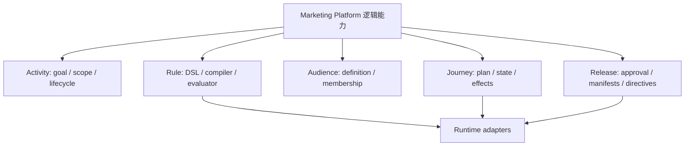

# 13 扩展点矩阵与五类 Engine 边界

## 2026-10-19 更新

未新增引擎或热加载插件；当前 Offer 支持子集和 Journey 编译护栏不等于已实现所有候选扩展。

当前源码核对基线 `6b9092f`；[完整状态与证据](CURRENT_STATUS.md)。以下保留原评审基线的发现、严重度和测试结果；其中“当前/待实施”均指原评审当时。历史源码链接已固定到原提交，后续实现请从最新状态索引进入。

## 历史报告正文（1392ca9 基线）

- 仓库：`marketing-lowcode-platform`；源码基线：`1392ca97bfe9cc6cfcd67888d318e0b2b66efe9c` 加当前未提交工作区。
- 分析日期：2026-09-22；模式：`READ_ONLY_ANALYSIS`。
- `CONFIRMED`＝源码/配置/测试直接证据；`INFERRED`＝据证据推断；`UNKNOWN`＝尚缺证据。代码存在不等于已部署或已通过真实链路验收。
- 本章遵循用户提示词；产品代码、数据库、运行配置、Git 提交与推送均不变。

## Extension Point Matrix

修改范围是逻辑边界估算，不是已确认工时/文件数；所有演进建议标记 **INFERRED**。

|能力|当前机制|扩展方式|修改范围|耦合度|风险|
|---|---|---|---|---|---|
|一种活动玩法|Campaign.Type + 专用 dialect/runtime|补合同、编译/执行与发布能力|约 6–9 边界，大|高|枚举新增不等于真实可发布|
|Rule Operator|Audience enum/switch；Journey equals|补类型矩阵、解析/evaluate、前端/合同|4–6，中|中|预览和线上语义不一致|
|Rule Action|Offer 公式/节点、编译器、pricing|扩充同源 IR 与规则测试|4–7，中|高|分摊、互斥和资损|
|Audience Source|字段目录 + PROFILE_CHANGED router|受信来源接入及 subject/segment 映射|3–6，中|中高|把请求标签当权威事实|
|Journey Node|目录 + compiler 类型转换 + runtime switch|新节点语义和持久状态兼容|5–8，中大|高|旧实例恢复、命令幂等|
|Trigger|EventPayloadRouter switch + 显式 JOURNEY_SIGNAL|受信事件转换/路由/合同|3–5，中|中|重复进入、错版本、错租户|
|Reward|Benefit 类型、资金模型/Assembler、外部 SKU|扩预算/数量语义、风险/履约/对账|5–8，大|高|未知态误释放或重复发奖|
|Channel|ProviderConnector/ProviderRoute、模板/回执|受控适配器和回执映射|3–6，中|中高|重复发送、同意/静默时段|

证据：[DefaultNodeRegistry.java:1](https://github.com/lirji/marketing-lowcode-platform/blob/1392ca97bfe9cc6cfcd67888d318e0b2b66efe9c/services/marketing-control-service/src/main/java/com/acme/marketing/control/application/DefaultNodeRegistry.java#L1)、[AudienceService.java:221](https://github.com/lirji/marketing-lowcode-platform/blob/1392ca97bfe9cc6cfcd67888d318e0b2b66efe9c/services/audience-service/src/main/java/com/acme/marketing/audience/application/AudienceService.java#L221)、[JourneyCompiler.java:28](https://github.com/lirji/marketing-lowcode-platform/blob/1392ca97bfe9cc6cfcd67888d318e0b2b66efe9c/runtime-spi/journey-runtime-spi/src/main/java/com/acme/marketing/journey/JourneyCompiler.java#L28)、[JourneyRuntime.java:38](https://github.com/lirji/marketing-lowcode-platform/blob/1392ca97bfe9cc6cfcd67888d318e0b2b66efe9c/runtime-spi/journey-runtime-spi/src/main/java/com/acme/marketing/journey/JourneyRuntime.java#L38)、[EventPayloadRouter.java:34](https://github.com/lirji/marketing-lowcode-platform/blob/1392ca97bfe9cc6cfcd67888d318e0b2b66efe9c/services/event-gateway-service/src/main/java/com/acme/marketing/eventgateway/application/EventPayloadRouter.java#L34)、[EngagementConfiguration.java:20](https://github.com/lirji/marketing-lowcode-platform/blob/1392ca97bfe9cc6cfcd67888d318e0b2b66efe9c/services/engagement-service/src/main/java/com/acme/marketing/engagement/infrastructure/EngagementConfiguration.java#L20)。

## 五个 Engine 是否存在

|逻辑边界|现状|建议|
|---|---|---|
|Activity|Campaign + ControlApplicationService，生命周期接线不足|留在 control 模块完善聚合规则|
|Rule|编译 worker + portable SPI + pricing + adapters|优先统一语义；无需再建通用 Rule 微服务|
|Audience|AudienceService + Flink delta + Decision projection|明确身份映射和全量计算责任|
|Journey|Compiler/Plan/Runtime + Flink + projection/dispatch|保留纯状态转移与副作用隔离|
|Release|Control release + 各 runtime verifier/state|共享信任合同，各 runtime 自主安装验证|

**INFERRED**：这五种职责适合作为领域能力地图，现有部署边界已经不少，不应因为 Engine 命名再增加五个服务。

## 平台化判断

- Domain abstraction：CONFIRMED，有版本、发布、资格、资金和旅程状态对象。
- Metadata driven：CONFIRMED，节点目录/端口/方言；表单渲染和扩展仍部分写死。
- Plugin architecture：Java SPI 可替换供应商；动态签名插件分发/安装 UNKNOWN。
- Runtime isolation：CONFIRMED，设计与安装制品分开；硬 CPU/内存沙箱 UNKNOWN。
- Multi tenant / version / observability：有实现，但共享资源隔离和全链路解释尚不完整。

**结论 INFERRED**：已形成领域专用营销低代码运行平台的主体；距离可自由扩玩法的成熟营销中台仍有语义一致、真实连接器与运维闭环缺口。无需在“CRUD”与“完整中台”之间二选一。
