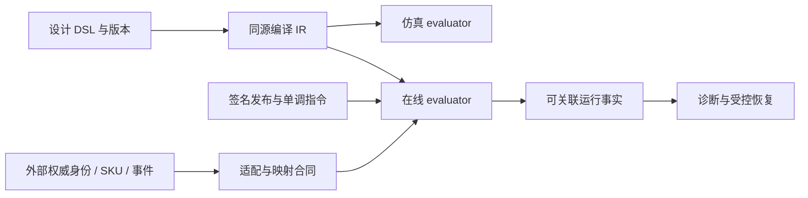

# 16 渐进演进路线与逐维成熟度

## 2026-10-19 更新

正确性护栏、类型矩阵和图编辑保真已有交付；原路线的业务合同、版本留存和容量恢复目标仍须逐项验收。

当前源码核对基线 `6b9092f`；[完整状态与证据](CURRENT_STATUS.md)。以下保留原评审基线的发现、严重度和测试结果；其中“当前/待实施”均指原评审当时。历史源码链接已固定到原提交，后续实现请从最新状态索引进入。

## 历史报告正文（1392ca9 基线）

- 仓库：`marketing-lowcode-platform`；源码基线：`1392ca97bfe9cc6cfcd67888d318e0b2b66efe9c` 加当前未提交工作区。
- 分析日期：2026-09-22；模式：`READ_ONLY_ANALYSIS`。
- `CONFIRMED`＝源码/配置/测试直接证据；`INFERRED`＝据证据推断；`UNKNOWN`＝尚缺证据。代码存在不等于已部署或已通过真实链路验收。
- 本章遵循用户提示词；产品代码、数据库、运行配置、Git 提交与推送均不变。

## Current Architecture

**CONFIRMED**：多服务、公共合同和 runtime SPI、签名制品、Kafka/Flink 流、数据库持久投影、HTTP 下游适配。工程已有控制/运行隔离、幂等与局部恢复，但 Offer 语义不一致、部分玩法未接线、活动状态与发布不同步。证据见 [风险登记](15-architecture-risks.md) 与 [运行架构](10-runtime-architecture.md)。

## Target Architecture（INFERRED / 建议，不是已批准实现）

保留现有部署边界，形成“同源规则语义、明确权威映射、可解释运行事实、受控恢复”四项能力。五个 Engine 作为逻辑职责，不新增通用微服务层、不新增 ES/工作流框架/消息系统。

## Evolution Path

|阶段|问题→证据→影响|建议与验收|取舍/依赖|
|---|---|---|---|
|E1 语义正确性|R01：图分支/比例字段不一致→优惠偏差|先拒绝未支持图，统一字段，再共用 IR/evaluator；差分测试一致|短期收窄可配范围；需定义支持子集|
|E2 工程与隔离|R05/R06/R09：缓存、Lint、演示路径|租户缓存回归、零警告、seed/API 数据|小步独立完成，不扩大框架|
|E3 核心业务闭环|R03/R04/R10：活动状态、人群操作符与身份|明确聚合状态、类型矩阵、真实 snapshot→decision 用例|需业务状态和数据来源约定|
|E4 玩法接线|R02/R07：裂变/DMN/重复节点|按独立纵向结果验收，默认拒绝保留至满足|跨系统依赖大；不得绕过外部签收|
|E5 规模与恢复|R08 与运行证据缺口|长时状态压测、故障重放、checkpoint/备份隔离恢复|先确定 SLO/重放窗口；无数据不承诺收益|

排序体现风险与依赖，不代表已经授权任何修复、DDL、上线或部署。

## 架构成熟度（无总分）

|维度|Current State / Evidence|Strength|Weakness|Evolution Opportunity|
|---|---|---|---|---|
|业务抽象|Campaign/Definition/Release；04章|活动与执行对象分开|活动生命周期接线不足|定义聚合状态及可观察验收|
|领域建模|ResourceAccount/Plan/ApprovalCase；03章|关键不变量有行为对象|部分应用服务集中、DTO 型建模|按变化点有保护地分解|
|规则引擎|Compiler/Pricing；05章|签名/组合/精确分摊|图条件语义丢失|同源 IR 与差分测试|
|Workflow|JourneyRuntime；07章|纯状态转移、明确副作用命令|单游标，无通用并行 join|先写清支持边界，按需求扩|
|低代码 Schema|NodeDefinition/GraphValidator；08章|类型/版本/端口/成本|目录代码化，表单不完全动态|合同与表单 schema 一致|
|版本管理|definition/generation/sequence；09章|历史代次与新指令分离|认知复杂、多对象版本|版本关系图和诊断入口|
|发布体系|签名 ACK+CAS+Outbox；09章|安装与切流分离|跨 runtime 最终一致窗口|生效进度/超时处置|
|Runtime|纯 SPI+Flink+持久投影；10章|单写者和版本固定|同步 JDBC、外部健康依赖|有界 IO/容量预算|
|幂等|数据库唯一键、hash、fence；11章|异内容冲突与原结果回放|外部幂等未在本轮证明|真实下游超时重试验收|
|一致性|local tx/outbox/receipts；11章|明确局部原子性|跨域终态需要收敛验证|账本/消息/对账故障矩阵|
|扩展性|registry+SPI+switch；13章|引擎供应商与纯模型分开|新增节点仍多边界修改|稳定协议优先于热插件|
|可观测性|trace/审计/状态；14章|已有运行标识和拒绝码|缺统一因果诊断|跨链解释视图|
|故障恢复|重试/DLT/checkpoint/脚本；14章|多层恢复机制|未做本轮全栈/DR演练|隔离恢复和重放证明|
|性能|求解上限/限流/批次；10章|单次资源有界意识|累计状态/缓存未全有界|长期/偏斜/冷启动压测|
|安全|TenantContextFilter、签名、审批；10章|身份/数据 scope/信任边界|DEV 缓存，硬沙箱未知|租户回归及受限 DSL|
|测试|前端83/纯模块130；01章|行为/合同测试存在且部分实跑|Lint失败、全服务未重跑|先修门禁，再真实边界集成|

## 不建议现在做的事

没有证据要求再拆服务、引入第二套配置中心、把 Journey 换成 BPMN 引擎或把人群迁入 ES。先解决已有数据/语义/恢复链路，避免把问题转换成更多基础设施。阶段 E5 若测量证明现有模型不适用，再对候选方案做有目标的兼容与成本评估。
