# 20 最终架构图册

## 2026-10-19 更新

服务拓扑总体保留；当前人群读取应理解为主键回源加有界缓存，图中的旧轮询实现以最新索引为准。

当前源码核对基线 `6b9092f`；[完整状态与证据](CURRENT_STATUS.md)。以下保留原评审基线的发现、严重度和测试结果；其中“当前/待实施”均指原评审当时。历史源码链接已固定到原提交，后续实现请从最新状态索引进入。

## 历史报告正文（1392ca9 基线）

- 仓库：`marketing-lowcode-platform`；源码基线：`1392ca97bfe9cc6cfcd67888d318e0b2b66efe9c` 加当前未提交工作区。
- 分析日期：2026-09-22；模式：`READ_ONLY_ANALYSIS`。
- `CONFIRMED`＝源码/配置/测试直接证据；`INFERRED`＝据证据推断；`UNKNOWN`＝尚缺证据。代码存在不等于已部署或已通过真实链路验收。
- 本章遵循用户提示词；产品代码、数据库、运行配置、Git 提交与推送均不变。

## 读图规则

图中的实线表示本仓库确认的结构/路径，示意活动不等于已部署活动。跨服务关系是逻辑引用，不全是数据库 FK。控制提交与运行生效有最终一致性窗口。判断依据见每张图对应章节；不能从箭头推断全链路已验收。

## 系统架构

来源：[01-project-landscape.md](01-project-landscape.md)。

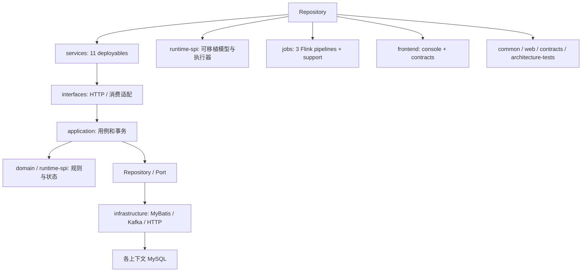

## 业务能力

来源：[02-business-architecture.md](02-business-architecture.md)。

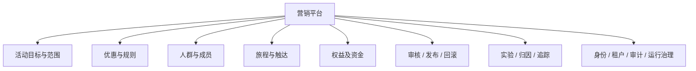

## Activity Lifecycle（领域方法与接线边界）

来源：[04-activity-engine.md](04-activity-engine.md)。

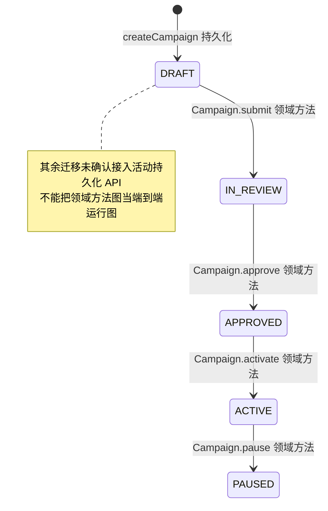

## Definition 与 Release 生命周期

来源：[04-activity-engine.md](04-activity-engine.md)。

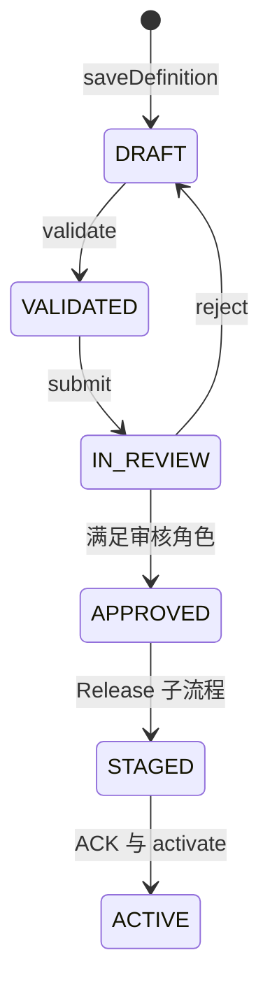

## Rule Engine

来源：[05-rule-engine.md](05-rule-engine.md)。

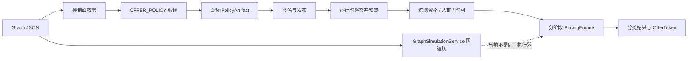

## Audience Pipeline

来源：[06-audience-engine.md](06-audience-engine.md)。

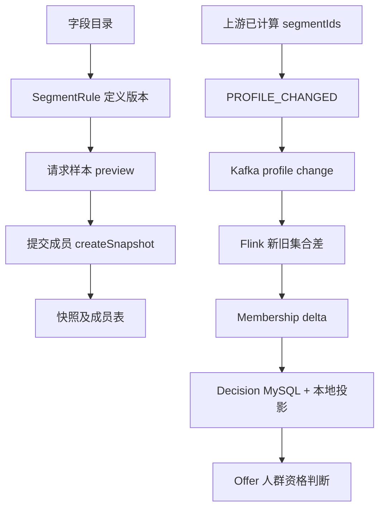

## Journey Graph（单路径分支）

来源：[07-journey-engine.md](07-journey-engine.md)。

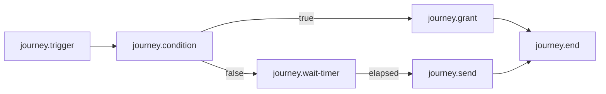

## 低代码设计到运行

来源：[08-low-code-architecture.md](08-low-code-architecture.md)。

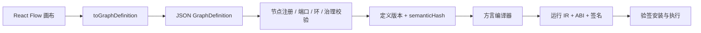

## Publish Pipeline

来源：[09-publish-version-rollback.md](09-publish-version-rollback.md)。

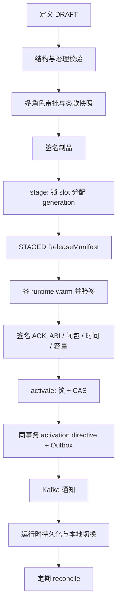

## Rollback Pipeline

来源：[09-publish-version-rollback.md](09-publish-version-rollback.md)。

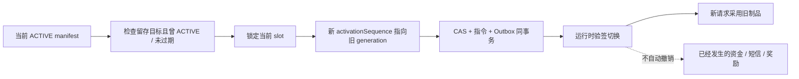

## Runtime Architecture

来源：[10-runtime-architecture.md](10-runtime-architecture.md)。

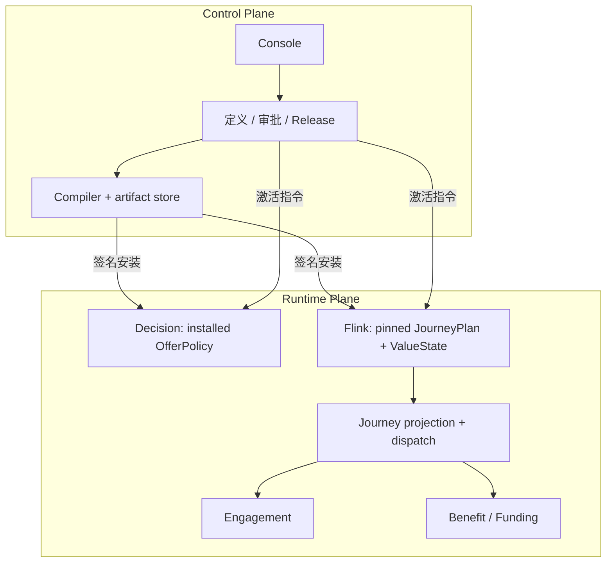

## Event Flow

来源：[11-event-consistency-idempotency.md](11-event-consistency-idempotency.md)。

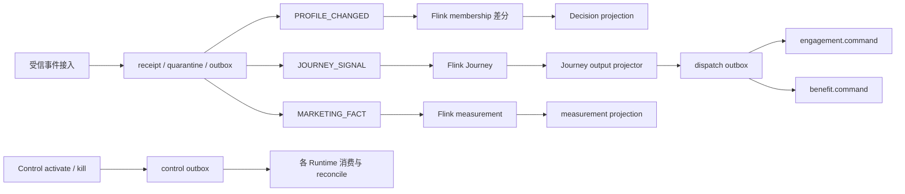

## 核心数据模型

来源：[12-data-model.md](12-data-model.md)。

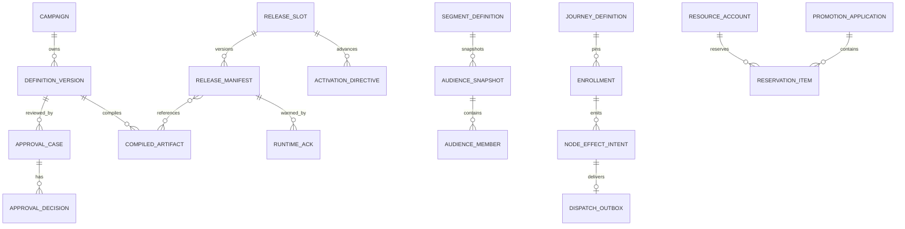

## Journey Runtime

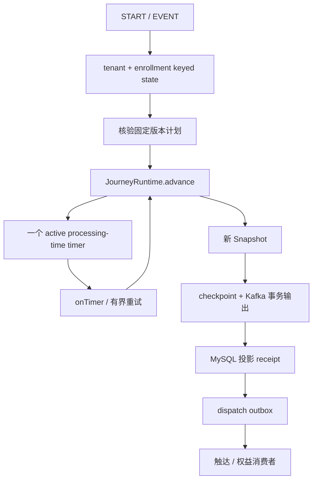

证据：[JourneyJobReducer.java:1](https://github.com/lirji/marketing-lowcode-platform/blob/1392ca97bfe9cc6cfcd67888d318e0b2b66efe9c/jobs/journey-runtime-flink-job/src/main/java/com/acme/marketing/jobs/journey/JourneyJobReducer.java#L1)、[JourneyRuntimeProcessFunction.java:1](https://github.com/lirji/marketing-lowcode-platform/blob/1392ca97bfe9cc6cfcd67888d318e0b2b66efe9c/jobs/journey-runtime-flink-job/src/main/java/com/acme/marketing/jobs/journey/JourneyRuntimeProcessFunction.java#L1)、[JourneyOutputProjector.java:1](https://github.com/lirji/marketing-lowcode-platform/blob/1392ca97bfe9cc6cfcd67888d318e0b2b66efe9c/services/journey-service/src/main/java/com/acme/marketing/journeyservice/application/JourneyOutputProjector.java#L1)。

## 更准确的核心模型

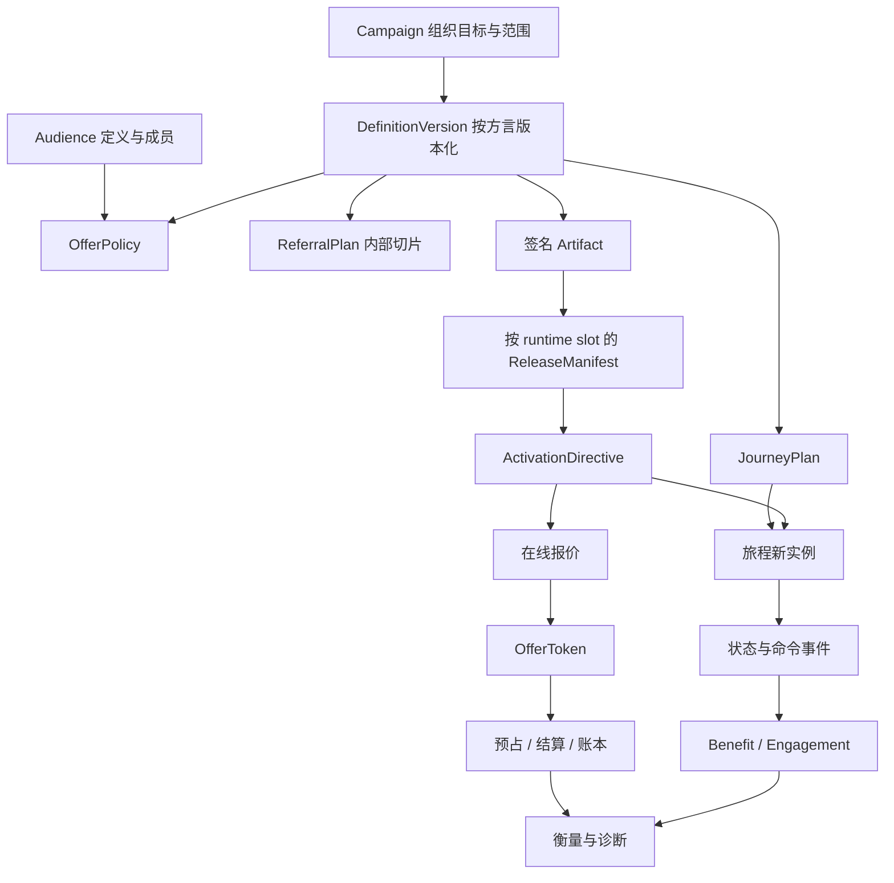

这比“所有 Activity/Rule/Audience 必经 Journey 才运行”的统一漏斗更准确：在线报价与旅程是不同运行路径，发布也按 runtime slot 分离。Referral 真实开放仍被门禁阻止。
