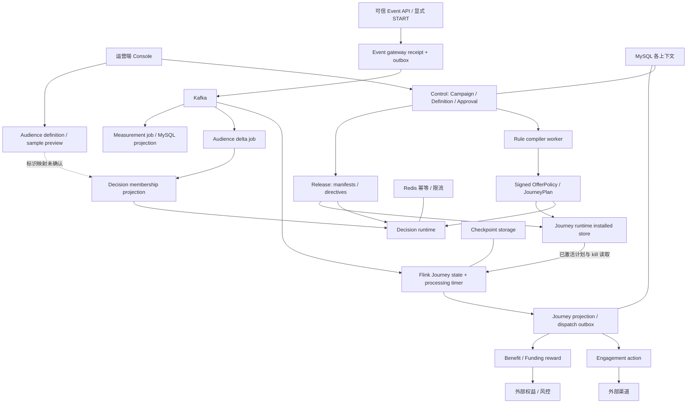

# 01 当前架构与 Exploration Findings Index

## 2026-10-19 更新

服务拓扑仍保留；原发现索引中的语义、编译、编辑和投影问题已有后续整改，详见更新映射。

当前源码核对基线 `6b9092f`；[完整状态与证据](../marketing-platform-analysis/CURRENT_STATUS.md)。以下保留原评审基线的发现、严重度和测试结果；其中“当前/待实施”均指原评审当时。历史源码链接已固定到原提交，后续实现请从最新状态索引进入。

## 历史报告正文（1392ca9 基线）

评审日期：2026-09-22；源码基线：`1392ca97bfe9cc6cfcd67888d318e0b2b66efe9c` 加现有工作区。模式：`READ_ONLY_ARCHITECTURE_REVIEW`。

`CONFIRMED` 为直接源码或明确测试证据，`INFERRED` 为推断和建议，`UNKNOWN` 为待补证据。所有目标模型、任务与验收均为规划，不表示已经实现或授权执行。

## 判断对象与证据连续性

CONFIRMED：系统已经采用多进程部署、共享契约与可移植 runtime SPI。11 个服务模块不代表 11 个完全自治的业务上下文；三个业务 Flink 作业也不是三个新业务域。保留上一阶段 170 处索引、74 个源码文件指纹；本阶段只围绕边界和缺口定向取证，不重新进行普通项目扫描。

|发现ID|上阶段发现与来源|本阶段处理|去向|
|---|---|---|---|
|F01 / R01|Offer 仿真/编译不同源，05/15|复读 compiler/simulator，确认为优先正确性问题|04、19 的 T01/T02|
|F02 / R02|裂变缺真实接线，09/15|保留默认拒绝，不把删除门禁当演进|07、19 的 T11|
|F03 / R03|Campaign 状态未完整持久化，04|区分业务状态和发布聚合读模型|03、T05|
|F04 / R04|人群类型与算子不一致，06|核查校验/evaluate/前端映射，增加类型矩阵|05、T04|
|F05 / R05/R06|DEV 缓存/Lint，15|沿用前轮测试，不冒充本轮重跑|19 的 T00|
|F06 / R07|REPEAT/DMN 未闭环，07/08|进一步确认缺分支仍可编译|06、T03/T10|
|F07 / R08|累计去重与热集合无界，10|建立容量变量与恢复实验，不编造QPS|14、T08|
|F08 / R10|snapshot/segment 映射未知，06|保留 UNKNOWN，不臆测外部同名约定|05、T04|
|F09|版本隔离/回滚，09|确认历史激活按历史时间验签|07、T06|
|F10|幂等/副作用，11|保留现有业务键，增加因果关联而不替换它们|12、T07|
|F11|观测与恢复，14|拆运行终态、投递终态、业务终态|13/15、T09|
|F12|模块边界，12/13/16|检查 jobs SQL 与现有 ArchUnit 范围|11/16/17|

其他输入涵盖 00/01/02/03/17/18/20 的摘要、业务、数据对象、难点与图册；面试材料是表述输入，不作为功能证据。技术决策历史没有作者记录，以下形成原因都为 INFERRED。

## 当前图：实线为已确认链路，虚线为尚需补证的整合

不存在一条所有请求都必须走 Event→Audience→Rule→Journey 的统一流水线：同步购物车报价与异步 Journey 是两个入口。Trigger 目前是接入分类和显式 START 协议；Task 主要是 Flink timer 与持久命令，不是独立 Task 服务。

## 架构形成原因与保留判断

INFERRED：纯 SPI 方便测试/隔离供应商；签名制品避免运行读草稿；Flink 将长等待与事件状态托管；outbox 将本地事务和跨系统失败分开。这些动机与结构相符，UNKNOWN：作者当初是否这样取舍、团队职责和历史替代方案。

应保留资金事务边界、版本轴分离、纯状态推进、已签名安装和下游适配。演进优先修跨层语义缺口，既不全盘重写，也不把当前服务数认作理想终局。

源码定位：[OfferPolicyGraphCompiler.java:28](https://github.com/lirji/marketing-lowcode-platform/blob/1392ca97bfe9cc6cfcd67888d318e0b2b66efe9c/services/rule-compiler-worker/src/main/java/com/acme/marketing/compiler/application/OfferPolicyGraphCompiler.java#L28)、[JourneyJobReducer.java:11](https://github.com/lirji/marketing-lowcode-platform/blob/1392ca97bfe9cc6cfcd67888d318e0b2b66efe9c/jobs/journey-runtime-flink-job/src/main/java/com/acme/marketing/jobs/journey/JourneyJobReducer.java#L11)、[JdbcJourneyPlanResolver.java:87](https://github.com/lirji/marketing-lowcode-platform/blob/1392ca97bfe9cc6cfcd67888d318e0b2b66efe9c/jobs/journey-runtime-flink-job/src/main/java/com/acme/marketing/jobs/journey/JdbcJourneyPlanResolver.java#L87)、[JourneyOutputProjector.java:21](https://github.com/lirji/marketing-lowcode-platform/blob/1392ca97bfe9cc6cfcd67888d318e0b2b66efe9c/services/journey-service/src/main/java/com/acme/marketing/journeyservice/application/JourneyOutputProjector.java#L21)、[ArchitectureRulesTest.java:34](https://github.com/lirji/marketing-lowcode-platform/blob/1392ca97bfe9cc6cfcd67888d318e0b2b66efe9c/architecture-tests/src/test/java/com/acme/marketing/architecture/ArchitectureRulesTest.java#L34)。

## 继承证据

- [上一阶段 01-project-landscape](../marketing-platform-analysis/01-project-landscape.md)：作为发现输入；本章新增判断以定向源码复核为准。
- [上一阶段 02-business-architecture](../marketing-platform-analysis/02-business-architecture.md)：作为发现输入；本章新增判断以定向源码复核为准。
- [上一阶段 20-final-architecture](../marketing-platform-analysis/20-final-architecture.md)：作为发现输入；本章新增判断以定向源码复核为准。

## 本阶段直接引用源码指纹

下表是本阶段正文自动定位引用的源码文件索引，不代表全仓扫描覆盖率；行号见各章节。旧170处索引继续由上一阶段01章维护，不覆盖旧报告。

|源码文件|SHA-256|
|---|---|
|[architecture-tests/src/test/java/com/acme/marketing/architecture/ArchitectureRulesTest.java](https://github.com/lirji/marketing-lowcode-platform/blob/1392ca97bfe9cc6cfcd67888d318e0b2b66efe9c/architecture-tests/src/test/java/com/acme/marketing/architecture/ArchitectureRulesTest.java)|`df18779f42e41ca09544c309b77f0a95804b1e757b03941563b05b5bc4f56e4d`|
|[frontend/apps/console/src/features/designers/AudienceBuilderPage.tsx](https://github.com/lirji/marketing-lowcode-platform/blob/1392ca97bfe9cc6cfcd67888d318e0b2b66efe9c/frontend/apps/console/src/features/designers/AudienceBuilderPage.tsx)|`702f19e304fb0d98d42cd970fdf6525080b41fa320b14ba08ae359a1a8169c85`|
|[frontend/apps/console/src/features/designers/graph.ts](https://github.com/lirji/marketing-lowcode-platform/blob/1392ca97bfe9cc6cfcd67888d318e0b2b66efe9c/frontend/apps/console/src/features/designers/graph.ts)|`470a24df22553a13378e8f29ae5736f97a3d4531624ceac4d105001514400bef`|
|[jobs/flink-job-support/src/main/java/com/acme/marketing/jobs/support/FlinkKafkaJobRunner.java](https://github.com/lirji/marketing-lowcode-platform/blob/1392ca97bfe9cc6cfcd67888d318e0b2b66efe9c/jobs/flink-job-support/src/main/java/com/acme/marketing/jobs/support/FlinkKafkaJobRunner.java)|`03303723db02686c44727f86efeb3c6b7d6d6ea21b920b3f0b9e934f0a8fe380`|
|[jobs/journey-runtime-flink-job/src/main/java/com/acme/marketing/jobs/journey/JdbcJourneyPlanResolver.java](https://github.com/lirji/marketing-lowcode-platform/blob/1392ca97bfe9cc6cfcd67888d318e0b2b66efe9c/jobs/journey-runtime-flink-job/src/main/java/com/acme/marketing/jobs/journey/JdbcJourneyPlanResolver.java)|`3caf5b3ee9eece98b788416952eaaccc37d798e980dd524afb96ed40902419da`|
|[jobs/journey-runtime-flink-job/src/main/java/com/acme/marketing/jobs/journey/JourneyJobReducer.java](https://github.com/lirji/marketing-lowcode-platform/blob/1392ca97bfe9cc6cfcd67888d318e0b2b66efe9c/jobs/journey-runtime-flink-job/src/main/java/com/acme/marketing/jobs/journey/JourneyJobReducer.java)|`dec9540c5aa9cfadfd8fcde4a1cd0f78da8497d47bc368f3690d3f8172826ff9`|
|[jobs/journey-runtime-flink-job/src/main/java/com/acme/marketing/jobs/journey/JourneyRuntimeProcessFunction.java](https://github.com/lirji/marketing-lowcode-platform/blob/1392ca97bfe9cc6cfcd67888d318e0b2b66efe9c/jobs/journey-runtime-flink-job/src/main/java/com/acme/marketing/jobs/journey/JourneyRuntimeProcessFunction.java)|`09a5d67044ad417bc7379ee24793cb6ff34ed8457b795e5b08ae600e02a22adc`|
|[runtime-spi/decision-runtime-spi/src/main/java/com/acme/marketing/decision/pricing/OfferSelector.java](https://github.com/lirji/marketing-lowcode-platform/blob/1392ca97bfe9cc6cfcd67888d318e0b2b66efe9c/runtime-spi/decision-runtime-spi/src/main/java/com/acme/marketing/decision/pricing/OfferSelector.java)|`24e562d8e039114ff03596379e4e77bf2126fee7a90ce04666276597971c46d5`|
|[runtime-spi/decision-runtime-spi/src/main/java/com/acme/marketing/decision/rule/RuleFacts.java](https://github.com/lirji/marketing-lowcode-platform/blob/1392ca97bfe9cc6cfcd67888d318e0b2b66efe9c/runtime-spi/decision-runtime-spi/src/main/java/com/acme/marketing/decision/rule/RuleFacts.java)|`26845be07dfe1ff0f628aa82c51be6bdfa130a10b1bcb5738c09207b95c5b751`|
|[runtime-spi/journey-runtime-spi/src/main/java/com/acme/marketing/journey/JourneyCompiler.java](https://github.com/lirji/marketing-lowcode-platform/blob/1392ca97bfe9cc6cfcd67888d318e0b2b66efe9c/runtime-spi/journey-runtime-spi/src/main/java/com/acme/marketing/journey/JourneyCompiler.java)|`e48a53824c785e9b377441290d6dc0266b47ddfdaa7dbbe3d7144b9114915daf`|
|[runtime-spi/journey-runtime-spi/src/main/java/com/acme/marketing/journey/JourneyNode.java](https://github.com/lirji/marketing-lowcode-platform/blob/1392ca97bfe9cc6cfcd67888d318e0b2b66efe9c/runtime-spi/journey-runtime-spi/src/main/java/com/acme/marketing/journey/JourneyNode.java)|`11449d48bbd655013c71278c198e3ed470e5b3d3bbb902515a5c925ac4eb4de8`|
|[runtime-spi/journey-runtime-spi/src/main/java/com/acme/marketing/journey/JourneyPlan.java](https://github.com/lirji/marketing-lowcode-platform/blob/1392ca97bfe9cc6cfcd67888d318e0b2b66efe9c/runtime-spi/journey-runtime-spi/src/main/java/com/acme/marketing/journey/JourneyPlan.java)|`8e88943719d1e4412a8d56093a2832f4185806f9359a7c80e7b9f049fc5b821a`|
|[runtime-spi/journey-runtime-spi/src/main/java/com/acme/marketing/journey/JourneyRuntime.java](https://github.com/lirji/marketing-lowcode-platform/blob/1392ca97bfe9cc6cfcd67888d318e0b2b66efe9c/runtime-spi/journey-runtime-spi/src/main/java/com/acme/marketing/journey/JourneyRuntime.java)|`5d13aec3a94325d2d4bf3242cc0995e9b2deae74882f5064fd98b5a52bd542a7`|
|[runtime-spi/lowcode-language-core/src/main/java/com/acme/marketing/lowcode/model/GraphDefinition.java](https://github.com/lirji/marketing-lowcode-platform/blob/1392ca97bfe9cc6cfcd67888d318e0b2b66efe9c/runtime-spi/lowcode-language-core/src/main/java/com/acme/marketing/lowcode/model/GraphDefinition.java)|`09d2689896c95959acb4a847f390c72e8c583e01a6c7967f62a55f767438ce2f`|
|[runtime-spi/lowcode-language-core/src/main/java/com/acme/marketing/lowcode/model/NodeDefinition.java](https://github.com/lirji/marketing-lowcode-platform/blob/1392ca97bfe9cc6cfcd67888d318e0b2b66efe9c/runtime-spi/lowcode-language-core/src/main/java/com/acme/marketing/lowcode/model/NodeDefinition.java)|`0ea64d7f3a5ad689a1cf5f5607d32d127e5907fd40b5da699f10cfbe74bec668`|
|[runtime-spi/lowcode-language-core/src/main/java/com/acme/marketing/lowcode/validation/GraphValidator.java](https://github.com/lirji/marketing-lowcode-platform/blob/1392ca97bfe9cc6cfcd67888d318e0b2b66efe9c/runtime-spi/lowcode-language-core/src/main/java/com/acme/marketing/lowcode/validation/GraphValidator.java)|`6aa9a412eebe1f3a09edc3704e287998dff099826aa191cdb6e1fde43cab7b1e`|
|[services/audience-service/src/main/java/com/acme/marketing/audience/application/AudienceService.java](https://github.com/lirji/marketing-lowcode-platform/blob/1392ca97bfe9cc6cfcd67888d318e0b2b66efe9c/services/audience-service/src/main/java/com/acme/marketing/audience/application/AudienceService.java)|`7613cc3c5886d132ab66d1d9a08b59eef653e7d50b8f8549066c927f9d353fa4`|
|[services/benefit-funding-service/src/main/java/com/acme/marketing/benefit/application/AwardIntentService.java](https://github.com/lirji/marketing-lowcode-platform/blob/1392ca97bfe9cc6cfcd67888d318e0b2b66efe9c/services/benefit-funding-service/src/main/java/com/acme/marketing/benefit/application/AwardIntentService.java)|`a98f801d25b1901deb0a1cedc8c995fbfa398ea284a830382f2dc6315d1972b6`|
|[services/benefit-funding-service/src/main/java/com/acme/marketing/benefit/application/BenefitFundingService.java](https://github.com/lirji/marketing-lowcode-platform/blob/1392ca97bfe9cc6cfcd67888d318e0b2b66efe9c/services/benefit-funding-service/src/main/java/com/acme/marketing/benefit/application/BenefitFundingService.java)|`9e93266be160ad61c58948f26fc3015ed81b52673bde04fee05f4566261c3aa4`|
|[services/benefit-funding-service/src/main/resources/db/migration/V1__benefit_funding.sql](../../services/benefit-funding-service/src/main/resources/db/migration/V1__benefit_funding.sql)|`94830751756a3699d9cc9352724845f3a4f57a845e1c4a749f28b7a0088724d5`|
|[services/benefit-funding-service/src/main/resources/mapper/AwardIntentRelayMapper.xml](https://github.com/lirji/marketing-lowcode-platform/blob/1392ca97bfe9cc6cfcd67888d318e0b2b66efe9c/services/benefit-funding-service/src/main/resources/mapper/AwardIntentRelayMapper.xml)|`10725bfb679df15ad8fd2d1e95c11212d53ae9daec751625388a919987e1e3ba`|
|[services/engagement-service/src/main/java/com/acme/marketing/engagement/application/EngagementService.java](https://github.com/lirji/marketing-lowcode-platform/blob/1392ca97bfe9cc6cfcd67888d318e0b2b66efe9c/services/engagement-service/src/main/java/com/acme/marketing/engagement/application/EngagementService.java)|`7f6cc67b2d154025bb045644d027d9e11d631a8f09ed8a5f693925b6dd71ea4c`|
|[services/event-gateway-service/src/main/java/com/acme/marketing/eventgateway/application/EventIngestionService.java](https://github.com/lirji/marketing-lowcode-platform/blob/1392ca97bfe9cc6cfcd67888d318e0b2b66efe9c/services/event-gateway-service/src/main/java/com/acme/marketing/eventgateway/application/EventIngestionService.java)|`5c7c241e3a041a3c4a2e06f2ece13967ccf65e02e9cd821cd496517ba23a2f68`|
|[services/event-gateway-service/src/main/java/com/acme/marketing/eventgateway/application/EventPayloadRouter.java](https://github.com/lirji/marketing-lowcode-platform/blob/1392ca97bfe9cc6cfcd67888d318e0b2b66efe9c/services/event-gateway-service/src/main/java/com/acme/marketing/eventgateway/application/EventPayloadRouter.java)|`0150c2bf7fb336b0318b2bdc5a19a9cafd87bd3a3e40380d68078927aa926fc4`|
|[services/journey-service/src/main/java/com/acme/marketing/journeyservice/application/JourneyOutputProjector.java](https://github.com/lirji/marketing-lowcode-platform/blob/1392ca97bfe9cc6cfcd67888d318e0b2b66efe9c/services/journey-service/src/main/java/com/acme/marketing/journeyservice/application/JourneyOutputProjector.java)|`eaa8c34b5ffd49b051d723d093376400dd5784652aa4f191a9d4d3dcc8d021c0`|
|[services/marketing-control-service/src/main/java/com/acme/marketing/control/application/ControlApplicationService.java](https://github.com/lirji/marketing-lowcode-platform/blob/1392ca97bfe9cc6cfcd67888d318e0b2b66efe9c/services/marketing-control-service/src/main/java/com/acme/marketing/control/application/ControlApplicationService.java)|`5a1dffb1d69e015cde30a26069bfceee23d869a2ad7c6cfb585fb397acbe0f7c`|
|[services/marketing-control-service/src/main/java/com/acme/marketing/control/application/DefaultNodeRegistry.java](https://github.com/lirji/marketing-lowcode-platform/blob/1392ca97bfe9cc6cfcd67888d318e0b2b66efe9c/services/marketing-control-service/src/main/java/com/acme/marketing/control/application/DefaultNodeRegistry.java)|`7c71204361e3898ad55bbdfb3e55ba791dc7bfed5b754ea56409578483501cae`|
|[services/marketing-control-service/src/main/java/com/acme/marketing/control/application/GraphSimulationService.java](https://github.com/lirji/marketing-lowcode-platform/blob/1392ca97bfe9cc6cfcd67888d318e0b2b66efe9c/services/marketing-control-service/src/main/java/com/acme/marketing/control/application/GraphSimulationService.java)|`2c40d174f3217d1f5e12245ddba92a3293c8006b6ecb23bfa17b7dacedf972d4`|
|[services/marketing-control-service/src/main/java/com/acme/marketing/control/application/ReleaseApplicationService.java](https://github.com/lirji/marketing-lowcode-platform/blob/1392ca97bfe9cc6cfcd67888d318e0b2b66efe9c/services/marketing-control-service/src/main/java/com/acme/marketing/control/application/ReleaseApplicationService.java)|`10e594904ddd01d60f4df450ef13ea01b7e85819f724429e6e9008068cb30373`|
|[services/marketing-control-service/src/main/java/com/acme/marketing/control/domain/Campaign.java](https://github.com/lirji/marketing-lowcode-platform/blob/1392ca97bfe9cc6cfcd67888d318e0b2b66efe9c/services/marketing-control-service/src/main/java/com/acme/marketing/control/domain/Campaign.java)|`e585dba0802d8b6aaa6d5d8abddbd76a653977b4b9dcda9d2bc4f978c1d0ed54`|
|[services/marketing-control-service/src/main/resources/mapper/ControlMapper.xml](https://github.com/lirji/marketing-lowcode-platform/blob/1392ca97bfe9cc6cfcd67888d318e0b2b66efe9c/services/marketing-control-service/src/main/resources/mapper/ControlMapper.xml)|`84ced4631695d01b3cd9c653066a34f8bb00fbe009f59006e39e6889e5e46bea`|
|[services/measurement-service/src/main/java/com/acme/marketing/measurement/application/MeasurementService.java](https://github.com/lirji/marketing-lowcode-platform/blob/1392ca97bfe9cc6cfcd67888d318e0b2b66efe9c/services/measurement-service/src/main/java/com/acme/marketing/measurement/application/MeasurementService.java)|`25a63e1c6e3c01f251ff901455e2f0bd0aeca1f518d6300f64987f6867ca9338`|
|[services/offer-decision-service/src/main/java/com/acme/marketing/decision/application/DecisionApplicationService.java](https://github.com/lirji/marketing-lowcode-platform/blob/1392ca97bfe9cc6cfcd67888d318e0b2b66efe9c/services/offer-decision-service/src/main/java/com/acme/marketing/decision/application/DecisionApplicationService.java)|`525b9184c77487d3fb0b1953e42a9d826ade3d1d7df15c482a14b3cf647b5d1f`|
|[services/offer-decision-service/src/main/java/com/acme/marketing/decision/application/DecisionRequestExecutor.java](https://github.com/lirji/marketing-lowcode-platform/blob/1392ca97bfe9cc6cfcd67888d318e0b2b66efe9c/services/offer-decision-service/src/main/java/com/acme/marketing/decision/application/DecisionRequestExecutor.java)|`1b36768b2728f12f1c878c7b9ad999475a6763ae9efe521a0b8be40222664cfe`|
|[services/offer-decision-service/src/main/java/com/acme/marketing/decision/runtime/AudienceMembershipConsumer.java](https://github.com/lirji/marketing-lowcode-platform/blob/1392ca97bfe9cc6cfcd67888d318e0b2b66efe9c/services/offer-decision-service/src/main/java/com/acme/marketing/decision/runtime/AudienceMembershipConsumer.java)|`19341462faa7907c599944bfd9a950560e76c625aae8e758b0d4f41f5f3aebfc`|
|[services/offer-decision-service/src/main/java/com/acme/marketing/decision/runtime/RuntimeManifestRegistry.java](https://github.com/lirji/marketing-lowcode-platform/blob/1392ca97bfe9cc6cfcd67888d318e0b2b66efe9c/services/offer-decision-service/src/main/java/com/acme/marketing/decision/runtime/RuntimeManifestRegistry.java)|`a14e0618e5370b05641111df6ccfbfd8a1955cf0a14ae1bca9dddd560380a7d5`|
|[services/referral-service/src/main/java/com/acme/marketing/referral/application/release/ReferralRuntimeReadinessPort.java](https://github.com/lirji/marketing-lowcode-platform/blob/1392ca97bfe9cc6cfcd67888d318e0b2b66efe9c/services/referral-service/src/main/java/com/acme/marketing/referral/application/release/ReferralRuntimeReadinessPort.java)|`3df7e7092b665bba50ec0cddb6787685adb1a1fbb64d320a566717cb3bb0f930`|
|[services/referral-service/src/main/java/com/acme/marketing/referral/infrastructure/ReferralConfiguration.java](https://github.com/lirji/marketing-lowcode-platform/blob/1392ca97bfe9cc6cfcd67888d318e0b2b66efe9c/services/referral-service/src/main/java/com/acme/marketing/referral/infrastructure/ReferralConfiguration.java)|`13abc9066aa7cbea727123ec5ee581445d54b4986a6334acbcd2f5b2ea962954`|
|[services/rule-compiler-worker/src/main/java/com/acme/marketing/compiler/application/OfferPolicyGraphCompiler.java](https://github.com/lirji/marketing-lowcode-platform/blob/1392ca97bfe9cc6cfcd67888d318e0b2b66efe9c/services/rule-compiler-worker/src/main/java/com/acme/marketing/compiler/application/OfferPolicyGraphCompiler.java)|`f5661698145c76065a7715c41a4e11c6f78236542892bce4bd6d18e0546bcc88`|
|[services/rule-compiler-worker/src/main/java/com/acme/marketing/compiler/application/RuleCompilerService.java](https://github.com/lirji/marketing-lowcode-platform/blob/1392ca97bfe9cc6cfcd67888d318e0b2b66efe9c/services/rule-compiler-worker/src/main/java/com/acme/marketing/compiler/application/RuleCompilerService.java)|`9d130bd37436cc148f49b66970a796edcc90a01ca4de6a51965578bb0e0f16e2`|

少数正文直接链接（如membership投影）可追溯上一阶段索引；上述自动索引不声称覆盖所有手工链接。候选第三方能力依据为04/06章的官方文档，未核验完整兼容/许可证/漏洞。
