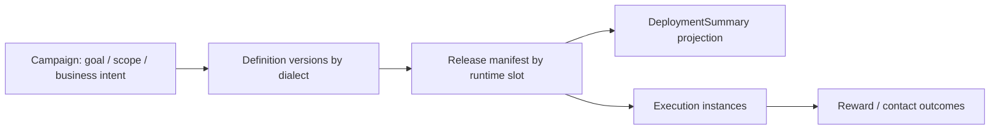

# 03 Activity 模型评审

## 2026-10-19 更新

Campaign 多方言聚合状态仍需合同；前端可读性和字段展示改善不等于生命周期已闭环。

当前源码核对基线 `6b9092f`；[完整状态与证据](../marketing-platform-analysis/CURRENT_STATUS.md)。以下保留原评审基线的发现、严重度和测试结果；其中“当前/待实施”均指原评审当时。历史源码链接已固定到原提交，后续实现请从最新状态索引进入。

## 历史报告正文（1392ca9 基线）

评审日期：2026-09-22；源码基线：`1392ca97bfe9cc6cfcd67888d318e0b2b66efe9c` 加现有工作区。模式：`READ_ONLY_ARCHITECTURE_REVIEW`。

`CONFIRMED` 为直接源码或明确测试证据，`INFERRED` 为推断和建议，`UNKNOWN` 为待补证据。所有目标模型、任务与验收均为规划，不表示已经实现或授权执行。

## 定性

CONFIRMED：当前 Activity 对应 Campaign，主要是目标、类型、scope与definition归属的领域对象/配置容器。它有迁移方法，但不是每个用户运行实例；预算账户、奖励和旅程状态分属其他Owner。没有充分证据把 Campaign 定性为 God Object。ControlApplicationService承载多用例也不能等同所有资金进入Campaign事务。

[Campaign.java:7](https://github.com/lirji/marketing-lowcode-platform/blob/1392ca97bfe9cc6cfcd67888d318e0b2b66efe9c/services/marketing-control-service/src/main/java/com/acme/marketing/control/domain/Campaign.java#L7)、[ControlApplicationService.java:54](https://github.com/lirji/marketing-lowcode-platform/blob/1392ca97bfe9cc6cfcd67888d318e0b2b66efe9c/services/marketing-control-service/src/main/java/com/acme/marketing/control/application/ControlApplicationService.java#L54)、[ControlMapper.xml:7](https://github.com/lirji/marketing-lowcode-platform/blob/1392ca97bfe9cc6cfcd67888d318e0b2b66efe9c/services/marketing-control-service/src/main/resources/mapper/ControlMapper.xml#L7)。

## A05：业务状态与发布事实缺少明确聚合规则

- Problem：Campaign生命周期方法与持久化发布接线不完整。
- Evidence：CONFIRMED，[Campaign.java:43](https://github.com/lirji/marketing-lowcode-platform/blob/1392ca97bfe9cc6cfcd67888d318e0b2b66efe9c/services/marketing-control-service/src/main/java/com/acme/marketing/control/domain/Campaign.java#L43)、[ControlApplicationService.java:191](https://github.com/lirji/marketing-lowcode-platform/blob/1392ca97bfe9cc6cfcd67888d318e0b2b66efe9c/services/marketing-control-service/src/main/java/com/acme/marketing/control/application/ControlApplicationService.java#L191)；审核更新Definition，Release更新slot；上一阶段04的定向搜索未找到完整Campaign状态更新链。
- Impact：INFERRED，新活动发布后列表仍DRAFT；运营误判断，不等于运行自动停止。
- Root Cause：活动业务状态、定义审核状态、多个runtime部署状态共用“活动状态”产品词，未明确唯一权威。
- Current Workaround：定义/Release页面可查真实状态；种子ACTIVE不是正式解决方案。
- Recommended Direction：保留Campaign业务意图状态，新增派生DeploymentSummary（建议模型）：各slot desired/observed/generation/健康；业务“暂停”要调用已授权运行控制，不只改页面枚举。
- Trade-off：新增组合展示与多状态心智；优于把一个slot成功就全活动标ACTIVE。
- Priority：P1（边界决策前置），原R03按上一轮影响模型为P2；T05需业务方签收聚合语义。

## 建议模型与不变量

建议：Activity Definition不重复Graph版本；Activity Release不另造第二个Manifest；Activity Runtime仅用关联读视图，实例仍归Journey或具体玩法。Campaign不拥有订单库存权威，Benefit不反向维护Campaign审核状态。

迁移：先增加只读聚合响应（旧status保留并说明语义），再让UI显示业务状态与部署状态；待调用方适配再弃用模糊字段。历史状态不按名字强行回填，从manifest与审计重建可解释结果，缺失为UNKNOWN。回滚仅切回旧UI/API读法，不删除新增证据，也不恢复已经发送的奖励。验收涵盖同活动两个方言只发布一个、灰度、回滚、停用和部分失败。

## 继承证据

- [上一阶段 03-domain-model](../marketing-platform-analysis/03-domain-model.md)：作为发现输入；本章新增判断以定向源码复核为准。
- [上一阶段 04-activity-engine](../marketing-platform-analysis/04-activity-engine.md)：作为发现输入；本章新增判断以定向源码复核为准。
