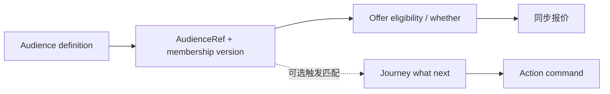

# 05 Audience 边界、计算与身份治理

## 2026-10-19 更新

类型/算子校验已实现；人群投影已改为有界主键回源；权威身份映射、全量计算与规模证据仍需补齐。

当前源码核对基线 `6b9092f`；[完整状态与证据](../marketing-platform-analysis/CURRENT_STATUS.md)。以下保留原评审基线的发现、严重度和测试结果；其中“当前/待实施”均指原评审当时。历史源码链接已固定到原提交，后续实现请从最新状态索引进入。

## 历史报告正文（1392ca9 基线）

评审日期：2026-09-22；源码基线：`1392ca97bfe9cc6cfcd67888d318e0b2b66efe9c` 加现有工作区。模式：`READ_ONLY_ARCHITECTURE_REVIEW`。

`CONFIRMED` 为直接源码或明确测试证据，`INFERRED` 为推断和建议，`UNKNOWN` 为待补证据。所有目标模型、任务与验收均为规划，不表示已经实现或授权执行。

## 当前定位

CONFIRMED：更接近受众定义/样本Query Builder + 成员投影体系，不是已完成全量计算的标签平台。保存定义、请求profile预览、外部提交成员snapshot、上游segment集合delta和Decision membership是不同路径。

[AudienceService.java:89](https://github.com/lirji/marketing-lowcode-platform/blob/1392ca97bfe9cc6cfcd67888d318e0b2b66efe9c/services/audience-service/src/main/java/com/acme/marketing/audience/application/AudienceService.java#L89)、[AudienceMembershipConsumer.java:38](https://github.com/lirji/marketing-lowcode-platform/blob/1392ca97bfe9cc6cfcd67888d318e0b2b66efe9c/services/offer-decision-service/src/main/java/com/acme/marketing/decision/runtime/AudienceMembershipConsumer.java#L38)。会员全量、标签规模、查询频率、SLO、上游合同均UNKNOWN。

## A06：字段元数据未成为执行语义的单一来源

- Problem：类型校验与operator脱节，缺失/空值/用途/时效元数据并未完整参与preview。
- Evidence：CONFIRMED，[AudienceService.java:167](https://github.com/lirji/marketing-lowcode-platform/blob/1392ca97bfe9cc6cfcd67888d318e0b2b66efe9c/services/audience-service/src/main/java/com/acme/marketing/audience/application/AudienceService.java#L167) 和 [AudienceService.java:197](https://github.com/lirji/marketing-lowcode-platform/blob/1392ca97bfe9cc6cfcd67888d318e0b2b66efe9c/services/audience-service/src/main/java/com/acme/marketing/audience/application/AudienceService.java#L197)。
- Impact：STRING GT VIP保存后求值失败；DECIMAL IN列表不能按集合校验；输入治理看似完善却不能保证行为。
- Root Cause：字段目录先建模，执行仍以字符串操作符分支实现。
- Current Workaround：使用当前明确可解释的EQ等子集；没有自动防错证据。
- Recommended Direction：类型×operator×arity矩阵，结构化集合，缺失/陈旧三值结果MATCH/NO_MATCH/UNKNOWN及对每个用例的落地策略。
- Trade-off：旧字符串集合要保留解析窗口，UNKNOWN不能在所有业务强制变false；新旧对比后版本化。
- Priority：P1，T04；原R04按局部影响为P2，本轮作为共享资格语义前置。

## A07：Definition Snapshot 与运行Membership的身份契约缺证

- Problem：Offer引用snapshotId，消费端写segmentId；二者是否映射不明。
- Evidence：CONFIRMED键来源，[OfferPolicyGraphCompiler.java:96](https://github.com/lirji/marketing-lowcode-platform/blob/1392ca97bfe9cc6cfcd67888d318e0b2b66efe9c/services/rule-compiler-worker/src/main/java/com/acme/marketing/compiler/application/OfferPolicyGraphCompiler.java#L96)；外部映射UNKNOWN。
- Impact：INFERRED，若无映射则应命中的人群可能被拒绝；不能断言所有线上人群失效。
- Root Cause：外部群体权威与本地快照契约未形成可查闭环证据。
- Current Workaround：无可确认通用映射；不能用手工同名种子当生产协议。
- Recommended Direction：先签收AudienceRef(kind,id,definitionVersion,membershipMode)，区分FROZEN_SET与LIVE_SEGMENT。映射表/适配器归Audience Owner；Delta带稳定subject命名空间和版本。
- Trade-off：冻结成员可复现但不够实时；动态成员需记录决策时版本/时效，不承诺整活动数据冻结。
- Priority：P1补证阻塞；先取真实匿名样例再决定迁移，不直接批量改ID。

## Who / Whether / What Next

Audience回答可复用群体资格与新鲜度，Rule回答当前交易条件和优惠，Journey回答接下来做什么和何时做。该模型适合逻辑解释，实际报价无Journey也能完成，Journey也不必每步查群体。共享typed predicate基础设施可以，合并业务生命周期和权威写入不合适。

## 实时/离线方案选择条件

|方式|适用条件|代价/边界|当前决定|
|---|---|---|---|
|Online evaluation|请求已有完整可信小事实集，低延迟|远程扇出与事实新鲜度预算|现有纯求值保留|
|预计算membership|多个请求反复查同群体|同步延迟、删除和版本治理|保留并补身份合同|
|SQL离线计算|权威关系数据可访问、可接受批时效|隔离批查询、索引/快照一致性|先确认数据Owner再PoC|
|Bitmap|巨大集合反复交并、稳定整数ID|映射、压缩分布、增删与多租户复杂性|无规模证据，暂不引入|
|ES|确有复杂检索/聚合需求，投影可重建|额外集群与刷新延迟，不能资金权威|当前不推荐|
|外部CDP Integrate/Buy|已有权威标签或运营圈选能力|合同、数据出域、延迟和费用|优先核查已有平台，未决定采购|

数据迁移计划：先增加可选ref字段与版本，在双读比较中禁止fallback把不明身份变成命中；旧字段保持只读兼容；证明覆盖和撤销传播后逐租户切换。回滚新引用选择但不逆转已发奖；保留原成员与映射历史。验证同群体新增/撤销/重复/乱序/过期，且只影响正确租户。

## 继承证据

- [上一阶段 06-audience-engine](../marketing-platform-analysis/06-audience-engine.md)：作为发现输入；本章新增判断以定向源码复核为准。
- [上一阶段 12-data-model](../marketing-platform-analysis/12-data-model.md)：作为发现输入；本章新增判断以定向源码复核为准。
