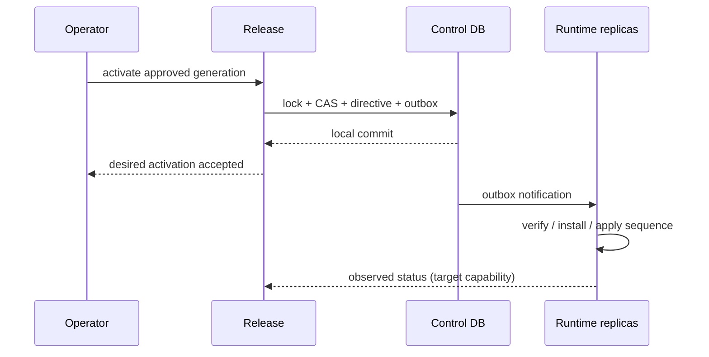

# 07 Release 原子范围、不可变性与回滚

## 2026-10-19 更新

旧比例制品重新激活须重新编译；代码修复没有静默重签已发布制品，也没有实现跨 slot 全局事务或完整保留策略。

当前源码核对基线 `6b9092f`；[完整状态与证据](../marketing-platform-analysis/CURRENT_STATUS.md)。以下保留原评审基线的发现、严重度和测试结果；其中“当前/待实施”均指原评审当时。历史源码链接已固定到原提交，后续实现请从最新状态索引进入。

## 历史报告正文（1392ca9 基线）

评审日期：2026-09-22；源码基线：`1392ca97bfe9cc6cfcd67888d318e0b2b66efe9c` 加现有工作区。模式：`READ_ONLY_ARCHITECTURE_REVIEW`。

`CONFIRMED` 为直接源码或明确测试证据，`INFERRED` 为推断和建议，`UNKNOWN` 为待补证据。所有目标模型、任务与验收均为规划，不表示已经实现或授权执行。

## 已存在Release Engine职责

CONFIRMED：发布不是一个Campaign.publish杂糅方法。Control保存定义/审批，Compiler生成签名Artifact，ReleaseApplicationService处理stage/ACK/activate/rollback，Runtime安装与验签。应完善已有体系，不重复建立另一Release服务。

[ReleaseApplicationService.java:85](https://github.com/lirji/marketing-lowcode-platform/blob/1392ca97bfe9cc6cfcd67888d318e0b2b66efe9c/services/marketing-control-service/src/main/java/com/acme/marketing/control/application/ReleaseApplicationService.java#L85)、[ReleaseApplicationService.java:126](https://github.com/lirji/marketing-lowcode-platform/blob/1392ca97bfe9cc6cfcd67888d318e0b2b66efe9c/services/marketing-control-service/src/main/java/com/acme/marketing/control/application/ReleaseApplicationService.java#L126)、[ReleaseApplicationService.java:226](https://github.com/lirji/marketing-lowcode-platform/blob/1392ca97bfe9cc6cfcd67888d318e0b2b66efe9c/services/marketing-control-service/src/main/java/com/acme/marketing/control/application/ReleaseApplicationService.java#L226)。

|层|绑定与原子范围|缺口|
|---|---|---|
|Definition|追加版本/semantic hash|不能覆盖原图重编译冒充同版本|
|Artifact|来源/ABI/字节checksum/签名|签名不证明语义等价，A01|
|Manifest|一个slot与制品闭包、generation|不代表活动全部runtime同时发布|
|Activation|slot锁/CAS、sequence、outbox同事务|多runtime实际应用有窗口|
|Membership/外部目录|成员动态、SKU发布校验|发布后并非全部事实冻结|
|Journey instance|固定reference，历史激活验证|保留窗口须覆盖存活实例及恢复需求|

## A08：跨runtime组合发布和历史保留需产品化合同

- Problem：已有ReleaseManifest仍不能自动保证Activity/Offer/Audience/Journey全局一致快照。
- Evidence：CONFIRMED，slot含runtime；[ReleaseApplicationService.java:60](https://github.com/lirji/marketing-lowcode-platform/blob/1392ca97bfe9cc6cfcd67888d318e0b2b66efe9c/services/marketing-control-service/src/main/java/com/acme/marketing/control/application/ReleaseApplicationService.java#L60)；动态成员和pinned resolver证据见05/06。
- Impact：INFERRED，若业务要求跨slot同时生效会看到混合版本；现有业务是否要求该原子性UNKNOWN。
- Root Cause：当前原子单位是slot，业务“整场活动”是更大聚合；程序版本与动态事实也不是同一个冻结对象。
- Current Workaround：独立slot发布、ACK、灰度、reconcile、旧版本绑定。
- Recommended Direction：T06先引入可选ReleaseBundle引用多个现有manifest及AudienceRef；状态PREPARING/READY/ACTIVATING/PARTIAL/ACTIVE，记录期望/观察版本。真正硬原子要求需入口路由绑定bundle，不能只加JSON字段。
- Trade-off：协调与超时复杂度增长；单slot活动不必付全局协调成本。无业务原子要求时只补视图和保留校验。
- Priority：P1（若跨slot强一致为验收），否则P2；不引入分布式事务中间件。

## 回滚四件事

1. Configuration Rollback：选历史定义生成新的可审计发布意图；不编辑历史。
2. Runtime Version Switch：当前已实现以新sequence指向旧generation，新流量回旧程序。
3. Runtime Instance Handling：已存在Journey继续pinned版本；暂停/终止/显式迁移是另一个有权限的用例。STREAM的MySQL为投影，不能用SQL改它迁移Flink状态。
4. Business Compensation：已发短信不可撤回；券/红包/积分视外部合同执行撤销/退款/冲正，需原业务身份和独立审计。

CONFIRMED：历史Journey resolver使用 `activation.activatedAt()` 验证旧激活，而非以当前时间强制让老实例失效，保留运行隔离。[JdbcJourneyPlanResolver.java:87](https://github.com/lirji/marketing-lowcode-platform/blob/1392ca97bfe9cc6cfcd67888d318e0b2b66efe9c/jobs/journey-runtime-flink-job/src/main/java/com/acme/marketing/jobs/journey/JdbcJourneyPlanResolver.java#L87)。但制品/旧key若被清掉仍会影响恢复；密钥留存与撤销策略需要安全合同，不能无限延长被撤销信任。

验收：乱序activate、回滚到留存旧版、发布中重启、缺ACK/过期ACK拒绝、旧实例继续/新实例新版本、member撤销不被配置回滚复活。每个case分别记录control期望与runtime观察结果。

## 继承证据

- [上一阶段 09-publish-version-rollback](../marketing-platform-analysis/09-publish-version-rollback.md)：作为发现输入；本章新增判断以定向源码复核为准。
- [上一阶段 11-event-consistency-idempotency](../marketing-platform-analysis/11-event-consistency-idempotency.md)：作为发现输入；本章新增判断以定向源码复核为准。
