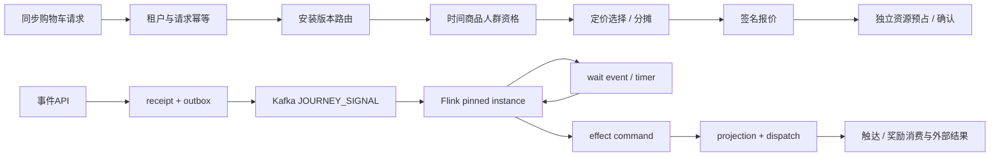

# 08 Trigger、Task、Action 与运行执行模型

## 2026-10-19 更新

运行模型保留；Journey IO 故障分类、Mapper XML 和等待上限已落实，外部动作终态及累计预算仍须验证。

当前源码核对基线 `6b9092f`；[完整状态与证据](../marketing-platform-analysis/CURRENT_STATUS.md)。以下保留原评审基线的发现、严重度和测试结果；其中“当前/待实施”均指原评审当时。历史源码链接已固定到原提交，后续实现请从最新状态索引进入。

## 历史报告正文（1392ca9 基线）

评审日期：2026-09-22；源码基线：`1392ca97bfe9cc6cfcd67888d318e0b2b66efe9c` 加现有工作区。模式：`READ_ONLY_ARCHITECTURE_REVIEW`。

`CONFIRMED` 为直接源码或明确测试证据，`INFERRED` 为推断和建议，`UNKNOWN` 为待补证据。所有目标模型、任务与验收均为规划，不表示已经实现或授权执行。

## 两条真实主链

CONFIRMED：[EventPayloadRouter.java:36](https://github.com/lirji/marketing-lowcode-platform/blob/1392ca97bfe9cc6cfcd67888d318e0b2b66efe9c/services/event-gateway-service/src/main/java/com/acme/marketing/eventgateway/application/EventPayloadRouter.java#L36)、[DecisionApplicationService.java:56](https://github.com/lirji/marketing-lowcode-platform/blob/1392ca97bfe9cc6cfcd67888d318e0b2b66efe9c/services/offer-decision-service/src/main/java/com/acme/marketing/decision/application/DecisionApplicationService.java#L56)、[JourneyOutputProjector.java:19](https://github.com/lirji/marketing-lowcode-platform/blob/1392ca97bfe9cc6cfcd67888d318e0b2b66efe9c/services/journey-service/src/main/java/com/acme/marketing/journeyservice/application/JourneyOutputProjector.java#L19)。不把每次报价异步化，也不把外部RPC塞进Flink节点执行器。

## 同步/异步决策

|动作|当前/推荐|Latency / Consistency / Retry / UX / Isolation|
|---|---|---|
|规则纯计算|同步|用户等报价；输入固定、有总预算；错误拒绝，重试须同幂等键|
|membership资格|本地投影同步读取|用新鲜度策略，缺失不远程无限扇出；陈旧可拒绝候选|
|接收Journey START|同步持久收据，异步实际启动|返回ACCEPTED不是RUNNING；重复回同收据|
|实例状态推进|单key顺序、无远程副作用|同实例顺序不等于全系统单线程|
|发券/短信/webhook|持久命令异步执行|可重试，外部幂等/未知结果；完成状态分层|
|timer|持久等待异步唤醒|用户无需保持连接；重启依赖checkpoint|
|发布stage/activate|命令同步确认，应用异步观察|API成功是期望提交，不是全副本成功|

## Trigger抽象：先合同后服务

当前EventPayloadRouter按事件类型路由，JOURNEY_SIGNAL由可信调用方指定计划；未确认通用订单/会员事件自动匹配活动。INFERRED：只有出现多个来源重复实现相同事件→候选Journey映射时，才在event-gateway内部建TriggerDefinition/Matcher/Runtime模块。TriggerRef需固定版本、租户、事件类型、进入去重窗口与目标计划选择规则。

API、MQ、Scheduler、Manual、Webhook各自只做受信适配；Webhook要校验签名/重放，不把用户传tenant当权威。订单事件权威仍在订单系统。Task抽象先覆盖“等待条件/到期/执行状态”，不新造万能调度器。

## Action / Reward边界

CONFIRMED：SEND/WEBHOOK进入Engagement，GRANT进入Benefit，纯Journey返回commands。[JourneyRuntime.java:63](https://github.com/lirji/marketing-lowcode-platform/blob/1392ca97bfe9cc6cfcd67888d318e0b2b66efe9c/runtime-spi/journey-runtime-spi/src/main/java/com/acme/marketing/journey/JourneyRuntime.java#L63)、[EngagementService.java:147](https://github.com/lirji/marketing-lowcode-platform/blob/1392ca97bfe9cc6cfcd67888d318e0b2b66efe9c/services/engagement-service/src/main/java/com/acme/marketing/engagement/application/EngagementService.java#L147)、[AwardIntentService.java:1](https://github.com/lirji/marketing-lowcode-platform/blob/1392ca97bfe9cc6cfcd67888d318e0b2b66efe9c/services/benefit-funding-service/src/main/java/com/acme/marketing/benefit/application/AwardIntentService.java#L1)。

建议ActionEnvelope共享tenant、commandId、causation、version、deadline和payload hash；ActionResult区分ACCEPTED/PENDING/SUCCEEDED/FAILED/UNKNOWN；重试沿用业务ID，attempt另记。Action registry只选择受信执行适配器。

不要把资金守恒/预算预占/权益终态压平成通用HTTP插件。SMS/Push可复用channel；Coupon/Points/Cashback需资源单位、风险和履约语义；抽奖概率、秒杀库存、公平性、拼团成团不是“换一个Action名称”就实现。任意Script/HTTP会增加SSRF和资源隔离要求，本轮不建议开放。

## 运行瓶颈判断

同步Decision有有界组合搜索；异步Journey存在同步resolver DB调用；投影与dispatch多次提交带来延迟但隔离副作用。不要仅为缩短MQ链条直接从Flink发券。先量化接入→推进→派发→渠道各段P99和积压年龄；仅合并可保留原子/恢复边界的冗余处理。

## 继承证据

- [上一阶段 02-business-architecture](../marketing-platform-analysis/02-business-architecture.md)：作为发现输入；本章新增判断以定向源码复核为准。
- [上一阶段 10-runtime-architecture](../marketing-platform-analysis/10-runtime-architecture.md)：作为发现输入；本章新增判断以定向源码复核为准。
- [上一阶段 11-event-consistency-idempotency](../marketing-platform-analysis/11-event-consistency-idempotency.md)：作为发现输入；本章新增判断以定向源码复核为准。
