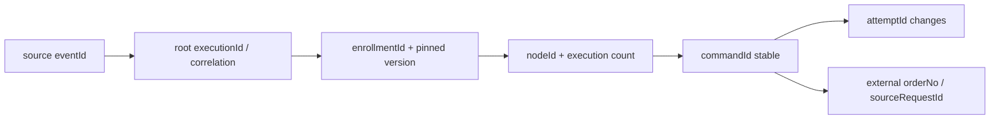

# 12 一致性、事件分类与 Execution Identity

## 2026-10-19 更新

资金事务和稳定业务幂等键未改；故障分类与投影一致性修复不构成全链 exactly-once 或外部终态保证。

当前源码核对基线 `6b9092f`；[完整状态与证据](../marketing-platform-analysis/CURRENT_STATUS.md)。以下保留原评审基线的发现、严重度和测试结果；其中“当前/待实施”均指原评审当时。历史源码链接已固定到原提交，后续实现请从最新状态索引进入。

## 历史报告正文（1392ca9 基线）

评审日期：2026-09-22；源码基线：`1392ca97bfe9cc6cfcd67888d318e0b2b66efe9c` 加现有工作区。模式：`READ_ONLY_ARCHITECTURE_REVIEW`。

`CONFIRMED` 为直接源码或明确测试证据，`INFERRED` 为推断和建议，`UNKNOWN` 为待补证据。所有目标模型、任务与验收均为规划，不表示已经实现或授权执行。

## 当前保护值得保留

CONFIRMED：本地事务+Outbox、内容hash冲突检测、数据库唯一约束、版本/fence、Flink checkpoint/事务sink、投影收据与稳定commandId承担不同保证。没有理由统一成一个Redis lock。

[EventIngestionService.java:1](https://github.com/lirji/marketing-lowcode-platform/blob/1392ca97bfe9cc6cfcd67888d318e0b2b66efe9c/services/event-gateway-service/src/main/java/com/acme/marketing/eventgateway/application/EventIngestionService.java#L1)、[JourneyRuntime.java:67](https://github.com/lirji/marketing-lowcode-platform/blob/1392ca97bfe9cc6cfcd67888d318e0b2b66efe9c/runtime-spi/journey-runtime-spi/src/main/java/com/acme/marketing/journey/JourneyRuntime.java#L67)、[JourneyOutputProjector.java:1](https://github.com/lirji/marketing-lowcode-platform/blob/1392ca97bfe9cc6cfcd67888d318e0b2b66efe9c/services/journey-service/src/main/java/com/acme/marketing/journeyservice/application/JourneyOutputProjector.java#L1)、[AwardIntentService.java:86](https://github.com/lirji/marketing-lowcode-platform/blob/1392ca97bfe9cc6cfcd67888d318e0b2b66efe9c/services/benefit-funding-service/src/main/java/com/acme/marketing/benefit/application/AwardIntentService.java#L86)。

|身份|作用域与权威|不能被什么替换|
|---|---|---|
|sourceId/eventId|tenant与来源事件收据|每次重试新UUID|
|enrollment businessKey|tenant与Journey实例|traceId|
|signalId|实例推进去重|Kafka offset（跨topic不稳定）|
|commandId|tenant/enrollment/version/node/execution摘要|delivery attempt|
|sourceSystem/sourceRequestId|奖励原业务请求|超时后的新请求ID|
|activationSequence|slot内单调指令|generation大小|
|topic/partition/offset|投影交付收据|业务commandId（两者都需要）|

## ExecutionId：统一关联，不统一所有幂等键

INFERRED：增加根executionId和causationId方便查询；每个领域原业务键继续作为唯一约束。executionId一次业务意图稳定，attemptId每次发送变化；signal/event可以导致多个action，因此不可拿同一个executionId去重全部动作。旧消息无该字段时记录LEGACY，并由可信映射产生关联，不改变已有key公式。

## 事件模型治理

Domain Event是同域状态事实；Integration Event是跨上下文已提交合同；Runtime Event描述推进、timer耗尽、state过期。command是意图，不能叫“已发券事件”。当前事件topic已有用途，未取得数量/共变证据，不确认Event Explosion。

建议统一最小envelope：schemaVersion、eventId、tenantId、occurredAt、producer、aggregateId/version、causationId/correlationId及payloadHash；敏感payload允许摘要/受控引用。不是强制迁移所有历史topic。新旧字段共存、枚举未知值可隔离、毒消息有DLQ/DLT与审计重放。

## A11：端到端结果与外部幂等证据不完整

- Problem：本地command成功、relay SENT或Kafka提交不等于外部奖励/短信最终成功。
- Evidence：CONFIRMED，本地状态分层，[EngagementService.java:147](https://github.com/lirji/marketing-lowcode-platform/blob/1392ca97bfe9cc6cfcd67888d318e0b2b66efe9c/services/engagement-service/src/main/java/com/acme/marketing/engagement/application/EngagementService.java#L147)、[AwardIntentRelayMapper.xml:1](https://github.com/lirji/marketing-lowcode-platform/blob/1392ca97bfe9cc6cfcd67888d318e0b2b66efe9c/services/benefit-funding-service/src/main/resources/mapper/AwardIntentRelayMapper.xml#L1)；真实供应商幂等/查询终态合同UNKNOWN。
- Impact：INFERRED，超时换身份可能重复履约，盲目释放可能错账；当前未确认实际绕过保护。
- Root Cause：本地持久化与外部副作用存在不可消除响应丢失窗口，证据不能跨边界自动传递。
- Current Workaround：稳定业务键、领取fence、retry/DEAD、部分UNKNOWN与对账机制。
- Recommended Direction：T09保留UNKNOWN查询/对账，按原身份恢复；T11接真实权威终态；界面分开受理、投递、履约。
- Trade-off：终态延迟、运营需要处理悬挂；不能为了“尽快失败”牺牲资金不变量。
- Priority：P1补证/集成阻塞；若有无幂等真实通道则需另行升级P0并停止相关动作。

## 一致性窗口与补偿

发布多副本最终一致、membership更新传播、Flink到MySQL投影和渠道回执各有窗口，目标值UNKNOWN。每个窗口要给测量时间戳、超时行为和恢复Owner。业务预占/确认保留本地强事务；请求token过期不等于可取消未知外部结果。端到端exactly-once不作为本报告结论。

## 继承证据

- [上一阶段 11-event-consistency-idempotency](../marketing-platform-analysis/11-event-consistency-idempotency.md)：作为发现输入；本章新增判断以定向源码复核为准。
- [上一阶段 14-observability-recovery](../marketing-platform-analysis/14-observability-recovery.md)：作为发现输入；本章新增判断以定向源码复核为准。
