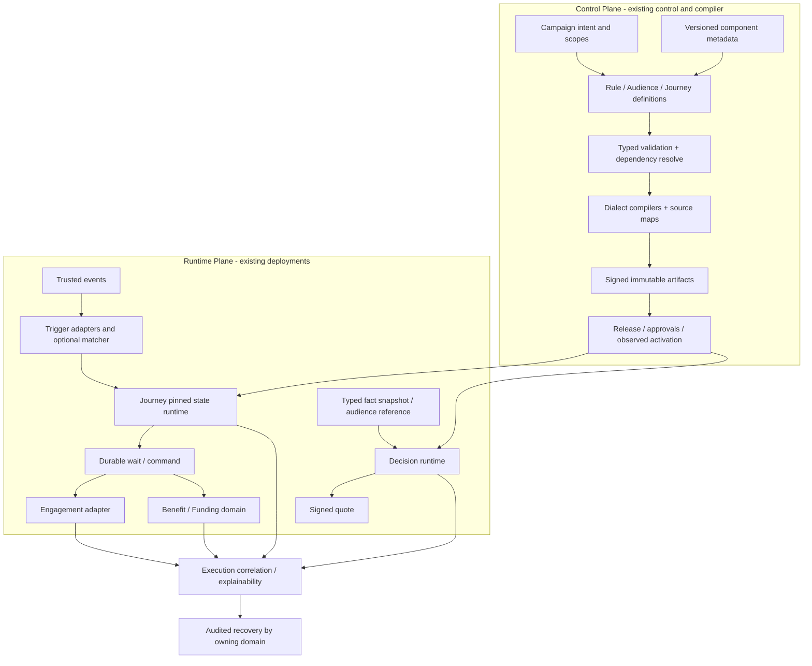

# 18 目标架构与架构决策

## 2026-10-19 更新

目标中的支持子集、类型治理、路由校验及编辑保真已有实现；通用 IR/metadata、组合发布与长期预算仍未全部交付。

当前源码核对基线 `6b9092f`；[完整状态与证据](../marketing-platform-analysis/CURRENT_STATUS.md)。以下保留原评审基线的发现、严重度和测试结果；其中“当前/待实施”均指原评审当时。历史源码链接已固定到原提交，后续实现请从最新状态索引进入。

## 历史报告正文（1392ca9 基线）

评审日期：2026-09-22；源码基线：`1392ca97bfe9cc6cfcd67888d318e0b2b66efe9c` 加现有工作区。模式：`READ_ONLY_ARCHITECTURE_REVIEW`。

`CONFIRMED` 为直接源码或明确测试证据，`INFERRED` 为推断和建议，`UNKNOWN` 为待补证据。所有目标模型、任务与验收均为规划，不表示已经实现或授权执行。

## 目标：同源语义、受控版本、可解释执行

INFERRED：目标逻辑架构可在现有部署中渐进形成。新增框不表示新增服务。营销不是要统一订单/会员/权益权威，而是统一设计到运行的治理合同。

## 分层职责与禁止依赖

|逻辑层|负责|禁止|
|---|---|---|
|Marketing Domain|定价/资源/资格/状态不变量|被任意运营script覆写|
|Marketing Definition|版本化DSL、metadata、scope|直接成为运行可变状态|
|Marketing Compiler|syntax/type/dependency/normalization/lowering/ABI/source map|静默忽略未支持条件|
|Marketing Release|审核/制品闭包/安装/ACK/activation/回滚审计|直接迁移所有在途实例或补偿资金|
|Marketing Runtime|固定程序+可信事实→结果/状态/命令|读draft、任意HTTP、跨域Mapper|
|Marketing Infrastructure|MyBatis/Kafka/Flink/Redis/渠道适配|定义或替换业务权威|

## Decision Register（全部为建议，未批准实施）

|ID|Problem / Evidence|Architecture Decision|Trade-off|Migration / Verification|
|---|---|---|---|---|
|D01|A01仿真与编译分离|同源typed IR+evaluator；先收窄支持子集|旧图可能需重新设计|T01→T02；F01差分|
|D02|A02缺分支仍编译|方言compiler检查完整可执行语义|拒绝更多旧坏图|T03；F02非法路由|
|D03|A06/A07受众类型与身份|类型矩阵+AudienceRef/membership模式|合同迁移与实时/冻结取舍|T04；F03资格闭环|
|D04|A05活动多状态|业务意图与发布观察分开|更多状态但更准确|T05；F04双方言|
|D05|A08组合/保留|复用Manifest，按需Bundle与保留依赖|协调复杂度，单slot不强制|T06；F05-F07|
|D06|A12关联缺口|execution关联+域原幂等键|存储/隐私成本|T07；F08/F09|
|D07|A03/A04长期运行|生命周期/IO/恢复预算|有限玩法/可用性取舍|T08/T09；F10-F13|
|D08|A09元数据往返|保真读写+显式migration+进程内registry|版本fixture维护|T10；F14/F15|
|D09|已有运行边界|保留部署、库式Rule Runtime与资金强事务|仍需维护多进程|T12；F16/F17|
|D10|R02真实接线缺失|保留默认拒绝至权威合同及E2E通过|功能上线延后|T11；F18|

## Build / Buy / Integrate汇总与复杂度预算

|领域|决定|新增中间件?|是否能用结构解决|新增运维/失败模式|价值条件|
|---|---|---|---|---|---|
|Rule|保留内核Build，已有Drools按需Integrate|否|能解决同源语义，不能代替事实权威|ABI/双读兼容|黄金集一致优先|
|Workflow|保留状态机+Flink；候选PoC有条件|否|可补路由/typed node；复杂并行未必低成本|serializer兼容/历史保留|需求超过当前模型再比较|
|Scheduler|复用当前Flink timer|否|先补寿命/恢复合同|到期突发/停机恢复|证明确需独立调度才改|
|Audience|优先Integrate权威provider，适度Build定义|暂不引入ES/Bitmap|ID/类型可代码和合同解决|同步延迟/删除传播|全量compute有需求和数据才能实施|
|Metadata|小型Build版本化契约|否|可在现有模块治理|版本不一致/未知类型|真实多个扩展点复用|
|可观测/恢复|复用现有DB/OTel与域接口|否|先关联ID/状态|隐私与查询成本|三种失败故事可查可处置|

技术比较详见04/06官方依据；商业采购、最新版本兼容/许可证/漏洞审计UNKNOWN，未作最终替换决定。每个任务的复杂度预算继承本表，不允许实施时顺手加入ES/Seata/另一套MQ。

## 统一中台的边界

统一：租户身份合同、定义/metadata版本、发布信任协议、因果关联、错误与恢复治理、受控渠道适配。不要统一：资金与触达终态、领域状态机、所有领域的持久表、用户画像和交易权威、全部规则的万能Map。Activity绑定Rule/Audience/Journey的版本引用，Release安装RuntimeDefinition，Execution固定程序并记录动态事实；这是可演进的核心抽象。

## 继承证据

- [上一阶段 16-architecture-evolution](../marketing-platform-analysis/16-architecture-evolution.md)：作为发现输入；本章新增判断以定向源码复核为准。
- [上一阶段 17-core-technical-challenges](../marketing-platform-analysis/17-core-technical-challenges.md)：作为发现输入；本章新增判断以定向源码复核为准。
