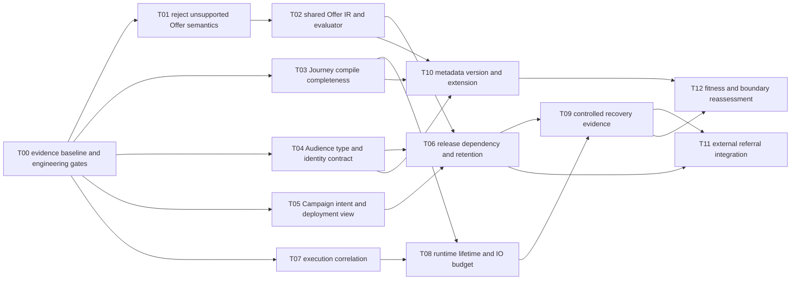

# 19 演进路线、Migration DAG 与执行交接

## 2026-10-19 更新

T00/T01/T02/T03/T04/T08/T10/T12 已有不同程度实现；详细映射见最新索引，原阶段完整 Exit Criteria 未全部通过。

当前源码核对基线 `6b9092f`；[完整状态与证据](../marketing-platform-analysis/CURRENT_STATUS.md)。以下保留原评审基线的发现、严重度和测试结果；其中“当前/待实施”均指原评审当时。历史源码链接已固定到原提交，后续实现请从最新状态索引进入。

## 历史报告正文（1392ca9 基线）

评审日期：2026-09-22；源码基线：`1392ca97bfe9cc6cfcd67888d318e0b2b66efe9c` 加现有工作区。模式：`READ_ONLY_ARCHITECTURE_REVIEW`。

`CONFIRMED` 为直接源码或明确测试证据，`INFERRED` 为推断和建议，`UNKNOWN` 为待补证据。所有目标模型、任务与验收均为规划，不表示已经实现或授权执行。

## 计划边界与状态

计划ID `MKT-ARCH-20260922-v1`，状态 `REVIEWED_CANDIDATE_WITH_BLOCKERS`，不是代码执行授权。以下为可供下一阶段拆片的任务合同；未生成架构拆分Skill的机器Decision，不伪装成其PLAN_READY或十类机器产物。服务抽取仍由17章门禁单独控制。当前只实施文档。

优先级按本轮用户定义：P0可能导致错误活动/资金效果；P1核心正确性与严重架构阻碍；P2扩展/规模治理；P3体验/效率。A01预防性P0，不表示已确认生产资损。无真实工期，工作量仅按低/中/高复杂度；不编日期或人日。

## Migration DAG



T00完成后T03/T04/T05/T07可以独立推进，不要求人为等待T02全部完成。T04外部身份签收阻塞时仍可先做类型矩阵，但不得宣称身份闭环通过。T11依赖外部系统，不阻塞其他已验收能力；禁止为了完成计划删除裂变拒绝门禁。结构最长依赖链不等于耗时关键路径。

## Phase 0：正确性护栏与基线

|字段|约定|
|---|---|
|Goal|消除“可校验/可编译却无法按审批执行”的已知缺口|
|Scope|T00/T01/T03；先保留错误反例，再修；不扩玩法|
|Files / Modules|GraphSimulationService、OfferPolicyGraphCompiler、GraphValidator、JourneyCompiler/Plan；既有CI和对应测试|
|Architecture Changes|显式支持子集、必需路由、统一比例字段；现有执行器暂保留|
|Data Changes|默认无DDL；只读盘点存量定义/制品，禁止静默重编译|
|Compatibility|历史制品按原ABI保留，受影响新发布拒绝；存量是否停用需Owner按实际曝光决策|
|Risk|收窄支持范围影响运营；旧制品可能已含错误语义，代码修复不自动修历史|
|Verification|F01/F02；前端原测试/构建/Lint；编译器/规则/旅程行为测试；批准环境运行代表用例|
|Rollback|回滚代码前维持新发布拦截，不重新放开已知错误；业务效果另行对账/补偿|
|Exit Criteria|已支持图差分一致；缺路由发布前拒绝；未知图失败关闭；存量清单和处置Owner明确|

## Phase 1：语义与领域合同

|字段|约定|
|---|---|
|Goal|统一Offer求值，明确Audience和Campaign状态权威|
|Scope|T02/T04/T05，禁止无限扩大统一规则平台|
|Files / Modules|decision-runtime-spi、compiler/control、AudienceService/Builder、Campaign/Control API|
|Architecture Changes|typed IR、FactRequirement、AudienceRef；业务意图/部署读模型分离|
|Data Changes|可能新增ref/mode/关联读模型字段；需合同签收后设计增量迁移，表/列中文注释|
|Compatibility|旧字段继续读；新字段可选；新旧纯计算影子对比，无双份副作用|
|Risk|空值/陈旧/金额语义变化，ID映射错误；业务定义未签收不得切流|
|Verification|F01/F03/F04，真实membership新增撤销；DB唯一/并发测试；契约新旧共存|
|Rollback|停新writer，保留新字段/历史映射，切回旧reader；不得删已用数据或复活旧资格|
|Exit Criteria|权威字段与身份合同签收；全部支持类型矩阵通过；金额一致；多slot状态不误报|

## Phase 2：发布依赖与版本留存

|字段|约定|
|---|---|
|Goal|把已有版本隔离变为可验收的发布与恢复合同|
|Scope|T06，Bundle仅在跨slot业务要求确认后做；不重写Release|
|Files / Modules|ReleaseApplicationService、runtime registry/store、Journey resolver、发布控制台|
|Architecture Changes|依赖快照/动态成员模式、observed状态、历史制品/密钥保留策略|
|Data Changes|如需Bundle用新增记录/关联，不覆盖manifest字节或旧signature|
|Compatibility|旧slot API继续工作；runtime新旧ABI并存；旧实例仍pinned|
|Risk|清理历史制品或key会破坏恢复，跨slot部分成功|
|Verification|F05/F06/F07：新旧实例并存、乱序/回滚/ACK缺失、断连和过期|
|Rollback|停止新Bundle入口，逐slot发更高sequence回留存目标；保留证据，不伪装全局原子|
|Exit Criteria|所有在途版本可恢复；desired/observed差异可见；四类Rollback说明和runbook签收|

## Phase 3：运行预算、解释与恢复

|字段|约定|
|---|---|
|Goal|证明长等待与外部未知结果可诊断、可受控恢复|
|Scope|T07/T08/T09，业务SLO和隔离演练条件为前置|
|Files / Modules|JourneyJobReducer/ProcessFunction/Resolver、membership projection、event/dispatch/award/engagement、查询UI|
|Architecture Changes|稳定关联、生命周期预算、IO截止时间/限额、原身份恢复流程|
|Data Changes|可选correlation字段/索引/恢复审计；不更换现有幂等key，不直接写Flink投影迁移实例|
|Compatibility|旧事件缺关联字段可读；旧state serializer/UID/key保持可恢复；不提前丢去重记录|
|Risk|错误窗口导致重复、压缩状态丢语义、kill陈旧、恢复放大下游|
|Verification|F08–F13与15章故障矩阵；长时/偏斜/冷启动；真实DB/外部sandbox|
|Rollback|停止新恢复入口；旧state兼容验证后回退job；未知结果先查询/对账，不能新ID补发|
|Exit Criteria|重复业务效果为0；无无法解释的丢失；合同SLO/RTO/RPO有实測且满足；未知结果有Owner和处置|

## Phase 4：受控元数据与扩展

|字段|约定|
|---|---|
|Goal|新增能力不破坏旧图/旧实例，降低明确变化点成本|
|Scope|T10；先read-edit-write保真，再registry；DMN/REPEAT另做切片|
|Files / Modules|graph.ts/LowCodeDesigner、NodeDefinition/DefaultNodeRegistry、方言compiler/runtime|
|Architecture Changes|版本化metadata、typed node spec、operator/executor受信registry|
|Data Changes|仅追加新definition/artifact，显式migration生成新版本；不改历史JSON|
|Compatibility|旧图可只读打开；兼容reader先发布；不支持升级明确拒绝|
|Risk|重复注册、错误migrator、未授权代码执行|
|Verification|F14/F15；旧fixture往返、unknown字段/版本、注册冲突、旧checkpoint恢复|
|Rollback|关新类型创建入口，保留新类型执行器直到在途实例退出；不能直接删除已用插件|
|Exit Criteria|支持版本矩阵与黄金fixtures完整；扩一纯算子不改核心分派，新增节点不改已有executor|

## Phase 5：真实接线与持续边界复评

|字段|约定|
|---|---|
|Goal|证明有权威来源的业务闭环；用事实决定平台化和服务抽取|
|Scope|T11/T12；裂变独立支线，非所有业务发布的前置|
|Files / Modules|ReferralConfiguration/ReadinessPort、benefit/外部适配、architecture-tests与CI|
|Architecture Changes|明确Owner合同，实际READY/ACK/终态；自动fitness按真实边界覆盖|
|Data Changes|若签收合同需要，仅增量迁移；资金/关系权威单写，禁止跨服务直接写库|
|Compatibility|默认拒绝至验收；消息和adapter新旧并存；不强制合并/拆分部署|
|Risk|绕过外部验收、重复奖励、迁移不可逆业务效果|
|Verification|F16–F18；真实授权sandbox、并发/未知/取消/对账；重新评估抽取证据|
|Rollback|关闭新进入，不抹掉已有奖励/参与历史；原身份完成恢复/补偿；不直接禁用在途消费者|
|Exit Criteria|G01权威合同与端到端证据齐全；各域fitness证据化；若外部缺失则本支线BLOCKED，不能报全通过|

## 可交接任务清单

每项只允许本行Owner模块改动；精确文件白名单由执行前影响分析冻结。未经显式下一阶段授权不得改代码/测试/配置/数据。

|ID / Priority /复杂度|输入 / Dependencies|Owner与候选文件|可观察验收 / Fitness|回滚与阻塞|
|---|---|---|---|---|
|T00 P1 低|当前HEAD/dirty清单；无依赖|既有前端Lint相关模块/CI；证据清单|前轮7警告清零不降门禁，83原测试和build；记录纯模块与服务测试范围|回退局部导出整理；保护用户改动|
|T01 P0 中|A01，支持子集决策；T00|[OfferPolicyGraphCompiler.java:1](https://github.com/lirji/marketing-lowcode-platform/blob/1392ca97bfe9cc6cfcd67888d318e0b2b66efe9c/services/rule-compiler-worker/src/main/java/com/acme/marketing/compiler/application/OfferPolicyGraphCompiler.java#L1)、[GraphSimulationService.java:1](https://github.com/lirji/marketing-lowcode-platform/blob/1392ca97bfe9cc6cfcd67888d318e0b2b66efe9c/services/marketing-control-service/src/main/java/com/acme/marketing/control/application/GraphSimulationService.java#L1)|条件/字段不支持必须拒绝；比例语义唯一；F01|不能回到静默丢条件；存量曝光未查为阻塞|
|T02 P1 高|T01；typed事实/金额合同|compiler/control/decision SPI及对应测试|同制品同输入计算/分摊/原因一致；F01|旧ABI兼容，影子无副作用；业务语义未定阻塞|
|T03 P1 中|T00；单游标支持边界|[GraphValidator.java:1](https://github.com/lirji/marketing-lowcode-platform/blob/1392ca97bfe9cc6cfcd67888d318e0b2b66efe9c/runtime-spi/lowcode-language-core/src/main/java/com/acme/marketing/lowcode/validation/GraphValidator.java#L1)、[JourneyCompiler.java:1](https://github.com/lirji/marketing-lowcode-platform/blob/1392ca97bfe9cc6cfcd67888d318e0b2b66efe9c/runtime-spi/journey-runtime-spi/src/main/java/com/acme/marketing/journey/JourneyCompiler.java#L1)、[JourneyPlan.java:1](https://github.com/lirji/marketing-lowcode-platform/blob/1392ca97bfe9cc6cfcd67888d318e0b2b66efe9c/runtime-spi/journey-runtime-spi/src/main/java/com/acme/marketing/journey/JourneyPlan.java#L1)|缺false/elapsed/next、无end、断连图明确拒绝；合法等待图通过；F02|旧制品不重写；不能只补UI校验|
|T04 P1 高|T00；G02与类型合同|[AudienceService.java:1](https://github.com/lirji/marketing-lowcode-platform/blob/1392ca97bfe9cc6cfcd67888d318e0b2b66efe9c/services/audience-service/src/main/java/com/acme/marketing/audience/application/AudienceService.java#L1)、[AudienceBuilderPage.tsx:1](https://github.com/lirji/marketing-lowcode-platform/blob/1392ca97bfe9cc6cfcd67888d318e0b2b66efe9c/frontend/apps/console/src/features/designers/AudienceBuilderPage.tsx#L1)、membership消费者/合同|类型矩阵、真实映射/撤销/乱序；F03|旧字段保留，未知身份不fallback命中；G02阻塞身份切换|
|T05 P1 中|T00；多方言活动状态签收|[Campaign.java:1](https://github.com/lirji/marketing-lowcode-platform/blob/1392ca97bfe9cc6cfcd67888d318e0b2b66efe9c/services/marketing-control-service/src/main/java/com/acme/marketing/control/domain/Campaign.java#L1)、[ControlApplicationService.java:1](https://github.com/lirji/marketing-lowcode-platform/blob/1392ca97bfe9cc6cfcd67888d318e0b2b66efe9c/services/marketing-control-service/src/main/java/com/acme/marketing/control/application/ControlApplicationService.java#L1)、活动页面/API|部分发布/灰度/停用状态准确；F04|回退读模型但不改实际运行；业务规则未签收阻塞|
|T06 P1 中高|T02/T04/T05；是否需要跨slot原子性|[ReleaseApplicationService.java:1](https://github.com/lirji/marketing-lowcode-platform/blob/1392ca97bfe9cc6cfcd67888d318e0b2b66efe9c/services/marketing-control-service/src/main/java/com/acme/marketing/control/application/ReleaseApplicationService.java#L1)、[RuntimeManifestRegistry.java:1](https://github.com/lirji/marketing-lowcode-platform/blob/1392ca97bfe9cc6cfcd67888d318e0b2b66efe9c/services/offer-decision-service/src/main/java/com/acme/marketing/decision/runtime/RuntimeManifestRegistry.java#L1)、resolver|desired/observed、历史留存、四类回滚；F05–F07|高序号回旧版；旧key/制品不可提前清理|
|T07 P2 中|T00；关联与隐私合同|contracts、event/decision/journey/benefit/engagement、诊断查询|一个execution贯通拒绝/timer/未知奖励；F08/F09|新增字段可选，原key不变；保留期待签收|
|T08 P1 高|T03/T07；SLO/寿命/重放窗口|[JourneyJobReducer.java:1](https://github.com/lirji/marketing-lowcode-platform/blob/1392ca97bfe9cc6cfcd67888d318e0b2b66efe9c/jobs/journey-runtime-flink-job/src/main/java/com/acme/marketing/jobs/journey/JourneyJobReducer.java#L1)、[JdbcJourneyPlanResolver.java:1](https://github.com/lirji/marketing-lowcode-platform/blob/1392ca97bfe9cc6cfcd67888d318e0b2b66efe9c/jobs/journey-runtime-flink-job/src/main/java/com/acme/marketing/jobs/journey/JdbcJourneyPlanResolver.java#L1)、membership投影|超长等待/活跃信号/IO慢下预算与正确性；F10/F11|serializer兼容，不能删旧去重；容量目标未知阻塞验收|
|T09 P1 高|T08/T06；隔离演练环境与外部sandbox|runtime恢复与域命令/运营runbook|15章故障记录、原身份恢复、无重复效果；F12/F13|停止恢复入口，按Owner对账/补偿；不得动共享/生产库|
|T10 P2 中高|T02/T03/T04；版本合同|[graph.ts:1](https://github.com/lirji/marketing-lowcode-platform/blob/1392ca97bfe9cc6cfcd67888d318e0b2b66efe9c/frontend/apps/console/src/features/designers/graph.ts#L1)、[NodeDefinition.java:1](https://github.com/lirji/marketing-lowcode-platform/blob/1392ca97bfe9cc6cfcd67888d318e0b2b66efe9c/runtime-spi/lowcode-language-core/src/main/java/com/acme/marketing/lowcode/model/NodeDefinition.java#L1)、registry/compiler/runtime|版本/variables保真与显式迁移；扩展fitness；F14/F15|停止新类型创建但留旧执行器；旧fixture缺失阻塞|
|T11 P1 高|T06/T09；外部合同与真实READY|[ReferralConfiguration.java:1](https://github.com/lirji/marketing-lowcode-platform/blob/1392ca97bfe9cc6cfcd67888d318e0b2b66efe9c/services/referral-service/src/main/java/com/acme/marketing/referral/infrastructure/ReferralConfiguration.java#L1)、[ReferralRuntimeReadinessPort.java:1](https://github.com/lirji/marketing-lowcode-platform/blob/1392ca97bfe9cc6cfcd67888d318e0b2b66efe9c/services/referral-service/src/main/java/com/acme/marketing/referral/application/release/ReferralRuntimeReadinessPort.java#L1)及adapter|身份→资格→授权→终态→取消/对账；F18|保留拒绝门禁，停新进入；外部G01不满足则BLOCKED|
|T12 P2 中|T10/T09；本轮boundary inventory|[ArchitectureRulesTest.java:1](https://github.com/lirji/marketing-lowcode-platform/blob/1392ca97bfe9cc6cfcd67888d318e0b2b66efe9c/architecture-tests/src/test/java/com/acme/marketing/architecture/ArchitectureRulesTest.java#L1)、Owner映射/CI|依赖/SQL/Owner/循环规则覆盖与负例夹具；F16/F17|新增规则可审查回退，不豁免业务缺陷；抽取另走正式评估|

T10中的编辑保真修复可在T00后先做独立兼容切片；插件扩展仍依赖语义合同。T07不是强制先替换所有领域幂等键。任一任务若需新中间件，退出该任务重做选型与审批，不在实施时扩大scope。

## 数据/事务/契约迁移与切换检查点

1. C0 基线：记录HEAD、文件指纹、dirty保护、当前默认/部署配置差异；来源漂移先复评。
2. C1 合同：支持DSL子集、状态聚合、Audience身份、新旧字段/ABI矩阵、保留和SLO由对应Owner签收。
3. C2 实现候选：增量迁移先扩展，读者先兼容；本地事务范围仍归原Owner；不采用无协调双写。
4. C3 影子：旧新纯求值同输入比较，不重复发券/短信；保存差异与原因，出现未解释金额差异停止。
5. C4 灰度：明确租户/活动白名单和可观察阈值，数值目标未签收不得放量；旧实例不迁移，旧制品留存。
6. C5 切换：运行、数据、事件、配置均有兼容证据；P0/P1阻塞未清不得扩大。
7. C6 收缩：旧writer/reader/在途实例与重放窗退出后才移除旧路径；备份、审计、下游状态可恢复。

Rollback分别记录Code/Config/Data/Traffic/Business：代码可退不等于数据可退；增量字段保留；已发生效果由原Owner补偿；未知外部结果先查询。每个检查点附测试结果、所选配置、数据点/版本和下一任务ID；恢复会话从最近已验证checkpoint继续，不重跑已完成的有副作用动作。

## Executor Handoff

```yaml
plan_id: MKT-ARCH-20260922-v1
mode: READ_ONLY_ARCHITECTURE_REVIEW
review_complete: true
implementation_authorized: false
migration_authorized: false
current_checkpoint: C0_REVIEW_DOCUMENTED
next_candidate: T00_then_T01
blocked_inputs:
  - supported_offer_semantics_and_existing_artifact_exposure
  - audience_identity_contract
  - campaign_aggregate_status_contract
  - workload_SLO_retention_and_isolated_recovery_environment
  - external_referral_authority_and_sandbox
preserve:
  - existing_user_changes
  - historical_signed_artifacts_and_pinned_instances
  - financial_invariants_and_business_idempotency_keys
stop_conditions:
  - unexpected_money_or_membership_difference
  - scope_or_source_fingerprint_drift
  - incompatible_state_or_unknown_external_effect
recommended_next: await_architecture_change_execution_instruction
```

## 继承证据

- [上一阶段 15-architecture-risks](../marketing-platform-analysis/15-architecture-risks.md)：作为发现输入；本章新增判断以定向源码复核为准。
- [上一阶段 16-architecture-evolution](../marketing-platform-analysis/16-architecture-evolution.md)：作为发现输入；本章新增判断以定向源码复核为准。
